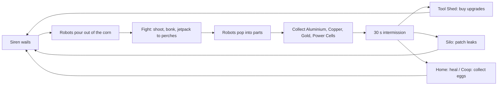
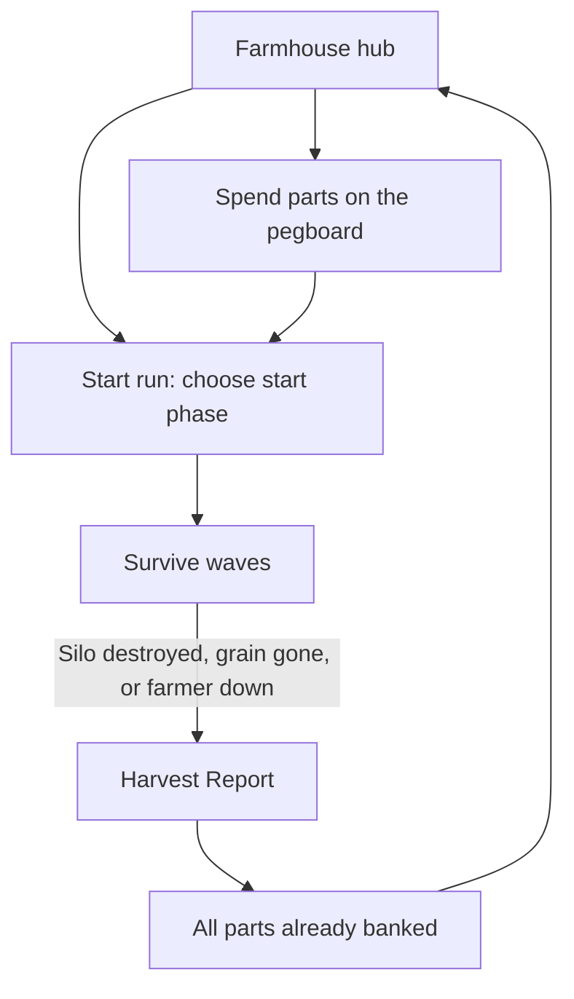
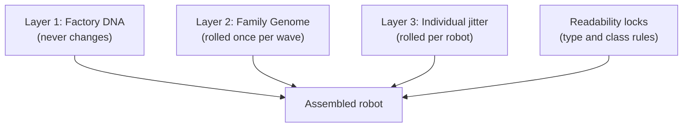
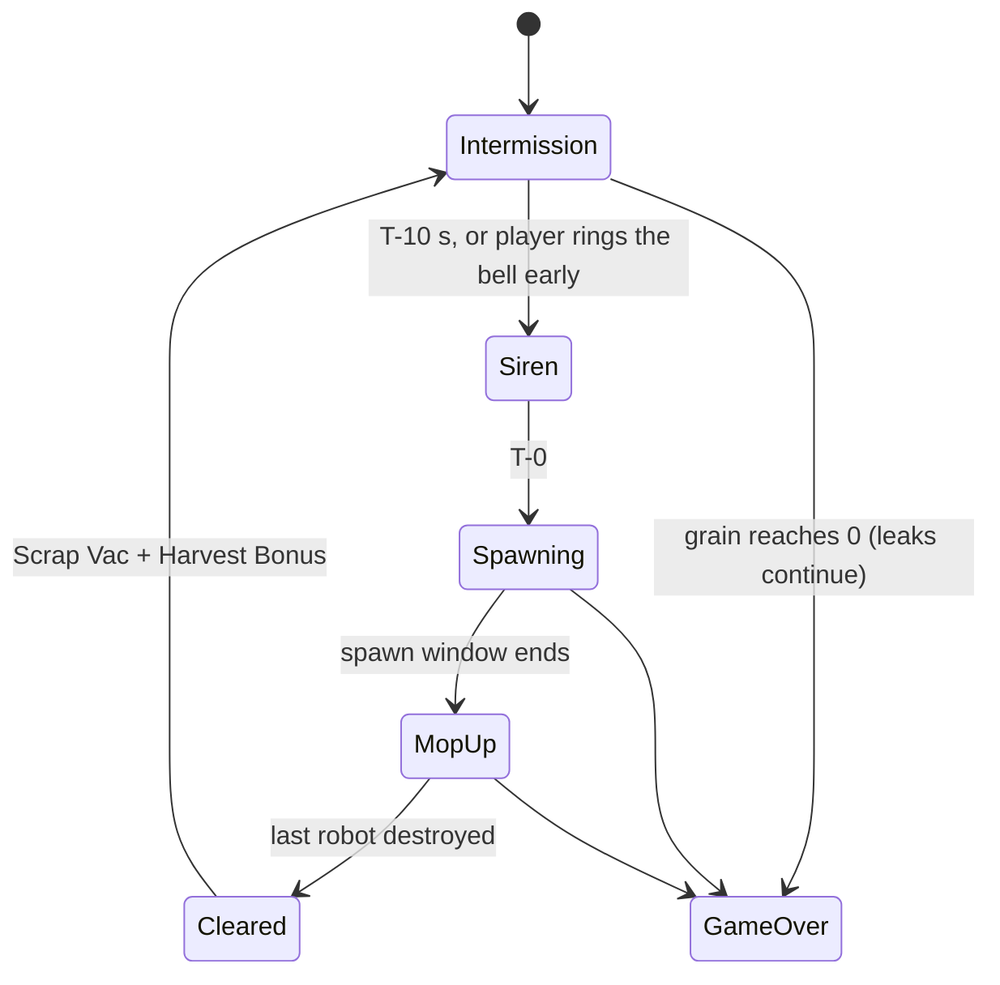
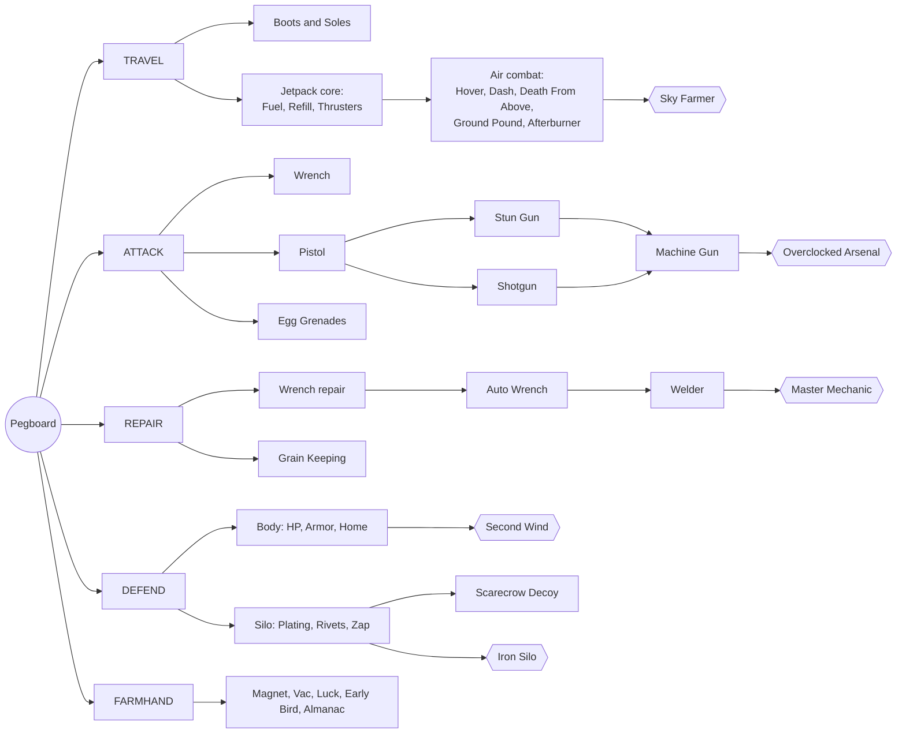
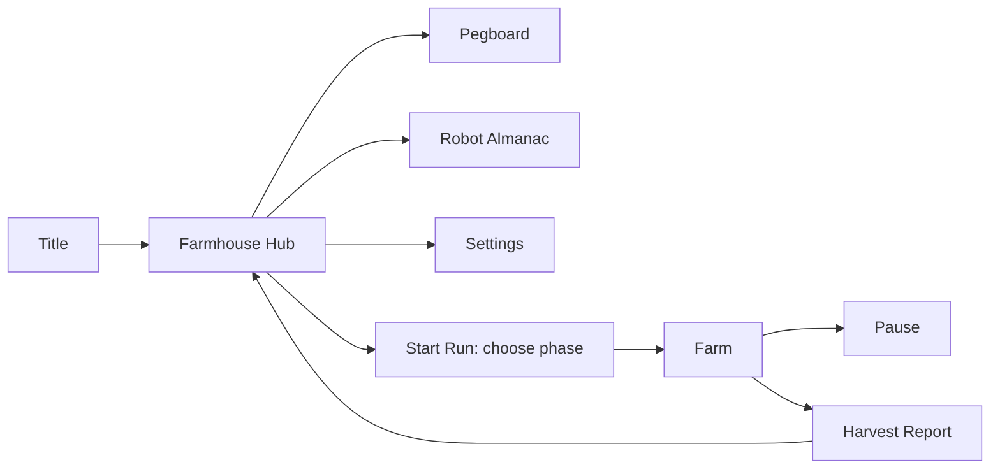
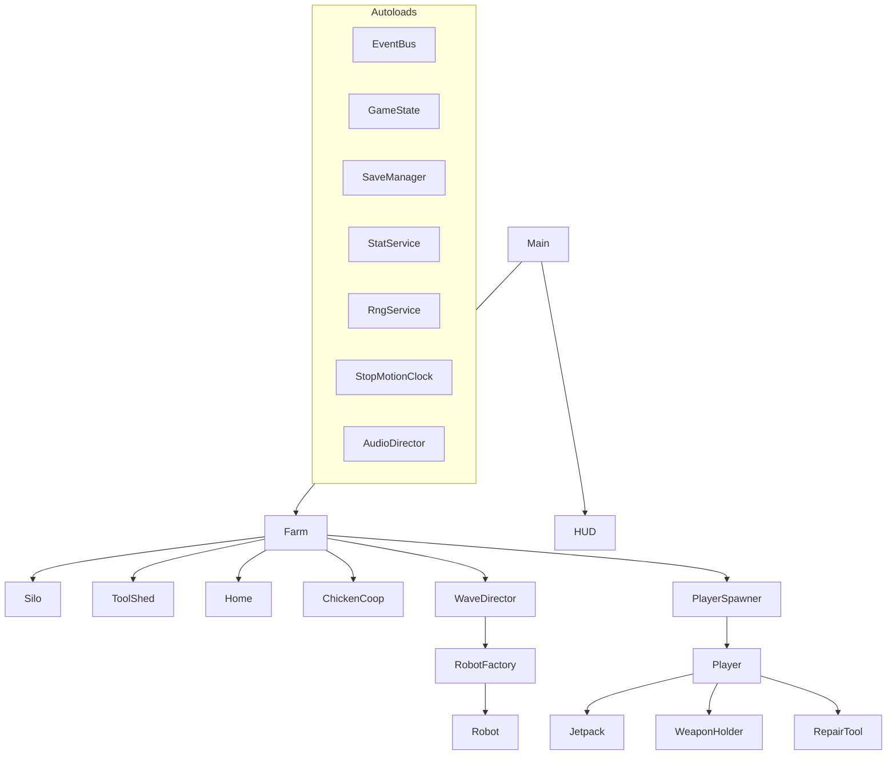

# ROBOT ATTACK! — Game Design Document

| | |
|---|---|
| **Status** | Draft v0.1 |
| **Date** | 2026-10-17 |
| **Genre** | 3D third-person wave-defense shooter, endless, procedurally generated |
| **Engine** | Godot 4.7.x stable (Forward+ renderer, GDScript, Jolt physics) |
| **Platforms** | PC (keyboard + mouse), Gamepad / Steam Deck |
| **Players** | Single-player at launch, with code structured so online co-op can be added later |
| **Progression model** | Full persistence: every upgrade and every part you collect is kept forever |
| **Art style** | Cute claymation / stop-motion miniature set |

---

## Table of Contents

1. [Overview](#1-overview)
2. [Core Loops](#2-core-loops)
3. [Rules of Play](#3-rules-of-play)
4. [The Farm (Level Design)](#4-the-farm-level-design)
5. [The Farmer (Player)](#5-the-farmer-player)
6. [Attack: Combat and Weapons](#6-attack-combat-and-weapons)
7. [Repair](#7-repair)
8. [Defend: Armor, Healing, Silo Plating](#8-defend-armor-healing-silo-plating)
9. [Enemies](#9-enemies)
10. [Procedural Robot Families](#10-procedural-robot-families)
11. [Waves and the Difficulty Director](#11-waves-and-the-difficulty-director)
12. [Economy: Parts and Drops](#12-economy-parts-and-drops)
13. [The Upgrade Tree (The Pegboard)](#13-the-upgrade-tree-the-pegboard)
14. [Persistence and Meta-Progression](#14-persistence-and-meta-progression)
15. [Art Direction: Claymation](#15-art-direction-claymation)
16. [Audio Direction](#16-audio-direction)
17. [UI / UX and HUD](#17-ui--ux-and-hud)
18. [Godot Technical Design](#18-godot-technical-design)
19. [Asset Sourcing (GitHub and CC0)](#19-asset-sourcing-github-and-cc0)
20. [Accessibility and Settings](#20-accessibility-and-settings)
21. [Production Roadmap](#21-production-roadmap)
22. [Risks and Mitigations](#22-risks-and-mitigations)
23. [Assumptions and Open Questions](#23-assumptions-and-open-questions)
24. [Appendix A: Tuning Cheat Sheet](#appendix-a-tuning-cheat-sheet)
25. [Appendix B: Name Generator Word Lists](#appendix-b-name-generator-word-lists)
26. [Appendix C: Glossary](#appendix-c-glossary)

---

## 1. Overview

### 1.1 Elevator pitch

> A stubby clay farmer with a jury-rigged milk-can jetpack defends the family grain silo from endless waves of adorable, grain-hungry robots. Every wave is a brand-new robot "family" with its own colors, shapes and quirks. Smash them into parts, then spend those parts in the tool shed on a long, branching tree of weapons, repair tools, armor and jetpack upgrades. How many phases can you last?

### 1.2 Design pillars

| Pillar | What it means | How we test it |
|---|---|---|
| **Cute chaos** | Robots are goofy, squishy and expressive. They pop into springy clay parts, never gore. Explosions are cotton-wool and cellophane. | A first-time player laughs within the first two waves. |
| **Protect the silo** | One clear objective. The silo's health and grain level are always readable at a glance. | Players can say how the silo is doing without looking at numbers. |
| **Every wave looks new** | Procedural robot families: each wave has a distinct look, name and personality, but every robot obviously comes from the same robot "factory". | Players talk about waves by family name ("the Pirate Teapots wrecked me"). |
| **Always one more upgrade** | A long branching tree with something affordable after almost every wave, and big aspirational goals. | Players want to start another run to buy "just one more" node. |
| **Height is power** | Rooftops, ladders, ziplines and the jetpack create attack angles. Several enemies have weak points that are best hit from above. | Skilled players spend a meaningful share of each wave off the ground. |

### 1.3 Player fantasy

You are the scrappy last line of defense for a cozy farm. You start with nothing but a wrench and stubbornness, and over many runs become a jet-powered, egg-grenade-lobbing, welder-wielding farm guardian who rains rivets down from the top of the silo.

### 1.4 Story setup (one paragraph, delivered on the title screen)

BOLT Co.'s robot harvesters were supposed to help farmers. Then someone discovered that grain makes excellent "Crunchy Oil", and the robots haven't stopped since. Every night they roll out of the corn in new, ever-sillier models, all heading for one thing: your silo. Grandpa's old workshop still has his tools, and somewhere in the shed is the jetpack he swore he'd never use again.

### 1.5 Comparable games and references

| Reference | What we borrow |
|---|---|
| Aardman stop-motion films (farm settings, chickens, squashy expressive characters) | Overall look, warmth, humor |
| Classic horde / wave-defense modes | Wave, intermission and shop rhythm |
| Third-person action platformer-shooters (e.g., Ratchet & Clank style) | Weapon variety, bolt pickups, mobility combat |
| Incremental / idle games | Long upgrade tail, percentage-based compounding upgrades |
| Roguelite "best run" chasing | Endless difficulty, personal records, seeds you can share |

---

## 2. Core Loops

### 2.1 Loop overview



### 2.2 Loops by time scale

| Loop | Length | Player activity | Reward |
|---|---|---|---|
| **Moment-to-moment** | 2–10 s | Move, aim, shoot, jump, jetpack hop, grab parts, patch a crack | Robot pops, parts burst out, satisfying feedback |
| **Wave** | 45 s – 3.5 min + mop-up | Defend the silo against one robot family | Parts, a new family logged in the Almanac |
| **Intermission** | 30 s | Shop, repair, heal, restock eggs, reposition | Power spike before the next wave |
| **Phase** | 5 waves | Survive the escalation to a "Big Haul" wave with a Foreman robot | Bonus parts, time of day advances |
| **Run** | 8 min (early) – 60+ min (late) | Push as far as possible | New best wave, parts banked forever |
| **Meta** | Hours to weeks | Fill the pegboard, complete the Almanac, beat records | Permanent power, cosmetics, bragging rights |

### 2.3 Run and meta loop



### 2.4 The first 10 minutes (onboarding)

1. **Morning Chores (tutorial, about 90 s, skippable on later runs):** walk to the silo, patch one small crack with the wrench, bonk a practice "Dummy-bot" on a hay bale, climb the silo ladder to the first catwalk.
2. **Siren:** the hand-cranked siren on the water tower winds up. The HUD shows "INCOMING" with the first family's name card.
3. **Wave 1 (45 s):** only Scout melee robots (Nibblers). The wrench is enough.
4. **Intermission 1:** the shed pegboard glows. Buying the **Pistol** is the obvious first purchase (affordable after wave 1).
5. **Wave 2:** Grunt melee trios (Clankers) appear.
6. **The Jetpack Moment:** after wave 2, a short scene shows Grandpa's **Milk-Can Jetpack** falling off a shelf in the shed. It is free and unlocked forever. A prompt teaches jetpack hops onto the tool shed and stable roofs.
7. **Waves 3–5:** short-range robots appear. Wave 5 is the first **Big Haul** with a Foreman (a Thumper heavy). Phase 1 complete.

---

## 3. Rules of Play

### 3.1 Objective

Survive as many waves as possible. Your score is **waves survived**, shown as **Phase.Wave** (for example, *Phase 4, Wave 3* = 18 waves).

### 3.2 Game over (any one of these)

| Condition | How it happens |
|---|---|
| **Silo destroyed** | Silo Structure reaches 0. |
| **Grain depleted** | Grain reaches 0 from leaks and theft. |
| **Farmer down** | Farmer HP reaches 0. (The late-game *Second Wind* upgrade grants one revive per run.) |

### 3.3 The silo

The silo has two meters:

- **Structure (HP):** base 1,000. Damaged by robot attacks.
- **Grain:** base 1,000 bushels. Lost through leaks and robot theft.

**Cracks and leaks**

- Every 10% of Structure lost opens a new **crack** at one of 16 crack sockets on the silo (maximum 10 active cracks).
- Sockets are spread across three heights: **ground level (0–4 m)**, **first catwalk (8 m)** and **upper catwalk (16 m)**. High cracks need the ladder, a zipline or the jetpack to reach. This ties repair to vertical traversal.
- Each crack is a visible grain spout (golden clay pellets pouring out and piling on the ground).
- A crack grows when more damage lands near it: **Small → Medium → Large**.
- **The more the silo is damaged, the more it leaks.** Leaks continue during intermissions, so repair is always competing with shopping.

| Crack size | Leak rate (bushels/s) | Hits to grow |
|---|---|---|
| Small | 0.6 | 3 nearby hits |
| Medium | 1.2 | 4 nearby hits |
| Large | 2.0 | max |

**Silo damage states** (visual and audio feedback)

| Structure | State | Visual |
|---|---|---|
| 100–80% | Pristine | Clean red paint, gentle creak |
| 80–60% | Cracked | Hairline cracks, first spouts |
| 60–40% | Split | Dents, bent panels, louder groans |
| 40–20% | Busted | Missing panels, wobbling top |
| 20–0% | Critical | Whole silo sways, alarm bell, red HUD pulse |

**Grain theft**

- Scout melee robots (Nibblers) and any robot with the *Thieving* trait can snatch a **grain sack** (20 bushels) from the silo chute and run for the nearest corn lane.
- Thieves are marked on the HUD. Destroying one drops the sack; walk over it to return the grain. Unclaimed sacks burst after 20 s.

**Harvest Bonus**

- When a wave is cleared, the fields deliver +40 bushels (up to the silo's capacity). Upgradable to +120. This keeps long runs possible while still making grain a slow-burning threat.

### 3.4 Farmer health

- Base 100 HP. HP only recovers at **Home** (the porch heal zone) or by eating a **Pie** (Lunchbox upgrade).
- **Body Armor** is a separate bar that absorbs damage first and recharges after a few seconds without taking damage.
- No fall damage. Landings squash the farmer like clay, which is purely visual.

### 3.5 What happens during a wave vs. intermission

| Activity | During wave | During intermission |
|---|---|---|
| Fight | Yes | No robots |
| Repair silo | Yes | Yes |
| Heal at Home | Yes | Yes |
| Collect eggs at Coop | Yes (slower lay rate) | Yes |
| Buy upgrades at Tool Shed | **No** (shed is shuttered) | Yes |
| Swap weapon mods | No | Yes (at the shed) |

---

## 4. The Farm (Level Design)

### 4.1 Layout philosophy

- **One handcrafted farm** that players learn deeply: rooftops, routes, zipline lines and sight lines stay the same every run.
- **Variation every run** comes from props, crops, time of day and weather (see 4.6), plus the robots themselves.
- **The silo is the center of gravity.** Every other building sits 20–40 m away, so the 30 s intermission forces a choice: shop, repair or heal. You can't comfortably do all three.

### 4.2 Scale

| Zone | Radius from silo | Purpose |
|---|---|---|
| Farmyard | 0–55 m | Buildings, cover, perches |
| Crop rings | 55–100 m | Open ground, low cover, robot approach routes, Longneck siege positions |
| Corn wall | 100 m and beyond | Endless tall corn hidden by fog. Robots spawn from 8 lanes at about 110 m. |

The playable area is about 200 m across. Running from the silo to the corn edge takes about 14 s at base speed.

### 4.3 Top-down map

```text
                                    N
 ccccccccccccccccccc [1] ENDLESS CORN + FOG [2] cccccccccccccccccccc
 c ::::::::::::::::::: WHEAT :::::::::  %%%%%%% SUNFLOWERS %%%%%%% c
 c ::                                                           %% c
 c ::    +-------------+  H  +------------------------+         %% c
 c ::    |    BARN     |     |        STABLES         |         %% c
 c ::    | L  roof 13m | Z3a | Z3b      roof 6m       |         %% c
 c ::    +-------------+     +------------------------+         %% c
[8]::       Z1b                                                 %[3]
 c ::                                                           %% c
 c ::   +--------+            .---------.          +---------+  %% c
 c ::   |  TOOL  |           /   SILO    \         | CHICKEN |  %% c
 c ::   |  SHED  |          |  L Z1a Z2b  |   (W)  |  HOUSE  |  %% c
 c ::   |   4m   |           \ 8/16/22m  /    WELL |  3.5m H |  %% c
 c ::   +--------+            '---------'          +---------+  %% c
 c ::                                                           %% c
[7]::  +-------------+                            /\  WATER     %[4]
 c ::  |    HOME     |                           /  \ TOWER     %% c
 c ::  |  roof 10m   |                          | L  | Z2a      %% c
 c ::  +---PORCH-----+                           \  / 15/19m    %% c
 c ::                                             \/            %% c
 c ::            +============================+                 %% c
 c ::            |    GARDEN  (raised beds,   |                 %% c
 c ::            |   trellises, greenhouse)   |                 %% c
 c ::            +============================+                 %% c
 c ,,,,,,,,,,,,,,, PUMPKINS ,,,,,,,,,,,,,,,,   """""" CABBAGES """ c
 ccccccccccccccccccc [6] ENDLESS CORN + FOG [5] cccccccccccccccccccc
                                    S

 Legend:  [1]-[8] robot spawn lanes     L  ladder     H  hay-bale stairs
          Z#a -> Z#b  zipline (start -> end)     (W) well
          c corn   : wheat   % sunflowers   , pumpkins   " cabbages/berries
```

### 4.4 Buildings and landmarks

Positions are in meters from the silo (x = east, y = north).

| Building | Position | Perch height(s) | Gameplay role | Vertical access |
|---|---|---|---|---|
| **Silo** (main objective) | (0, 0) | Catwalks 8 m and 16 m, dome top 22 m | Defend it. Repair cracks. The dome top is the best perch on the farm but also the most dangerous. | Caged service ladder (0 → 8 → 16 → 22 m). Zipline Z1 start; Z2 end. |
| **Home** (healing) | (−30, −22) | Porch roof 4 m, main roof ridge 10 m | Porch heal zone (15 HP/s). Lunchbox pies refill here. | Climbable vine trellis to the porch roof; jetpack to the main roof. |
| **Tool Shed** (upgrades) | (−20, 2) | Roof 4 m | The pegboard upgrade UI. Shuttered during waves. | Rain barrel + crate step-up; easy jetpack hop. |
| **Barn** | (−32, 28) | Hayloft door 7 m, roof ridge 13 m | Big cover; the hayloft is a sheltered sniper nest facing the north lanes. | Side ladder to the hayloft. Zipline Z1 end; Z3 start. |
| **Stables** | (20, 34) | Roof 6 m | Long, flat roof for running along the north edge. | Hay-bale stairs. Zipline Z3 end. |
| **Chicken House** | (34, 6) | Roof 3.5 m | Hens lay **Egg Grenades**: walk through the coop to collect them. Chickens panic comically during waves. | Hay-bale stairs; low jetpack hop. |
| **Water Tower** | (28, −24) | Deck 15 m, tank top 19 m | Covers the south-east lanes. The wave siren is mounted on top. | Long ladder. Zipline Z2 start. |
| **Garden** | (0, −34) | Greenhouse roof 3 m, trellises 1.8 m | Low cover maze; good for melee kiting. | Step-ups. |
| **Well** | (14, −8) | Roof 2.8 m | Low cover right next to the silo. | Jump. |
| **Props** (vary per run) | Throughout | 1–3 m | Tractor, hay bales, crates, fences, scarecrows | Jump |

### 4.5 Vertical traversal options

| Method | Available | Notes |
|---|---|---|
| **Ladders** | Always | Silo (cage ladder to all levels), Water Tower, Barn hayloft. 4 m/s climb. You can't shoot while climbing. |
| **Ziplines** | Always | **Z1:** silo dome (22 m) → barn roof (13 m). **Z2:** water tower top (19 m) → silo upper catwalk (16 m). **Z3:** barn roof (13 m) → stables roof (6 m). 12 m/s. You can fire the pistol while riding. |
| **Hay-bale stairs** | Always | Stacked bales next to the stables and chicken house. They give early-game access to low roofs. |
| **Vine trellis** | Always | Home porch roof. |
| **Jetpack** | Unlocked free after wave 2 | Base reach about 8.5 m. Upgrades extend it to every roof (see 5.4). |

**Design rule:** every perch has at least two ways up and one fast way down. Robots can't climb. Ranged robots and flying Buzzers are the counter to camping.

### 4.6 Per-run variation (seeded)

Each run rolls a **Farm Seed** that sets:

| Variable | Options |
|---|---|
| Starting time of day | Dawn, Morning, Noon, Golden Hour, Dusk, Moonlit Night. Advances one step each phase. |
| Weather | Clear, Breezy (corn sways, drones drift), Drizzle (wet, shinier clay, puddles), Morning Fog (shorter visibility; robot eye glows boosted for readability) |
| Crop ring arrangement | Which crop fills each wedge of the crop ring (wheat, sunflowers, pumpkins, cabbages, strawberries). Tall sunflowers block sight lines; pumpkins give low cover. |
| Prop scatter | Tractor position, hay bale stacks, crate piles, fence segments, scarecrows |
| Active spawn lanes | Which 2–5 of the 8 lanes each wave uses |
| Ambient life | Chicken positions, a cow that wanders the stables, crows |

Weather is mostly cosmetic. The one gameplay effect is that Morning Fog reduces long-range robot engagement range by 20%.

### 4.7 The boundary: "Lost in the Corn"

- The farmer can walk about 15 m into the corn. Fog thickens and the music gets muffled.
- At 115 m from the silo the screen does a dizzy swirl ("Whoa, lost in the corn!") and the farmer pops back out at the corn edge. No penalty and no invisible wall bonk.
- Robots emerge from the corn at the 8 lanes. The stalks rustle and part 3 s before they appear, which telegraphs the spawn.
- Robots trample the crops they walk through, leaving visible trails that stay for the whole run.

---

## 5. The Farmer (Player)

### 5.1 Character

A stubby clay farmer in patched overalls, a straw hat and welding goggles (working name: **Pip**). The hat is customizable with cosmetics unlocked through the Robot Almanac.

### 5.2 Controls

| Action | Keyboard + Mouse | Gamepad |
|---|---|---|
| Move | WASD | Left stick |
| Look / aim | Mouse | Right stick |
| Jump / Jetpack (hold in the air) | Space | A / Cross |
| Air Dash / dodge | Shift | B / Circle |
| Aim (zoom) | Right mouse | LT / L2 |
| Fire | Left mouse | RT / R2 |
| Melee bonk (wrench) | V | R3 |
| Throw egg grenade | G | RB / R1 |
| Reload (tap) / Interact, repair (hold) | R / E | X / Square |
| Weapon wheel (hold) / last weapon (tap) | Q, or 1–6, mouse wheel | Y / Triangle |
| Deploy (Auto Wrench, Scarecrow) | F | LB / L1 |
| Eat pie | C | D-pad left |
| Overdrive (jetpack capstone) | X | LB + RB |
| Run (hold; +20% speed) | — | L3 |
| Shoulder swap | Middle mouse | — |
| Wave info / map | Tab | View / Select |
| Pause | Esc | Start / Options |

All bindings are remappable. Gamepad gets aim assist (slowdown plus light magnetism, adjustable). Steam Deck gyro aiming works through Steam Input.

### 5.3 Movement and camera

| Stat | Base value |
|---|---|
| Run speed | 7.0 m/s |
| Walk speed (while aiming) | 4.0 m/s |
| Jump height | 1.3 m |
| Air control | 60% of ground acceleration |
| Coyote time / jump buffer | 0.12 s / 0.12 s |
| Ladder climb | 4 m/s |
| Zipline speed | 12 m/s |

- **Camera:** over-the-shoulder third person (right shoulder by default, swappable). Offset (0.6, 1.6, 3.2) m. FOV 70°, or 50° when aiming. A spring arm prevents wall clipping. While jetpacking, the camera pulls back 1 m and tilts down slightly so the player can see targets below.
- **Aiming:** a ray from the camera center finds the target point; projectiles and hitscan travel from the muzzle to that point. This avoids third-person parallax problems.

### 5.4 The Milk-Can Jetpack

**Unlock:** free, after wave 2 of the very first run ("The Jetpack Moment"). It is kept forever.

**Early role:** traversal. It gets you onto low roofs and catwalks quickly. **Later role:** attack advantage through hovering, air dashes, aerial damage bonuses, ground pounds and afterburner damage (see the Travel branch in 13.4).

| Stat | Base value |
|---|---|
| Flight fuel | 1.2 s of thrust |
| Climb rate | 6 m/s |
| Horizontal air speed | 5 m/s |
| Recharge | Only while grounded; 0.5 s delay, then full in 2.0 s |

**Percentage-based upgrades (compounding).** Each **Fuel Tank** level multiplies flight time by **×1.20**. Reach assumes a standing jump plus full thrust with no Thruster upgrades.

| Fuel Tank level | Flight time | Approx. max reach | Newly reachable perches |
|---|---|---|---|
| 0 (base) | 1.20 s | 8.5 m | Shed, coop, well, stables, porch roof, silo catwalk 1 |
| 1 | 1.44 s | 9.9 m | — (the home roof ridge is 10 m) |
| 2 | 1.73 s | 11.7 m | Home roof |
| 3 | 2.07 s | 13.7 m | Barn roof |
| 4 | 2.49 s | 16.2 m | Water tower deck, silo upper catwalk |
| 5 | 2.99 s | 19.2 m | Water tower top |
| 6 | 3.58 s | 22.8 m | Silo dome top |
| 7 | 4.30 s | — | Long aerial fights |
| 8 | 5.16 s | — | |
| 9 | 6.19 s | — | |
| 10 | 7.43 s | — | Nearly continuous air combat |

Thruster upgrades (+8% climb rate per level) let players reach perches earlier, and ladders and ziplines always remain an alternative.

---

## 6. Attack: Combat and Weapons

### 6.1 Combat rules

- **Ammo:** unlimited reserve. Guns use magazines (or heat) and reloads. Only **Egg Grenades** are limited, restocked at the Chicken House.
- **Weak points (×2 damage):** every robot's eye. Heavies also have a back weak point (Thumper's **vent**, Boiler's **fuel tank**) or a **top hatch** (Longneck), and these reward flanking and vertical angles.
- **Hit feedback:** dents appear on the robot, bolts fly off, its eye expression changes (angry, dizzy spirals when stunned, X_X on death), and it pops into clay parts in a cotton-wool puff.
- **Robot projectiles** are slow, chunky and dodgeable: clay blobs, popcorn kernels, bolts. Long-range attacks are telegraphed (red-yarn aiming lines, chalk landing circles).
- **Weapon carry:** all unlocked weapons are carried at once. Swap with the weapon wheel or number keys.

### 6.2 Arsenal (base stats)

| Weapon | Flavor | Damage | Rate | Magazine / heat | Reload | Effective range | Unlock cost | Requires |
|---|---|---|---|---|---|---|---|---|
| **Wrench** | Grandpa's big red wrench. Melee weapon **and** repair tool. | 25 (3rd hit ×1.5 + knockback) | 1.6 swings/s | — | — | 2.2 m | Starting | — |
| **Pistol** ("Rivet Pistol") | Reliable rivet gun | 12 | 4 shots/s (semi) | 10 | 1.1 s | 40 m | 20 Al | — |
| **Stun Gun** ("Zap-Fork") | A pitchfork wired to a car battery | 6 dps beam; stuns for 1.5 s after 0.6 s of contact | Continuous | 5 s battery | 2 s recharge | 12 m | 40 Al + 10 Cu | Pistol Damage 2 |
| **Shotgun** ("Barn Blaster") | Duct-taped double barrel firing washers | 8 pellets × 7 | 1.2 shots/s | 6 | 0.5 s per shell | 12 m | 60 Al + 20 Cu | Pistol Fire Rate 2 |
| **Machine Gun** ("Rivet Repeater") | Hand-crank rivet repeater | 9 | 12 shots/s after 0.4 s spin-up | 4 s of heat | 2 s cooldown | 30 m | 80 Al + 40 Cu + 5 Au | Stun Gun or Shotgun at any track level 3 |
| **Egg Grenade** | Fresh from the coop | 120 in a 5 m radius | Throw | Carry 2 | Restock at coop | 25 m throw | 30 Cu + 3 PC | Any weapon at any track level 3 |

**Chicken House egg lay rate:** 1 egg per 15 s during intermission and 1 per 30 s during waves (upgradable with *Happy Hens*). Walk through the coop to collect eggs, up to your carry limit.

### 6.3 Weapon upgrade structure

Every gun follows the same readable pattern, which keeps the tree long without making it confusing:

| Track | Levels | Effect per level |
|---|---|---|
| **Damage** | 10 | +12% base damage (additive, so +120% at level 10) |
| **Fire Rate** | 10 | +8% rate of fire (additive, so +80% at level 10) |
| **Handling** | 5 | Weapon-specific: magazine size, reload speed, spread, heat capacity |
| **Mods** | 2 per weapon | Unlocked at Damage 4 and Fire Rate 4. Each weapon has **1 mod slot**; a **Gold Mod Slot** unlocks at Damage 8 + Fire Rate 8. Mods are swapped freely at the shed. |

Weapon-specific details are in the Attack branch (13.5).

---

## 7. Repair

### 7.1 How repair works

- Stand at a crack and **hold Interact** to repair it with your best hand tool. Each crack has its own HP. Repairing it restores silo Structure and shrinks the crack. A fully repaired crack closes and its leak stops.
- **Deploy** places an Auto Wrench on the nearest crack.
- High cracks require getting up there (ladder, zipline or jetpack).

### 7.2 Repair tools

| Tool | How it works | Base repair rate | Unlock |
|---|---|---|---|
| **Wrench** | Hold at a crack. You can't shoot while repairing. | 20 Structure/s | Starting |
| **Auto Wrench** | Clamp it onto a crack and it repairs by itself while you fight. | 12 Structure/s for 20 s; 1 deployed at a time | Elbow Grease 3 + 40 Al + 15 Cu |
| **Welder** | A ranged repair beam (10 m). No need to stand at the crack, so you can repair from a rooftop. | 40 Structure/s | Auto Wrench + Elbow Grease 6 + 20 Au + 3 PC |

Progression in this branch improves **how much** each repair restores and **how long** it takes (see 13.6).

---

## 8. Defend: Armor, Healing, Silo Plating

### 8.1 Farmer defense

| System | Base | Notes |
|---|---|---|
| Max HP | 100 | +10 per *Hearty Breakfast* level |
| Body Armor | 0 | Tiers: **Overalls** (25) → **Padded Vest** (50) → **Tin Plate** (80) → **Tractor Plate** (120). Absorbs damage before HP. Recharges at 10/s after 4 s without taking damage. |
| Home porch heal | 15 HP/s | Upgradable. Robots near the home make healing risky. |
| Lunchbox pies | — | Portable heal: 40 HP over 2 s. Carry 1–3. Refills at Home. |
| Second Wind | — | Capstone: once per run, on death, revive at Home with 50% HP after 5 s. |

### 8.2 Silo defense

| System | Effect |
|---|---|
| **Silo Plating tiers** | Tin (10% damage reduction) → Aluminium (18%) → Copper (25%) → Gold-Trim (32%) → Power-Shield (40% + a 200 HP shield layer that refills between waves). Each tier is visible on the silo as patchwork metal plates. |
| **Rivet Count** | +10% silo max Structure per level |
| **Crack Stoppers** | Lower chance that damage opens a new crack |
| **Zap Plates** | Melee robots attacking the silo take shock damage |
| **Scarecrow Decoy** | A placeable scarecrow that pulls melee robots' attention for 10 s |

---

## 9. Enemies

### 9.1 Types (size, speed, toughness)

| Type | Size | HP (wave 1) | Speed | Group | Frequency |
|---|---|---|---|---|---|
| **Scout** | 0.8 m | 30 | 8.0 m/s (faster than the farmer) | Alone | Most frequent (about 55% of spawn events) |
| **Grunt** | 1.4 m | 60 each | 4.5 m/s | Squads of 3 | Medium (about 35%) |
| **Heavy** | 2.6 m | 400 | 2.5 m/s | Alone | Rare (about 10%, with a per-wave cap) |

### 9.2 Classes (attack style)

| Class | Range | Frequency | Default target | Visual tell (never randomized) |
|---|---|---|---|---|
| **Melee** | 1.8 m | Most common (60%) | Silo 70% / farmer 30% | Big claw, fist or hammer arm. **Red** eye glow. Fist icon on the chest plate. |
| **Short-range** | 8 m | Medium (28%) | Farmer 60% / silo 40% | Nozzle or funnel arm. **Amber** eye glow. Spray icon. |
| **Long-range** | 25–55 m | Least common (12%) | Varies by type | Long barrel plus a dish or scope antenna. **Blue** eye glow. Crosshair icon. |

Robots switch targets when the farmer damages them from within 10 m (melee) or stays in their line of sight for 3 s (ranged).

### 9.3 The nine archetypes

| | **Melee** | **Short-range** | **Long-range** |
|---|---|---|---|
| **Scout** | **Nibbler** — a zippy unicycle bot that nips ankles and bashes the silo. 50% chance to snatch a grain sack instead. | **Spritzer** — squirts a cone of hot oil (8 m). Runs circles around the farmer. | **Buzzer** — a hover drone that plinks from 25 m. **Flies.** It is the reason to master jetpack air combat. |
| **Grunt** (×3) | **Clanker** — a waddling trio that punches the silo in rhythm. | **Popper** — sprays popcorn-kernel buckshot (8 m). | **Lobber** — lobs bolts in arcs from 30 m. Chalk circles mark where they will land. |
| **Heavy** | **Thumper** — a tracked brute. Ground slam with a shockwave ring (jump over it). **Back vent** weak point. | **Boiler** — a steam and cellophane-flame cannon cone. **Back fuel tank** weak point. | **Longneck** — parks in the crop ring 45–55 m out and fires a telescoping rail cannon at the silo every 6 s after a 2 s red-yarn aim line. **Top hatch** weak point (×3), best hit from high perches or the jetpack. |

### 9.4 Damage table (wave 1 values)

| Archetype | Vs farmer | Vs silo | Notes |
|---|---|---|---|
| Nibbler | 4 / hit, 1 hit/s | 6 / hit | May steal 20 bushels instead |
| Spritzer | 6 dps in cone | 4 dps | |
| Buzzer | 5 / shot every 1.2 s | — | Targets the farmer only |
| Clanker | 8 / hit every 1.2 s | 12 / hit | |
| Popper | 7 / burst every 1.5 s | 8 / burst | |
| Lobber | 15 splash (2 m) | 15 splash | Telegraphed |
| Thumper | 25 slam + 10 shockwave | 60 / slam every 2.5 s | |
| Boiler | 14 dps in cone | 18 dps | |
| Longneck | 30 (if the farmer blocks the shot) | 80 / shot every 6 s | Top priority threat |

### 9.5 Archetype unlock schedule (by wave)

| Wave | New archetype |
|---|---|
| 1 | Nibbler |
| 2 | Clanker |
| 3 | Spritzer |
| 4 | Popper |
| 5 | Thumper (as the first Foreman) |
| 7 | Buzzer |
| 9 | Lobber |
| 10 | Boiler (as the Phase 2 Foreman) |
| 15 | Longneck (as the Phase 3 Foreman) |

Heavies debut as a Foreman, then join regular spawns from the next wave. From wave 16 on, all nine archetypes can appear and the director's weights decide the mix.

### 9.6 AI behavior summary

Each class runs one behavior tree (built with LimboAI, see 18.4), parameterized by type stats and family traits:

- **Melee:** Approach the target → circle-strafe if blocked → attack → retarget on aggro. Nibblers may branch into *Steal grain → Flee to lane*.
- **Short-range:** Approach to 6–8 m → strafe and spray → back off if the farmer closes to melee range (except Boilers).
- **Long-range:** Find a firing position (perch-aware: prefers line of sight to rooftops) → telegraph → fire → reposition every 2–3 shots. Buzzers use 3D steering, not the navmesh.
- **Squads (Grunts):** Shared blackboard. They move in a loose triangle and attack in a 3-beat rhythm, which gives a readable "clank-clank-CLANK" pattern.
- **Stragglers:** if mop-up lasts longer than 20 s, remaining robots are outlined and shown on the compass so the player can find them.

---

## 10. Procedural Robot Families

**Goal:** every wave has a distinct look and feel, and every robot clearly comes from the same robot factory.

### 10.1 Three layers of robot design



#### Layer 1: Factory DNA (the family resemblance; constant forever)

These traits make every robot read as "a BOLT Co. robot":

- The **BOLT Co. cog emblem** stamped on the chest plate
- A **chunky chibi proportion** (head-to-body ratio about 1:1.2), rounded clay forms, visible rivets
- One shared **eye language:** a glowing screen-eye whose expressions (neutral, angry, dizzy, X_X) are identical across all families
- An **antenna with a bulb** that blinks in sync across the whole wave (a "hive" pulse that speeds up when the wave is almost over)
- The same **clay material**, thumbprints and stop-motion "boil"
- A shared **beep-boop voice synth** (pitch and scale vary per family)
- The same **pop-into-parts death** effect

#### Layer 2: Family Genome (rolled once per wave)

All robots in a wave share these genes, so the wave reads as one family.

| Gene | Example values at launch | Notes |
|---|---|---|
| **Theme** | Junkyard, Disco, Pirate, Chef, Construction, Spooky, Sporty, Space, Tiki, Royal, Picnic, Winter (12) | Drives every other gene's allowlist, the accessories and the name |
| **Palette** | 24 curated sets (primary / secondary / trim) | Validated for contrast against the farm palette. Eye glow is **not** part of the palette. |
| **Body shape** | Tin Can, Gumdrop, Toaster, Egg, Barrel, Lunchbox | Each shape exists in Scout, Grunt and Heavy sizes |
| **Head** | Dome, Bucket, Light Bulb, Old TV, Teapot, Mailbox | |
| **Eye style** | Cyclops lens, Twin goggles, Visor slit, LED grid, Monocle | Glow color stays locked to class |
| **Antenna** | Bulb, Spring, Dish, Propeller, Lightning Rod, Whisk | Long-range robots always add a dish or scope |
| **Locomotion** | Scout: unicycle, pogo spring, hover (Buzzer only). Grunt: waddle legs, mini-treads, tripod. Heavy: treads, four-leg stomp, giant wheel. | Constrained by type |
| **Pattern** | None, stripes, polka dots, checker, rust patches, hazard tape, flame decals, stars | Applied by shader, no extra meshes |
| **Wear** | Factory-fresh (shiny), Scuffed, Rusty, Patched-up | Affects roughness, decals and squeak SFX |
| **Personality** | Bouncy, Sneaky, Marching, Wobbly, Grumpy | Changes idle animation, walk cadence and voice phrasing |
| **Voice** | Pitch 0.7–1.4; major, minor, whole-tone or pentatonic beep scales | |
| **Size** | 0.9–1.1× | |
| **Traits** (gameplay mutators) | See 10.3 | 0–3 per wave depending on wave number |

#### Layer 3: Individual jitter (per robot, small)

- Hue ±4%, scale ±5%
- Dent and scratch decal placement
- 20% chance of an extra theme accessory
- Blink timing and idle fidgets

#### Readability locks (never broken by procedural rolls)

| Lock | Rule |
|---|---|
| **Type → silhouette size and locomotion family** | Scouts are always small and fast-looking, Heavies always huge |
| **Class → weapon arm, eye glow color, chest icon** | Melee = red + fist, Short-range = amber + spray, Long-range = blue + crosshair |
| **Weak points** | Always rendered with the same hazard-stripe trim and a slight glow |
| **Contrast** | A family palette must keep at least 30% luminance contrast against the current time-of-day farm palette. If not, the generator re-rolls. |

### 10.2 Novelty rules

- No theme repeats within the last 4 waves.
- A palette must differ from the previous wave's by a minimum perceptual distance (OKLab ΔE > 0.15).
- At most 2 of the 5 shape genes (body, head, eyes, antenna, locomotion) can match the previous wave.
- **Wave name card:** every family gets a generated name, e.g., *"The Minty Pirate Teapots"* or *"The Rusty Disco Toasters"*. It is shown during the siren and logged in the Almanac (word lists in Appendix B).
- **Family code:** a 6-character seed code per family that players can share. Entering it in the Almanac rebuilds that family's look.

### 10.3 Family traits (gameplay mutators)

| Trait | Effect | Visual tell |
|---|---|---|
| **Speedy** | +25% move speed | Racing stripes, speed lines |
| **Armored** | +40% HP, −10% speed | Bolted-on plates |
| **Bouncy** | Robots hop over low cover and dodge sideways | Springs on the feet |
| **Magnetic** | Nearby parts drift toward robots (kill them to get the parts back) | Horseshoe magnet antenna |
| **Gilded** | ×3 Gold drop chance | Gold trim |
| **Overcharged** | ×2 Power Cell chance; robots explode on death (small AoE) | Crackling sparks |
| **Shielded** | Front shield blocks 50% of damage; flank or shoot from above | Trash-can-lid shield |
| **Splitter** | Scouts split into 2 mini-scouts on death | Visible seam down the middle |
| **Thieving** | Any melee robot may steal grain | Little sacks on their backs |
| **Medic** | Robots slowly repair nearby allies | Wrench antenna, green cross |

**Trait count by wave:** 0 (waves 1–5), 1 (waves 6–15), 2 (waves 16–30), 3 (wave 31 and later). A Foreman always gets +1 extra trait.

### 10.4 Assembly method

Robots are **modular kit-bashes**, not unique meshes:

1. A **body mesh** for the chosen shape and type size contains `Marker3D` sockets: `head`, `eye`, `antenna`, `arm_weapon`, `arm_off`, `locomotion`, `accessory_*`.
2. The `RobotFactory` instances the chosen part scenes into the sockets.
3. One shared clay `ShaderMaterial` is used by every part. Per-robot colors, pattern and wear are set through **instance uniforms**, so there is no per-robot material duplication and batching stays efficient.
4. Animation is **procedural** (bobbing, squash and stretch on footfalls, wheel spin, spring-physics antennas, eye expressions) instead of skeletal. This works naturally with swappable parts and is quantized to 12 fps for the stop-motion look (see 15.4).

**Part library target at launch:** 18 body meshes (6 shapes × 3 sizes), 6 heads, 5 eyes, 6 antennas, 9 weapon arms (3 classes × 3 sizes), 9 locomotion sets, about 48 theme accessories (4 per theme), 8 shader patterns. That allows millions of distinct families.

---

## 11. Waves and the Difficulty Director

### 11.1 Wave structure



| Phase of a wave | Rules |
|---|---|
| **Intermission** | Fixed **30 s**. Shed open. Leaks keep draining. |
| **Siren (last 10 s of intermission)** | The water-tower siren winds up. Active spawn lanes are marked on the compass and the corn rustles. The family name card appears with a silhouette. |
| **Ring the bell early** | Hold Interact on the dinner bell (by the porch) or press the "Ready" button to jump straight to the siren. **Early Bird bonus:** +1 Aluminium per second skipped × (1 + wave/10). |
| **Spawning** | The director spends the wave's threat budget over the spawn window. |
| **Mop-up** | No new spawns. The wave ends when the last robot is destroyed. |
| **Cleared** | Jingle, *Scrap Vac* collects 50% of uncollected parts (upgradable to 100%), and the Harvest Bonus adds grain. |

### 11.2 Phases and the Big Haul

- **A phase is 5 waves.** Wave 5 of each phase is a **Big Haul**: the threat budget is ×1.3 and a **Foreman** appears.
- **Foreman:** an elite Heavy of the current family with a crown or hard hat, 3× HP, +1 trait, a unique stinger sound and a guaranteed drop of 3 Power Cells + 2 Gold. The Foreman's class rotates by phase (melee → short → long): Thumper at wave 5, Boiler at wave 10 and Longneck at wave 15 are each that Heavy's first appearance.
- Completing a phase advances the time of day by one step (dawn → morning → … → moonlit → dawn).

### 11.3 Wave length

Each attack starts short and grows longer:

**Spawn window D(w) = min(45 + 7 × (w − 1), 210) seconds**

| Wave | 1 | 5 | 10 | 15 | 20 | 25+ |
|---|---|---|---|---|---|---|
| Spawn window | 45 s | 73 s | 108 s | 143 s | 178 s | 210 s (cap) |

After wave 25 the window stops growing, but the budget keeps rising, so waves get **denser**.

### 11.4 Threat budget

**Budget B(w) = 12 + 6 × w^1.3** (× 1.3 on Big Haul waves; the table below shows the base value before that multiplier)

| Spawn | Base cost | Class multiplier |
|---|---|---|
| Scout | 2 | Melee ×1.0 |
| Grunt squad (3) | 6 | Short ×1.25 |
| Heavy | 14 | Long ×1.6 |

| Wave | 1 | 2 | 5 | 10 | 15 | 20 | 30 | 40 | 60 |
|---|---|---|---|---|---|---|---|---|---|
| Base budget | 18 | 27 | 61 | 132 | 215 | 307 | 511 | 738 | 1,242 |

**Spawn pacing:** the budget is spent in a wave shape (ramp → peak → short lull → bigger peak), never evenly. A concurrency cap holds extra spawns in a queue: **60 live robots on PC, 40 on Steam Deck**.

### 11.5 Stat scaling (endless)

| Formula | |
|---|---|
| Robot HP multiplier | 1 + 0.07(w−1) + 0.002(w−1)² |
| Robot damage multiplier | 1 + 0.04(w−1) + 0.001(w−1)² |
| Drop quantity multiplier | 1 + 0.03(w−1) |

| Wave | 1 | 10 | 20 | 30 | 40 | 60 |
|---|---|---|---|---|---|---|
| HP × | 1.00 | 1.79 | 3.05 | 4.71 | 6.77 | 12.1 |
| Damage × | 1.00 | 1.44 | 2.12 | 3.00 | 4.08 | 6.84 |

**Design intent with full persistence:** player upgrades have additive per-level bonuses (diminishing relative returns) while robot scaling is quadratic, so every player eventually hits a wall. A fully upgraded, skilled player's **soft ceiling is around wave 45–60**. This keeps "best wave" meaningful even after the whole pegboard is filled.

### 11.6 Spawn lanes

- 8 lanes at the compass points, emerging from the corn at about 110 m.
- Waves 1–4 use 2 lanes; waves 5–14 use 3; waves 15–29 use 4; wave 30 and later use 5. The active lanes are chosen per wave from the wave seed.
- Grunt squads always share a lane. Longnecks always take a lane that gives them a siege position facing the silo.

---

## 12. Economy: Parts and Drops

### 12.1 Parts (the currencies)

| Part | Rarity | Look | Main sources |
|---|---|---|---|
| **Aluminium (Al)** | Most common | Silver clay nuts and bolts | Everything, especially melee robots |
| **Copper (Cu)** | Uncommon | Orange coils and springs | Grunts, short-range robots |
| **Gold (Au)** | Least common metal | Shiny gears | Heavies, long-range robots, Gilded families |
| **Power Cells (PC)** | Special | Chunky cartoon batteries with a lightning bolt | Heavies (guaranteed), ranged robots, Foremen, Overcharged families |

**Lore hook:** ranged robots carry batteries to power their blasters, which is why they drop Power Cells more often.

### 12.2 Drop table (base, before wave scaling)

| Type | Aluminium | Copper | Gold | Power Cell |
|---|---|---|---|---|
| Scout | 1–2 (100%) | 15% × 1 | 1% × 1 | 0.5% × 1 |
| Grunt (each) | 1–3 (100%) | 40% × 1 | 3% × 1 | 2% × 1 |
| Heavy | 4–6 (100%) | 2–3 (100%) | 30% × 1 | **100% × 1** |
| Foreman | 10 | 6 | 2 (guaranteed) | 3 (guaranteed) |

**Class modifiers:** Melee +1 Aluminium. Short-range ×1.5 Copper chance. Long-range ×2 Gold chance and ×2 Power Cell chance.

### 12.3 Pickup behavior

- Parts burst out as springy clay bits, then **magnetize** to the farmer within 3 m (upgradable).
- Uncollected parts blink and despawn after 25 s. At wave end, **Scrap Vac** collects a percentage of whatever is left.
- **Full persistence:** parts are banked the instant they are collected. Nothing is lost on game over.

### 12.4 Cost tiers ("more items in different combinations")

Each upgrade track's recipe changes as levels climb:

| Track levels | Recipe |
|---|---|
| 1–3 | Aluminium only |
| 4–6 | Aluminium + Copper |
| 7–8 | Copper + Gold |
| 9–10 | Copper + Gold + Power Cells |
| Unlocks, capstones | Hand-tuned mixes, often heavy on Power Cells |

**Cost curve:** each part type in a recipe has its own base amount and grows from the level where it first appears: cost(L) = base × 1.35^(L − first level), rounded.

**Example: Pistol Damage**

| Level | 1 | 2 | 3 | 4 | 5 | 6 | 7 | 8 | 9 | 10 |
|---|---|---|---|---|---|---|---|---|---|---|
| Al | 15 | 20 | 27 | 37 | 50 | 67 | — | — | — | — |
| Cu | — | — | — | 8 | 11 | 15 | 20 | 27 | 36 | 48 |
| Au | — | — | — | — | — | — | 4 | 5 | 7 | 10 |
| PC | — | — | — | — | — | — | — | — | 2 | 4 |

Each weapon or system has a base multiplier (Pistol ×1.0, Stun Gun ×1.3, Shotgun ×1.5, Machine Gun ×2.0, Eggs ×1.8).

### 12.5 Economy targets

| Milestone | Target playtime |
|---|---|
| First purchase (Pistol) | After wave 1 of run 1 |
| Something affordable in the shed | After almost every wave |
| All 6 weapons unlocked | About 3–4 hours |
| About 50% of pegboard levels | About 10–12 hours |
| About 80% of total power | About 15 hours |
| Every node maxed | About 30–35 hours |

Tuning lever: the drop quantity multiplier (12.2 and 11.5) and per-branch base multipliers. All numbers live in data resources (see 18.5).

---

## 13. The Upgrade Tree (The Pegboard)

### 13.1 Presentation

The upgrade tree is a big **pegboard on the tool shed wall**. Each branch is a board section; each node is a tool hanging on a peg. **Red yarn** connects prerequisites, like a detective board. Buying a node makes the tool squish and pop with a satisfying clay "thwump". Between runs, the same pegboard is available in the Farmhouse hub without a timer.

### 13.2 Branch overview



About **350 purchasable levels** in total, so the tree is long. With full persistence, choices are about **order and priority** rather than permanent lock-outs; mods give moment-to-moment build variety.

### 13.3 Node legend

| Column | Meaning |
|---|---|
| **Lvls** | Number of purchasable levels |
| **Effect** | Per level unless stated |
| **Requires** | Prerequisite nodes (and levels) |
| **Recipe** | Which parts it costs as it levels (see 12.4) |

### 13.4 TRAVEL branch

| Node | Lvls | Effect | Requires | Recipe |
|---|---|---|---|---|
| Comfy Boots | 5 | +3% run speed | — | Al → Cu |
| Springy Soles | 3 | +10% jump height | Comfy Boots 2 | Al |
| Zipline Grip | 2 | +30% zipline speed; level 2 lets you fire **any** weapon while ziplining | Comfy Boots 3 | Al / Cu |
| **Milk-Can Jetpack** | Unlock | Free after wave 2 (first run) | — | — |
| Fuel Tank | 10 | ×1.20 flight time (compounding; see 5.4) | Jetpack | Al → PC |
| Quick Refill | 8 | +15% recharge speed; level 4 also cuts recharge delay by 0.25 s | Jetpack | Al → Au |
| Thrusters | 5 | +8% climb rate and air speed | Fuel Tank 2 | Al / Cu |
| Hover Mode | Unlock | Hold Jump while aiming to hover at 40% fuel drain | Fuel Tank 3 | Cu |
| Steady Hands | 3 | −20% weapon spread while airborne | Hover Mode | Cu / Au |
| Air Dash | Unlock + 3 | 8 m burst in any direction; cooldown 4 s → 2.5 s; level 3 adds brief invulnerability | Thrusters 3 | Cu / Au |
| Death From Above | 5 | +10% damage while airborne (+50% at max) | Hover Mode | Cu → PC |
| Fuel Siphon | 3 | Airborne kills refund 8 / 12 / 16% fuel | Death From Above 2 | Au / PC |
| Ground Pound | Unlock + 4 | Slam from at least 4 m high: 40 AoE damage + 1 s stun; +25% damage and radius per level | Thrusters 5 | Au / PC |
| Afterburner | 5 | Jet flame damages robots below you (6 dps per level) | Fuel Tank 6 | Au / PC |
| **Sky Farmer** (capstone) | 1 | **Overdrive:** 6 s of unlimited fuel + 25% damage; 45 s cooldown | Fuel Tank 10, Hover, Air Dash 3, Death From Above 5 | 20 Au + 10 PC |

### 13.5 ATTACK branch

**Wrench (starting weapon)**

| Node | Lvls | Effect | Requires | Recipe |
|---|---|---|---|---|
| Swing Damage | 10 | +12% damage | — | Al → PC |
| Swing Speed | 5 | +8% swing speed | — | Al / Cu |
| Mod: **Bonk!** | Mod | 3rd combo hit stuns for 1 s | Swing Damage 4 | Cu |
| Mod: **Wide Swing** | Mod | Swings hit a 120° arc | Swing Speed 3 | Cu |
| Spin-to-Win | Unlock | Hold melee to charge a spinning AoE attack | Swing Damage 8 | Au + PC |

**Pistol**

| Node | Lvls | Effect | Requires | Recipe |
|---|---|---|---|---|
| Unlock | — | — | — | 20 Al |
| Damage | 10 | +12% | Pistol | Al → PC |
| Fire Rate | 10 | +8% | Pistol | Al → PC |
| Handling | 5 | +2 magazine, −8% reload time | Pistol | Al / Cu |
| Mod: **Ricochet Rivets** | Mod | Shots bounce to 1 nearby robot for 50% damage | Damage 4 | Cu |
| Mod: **Charge Shot** | Mod | Hold fire for a 3× piercing shot | Fire Rate 4 | Cu |

**Stun Gun ("Zap-Fork")**

| Node | Lvls | Effect | Requires | Recipe |
|---|---|---|---|---|
| Unlock | — | — | Pistol Damage 2 | 40 Al + 10 Cu |
| Damage | 10 | +12% beam damage | Stun Gun | Al → PC |
| Stun Duration | 5 | +0.2 s stun | Stun Gun | Cu / Au |
| Chain | 3 | Beam arcs to +1 extra robot | Stun Duration 2 | Cu / Au |
| Battery | 5 | +15% battery, −10% recharge time | Stun Gun | Al / Cu |
| Mod: **Overload** | Mod | Stunned robots take +25% damage from all sources | Damage 4 | Au |
| Mod: **Static Field** | Mod | Stuns leave a 3 m field that slows robots for 2 s | Chain 2 | Au |

**Shotgun ("Barn Blaster")**

| Node | Lvls | Effect | Requires | Recipe |
|---|---|---|---|---|
| Unlock | — | — | Pistol Fire Rate 2 | 60 Al + 20 Cu |
| Damage | 10 | +12% pellet damage | Shotgun | Al → PC |
| Fire Rate | 10 | +8% | Shotgun | Al → PC |
| Handling | 5 | +1 shell, −10% spread | Shotgun | Al / Cu |
| Mod: **Slug** | Mod | Single 50-damage piercing slug | Damage 4 | Cu / Au |
| Mod: **Barn Door** | Mod | Massive knockback that sends robots tumbling into the corn | Fire Rate 4 | Cu / Au |

**Machine Gun ("Rivet Repeater")**

| Node | Lvls | Effect | Requires | Recipe |
|---|---|---|---|---|
| Unlock | — | — | Stun Gun or Shotgun at any track level 3 | 80 Al + 40 Cu + 5 Au |
| Damage | 10 | +12% | Machine Gun | Cu → PC |
| Fire Rate | 10 | +8% | Machine Gun | Cu → PC |
| Cooling | 5 | +15% heat capacity, −10% cooldown time | Machine Gun | Cu / Au |
| Spin-Up | 3 | −0.1 s spin-up | Machine Gun | Cu |
| Mod: **Hot Rivets** | Mod | Hits apply a burn (20% of damage over 2 s) | Damage 4 | Au |
| Mod: **Twin Barrel** | Mod | +1 projectile per shot, +30% heat per shot | Fire Rate 4 | Au |

**Egg Grenades**

| Node | Lvls | Effect | Requires | Recipe |
|---|---|---|---|---|
| Unlock | — | — | Any weapon at any track level 3 | 30 Cu + 3 PC |
| Blast Damage | 10 | +12% | Eggs | Cu → PC |
| Blast Radius | 5 | +8% radius | Eggs | Cu / Au |
| Egg Carton | 4 | +1 carry capacity (2 → 6) | Eggs | Cu / Au |
| Happy Hens | 3 | Lay interval: 15 s → 11 s → 8 s → 6 s (intermission); wave rate scales the same way | Eggs | Al / Cu |
| Sticky Egg | Unlock | Eggs stick to robots | Blast Damage 3 | Au |
| Shock Egg | Unlock | Eggs stun for 2 s in the radius | Stun Gun + Blast Radius 2 | Au + PC |
| Cluster Egg | Unlock | Egg splits into 4 mini-eggs | Blast Damage 6 | Au + PC |
| **Golden Egg** | Unlock | Once per wave: a huge blast (3× damage, 2× radius) | Cluster Egg + Egg Carton 4 | 15 Au + 8 PC |

**Attack capstone**

| Node | Effect | Requires | Recipe |
|---|---|---|---|
| **Overclocked Arsenal** | +15% damage and +10% fire rate for all weapons | Every weapon's Damage track at 5 or higher | 30 Au + 15 PC |

### 13.6 REPAIR branch

| Node | Lvls | Effect | Requires | Recipe |
|---|---|---|---|---|
| Elbow Grease | 8 | +15% wrench repair speed | — | Al → Au |
| Bigger Patches | 5 | +10% Structure restored per repair tick (all tools) | Elbow Grease 2 | Al / Cu |
| Patch Plates | 3 | Freshly repaired cracks resist 20 / 35 / 50% damage for 30 s | Elbow Grease 4 | Cu / Au |
| **Auto Wrench** | Unlock | Deployable repair (see 7.2) | Elbow Grease 3 | 40 Al + 15 Cu |
| Wrench Pack | 2 | +1 Auto Wrench deployed at once (max 3) | Auto Wrench | Cu / Au |
| Long Battery | 5 | +20% Auto Wrench duration | Auto Wrench | Cu / Au |
| Torque | 5 | +12% Auto Wrench repair rate | Auto Wrench | Cu / Au |
| **Welder** | Unlock | Ranged beam repair (see 7.2) | Auto Wrench + Elbow Grease 6 | 20 Au + 3 PC |
| Welder Range | 5 | +2 m range | Welder | Au / PC |
| Welder Power | 5 | +12% repair rate | Welder | Au / PC |
| Reinforce | 3 | Welding a fully repaired silo builds an overshield of up to 10 / 20 / 30% of max Structure | Welder Power 2 | Au / PC |
| Hot Tip | 3 | Welder beam also burns robots for 10 / 20 / 30 dps | Welder | Au / PC |
| *Grain Keeping:* Leak Plugs | 5 | −8% leak rate per crack | Elbow Grease 2 | Al / Cu |
| *Grain Keeping:* Harvest Helpers | 5 | +16 bushels Harvest Bonus per level (40 → 120) | — | Al → Au |
| *Grain Keeping:* Bigger Silo | 5 | +10% grain capacity (Harvest Bonus fills the new space over time) | Leak Plugs 3 | Cu / Au |
| *Grain Keeping:* Sack Tracker | 1 | Thieves visible through walls; dropped sacks auto-return after 5 s | — | 25 Cu |
| **Master Mechanic** (capstone) | 1 | The silo self-seals 2 Structure/s; all repair tools +25% speed | Welder, Elbow Grease 8, Leak Plugs 5 | 25 Au + 12 PC |

### 13.7 DEFEND branch

| Node | Lvls | Effect | Requires | Recipe |
|---|---|---|---|---|
| Hearty Breakfast | 5 | +10 max HP | — | Al / Cu |
| Body Armor: Overalls | Tier | 25 armor | — | 30 Al |
| Body Armor: Padded Vest | Tier | 50 armor | Overalls | 60 Al + 20 Cu |
| Body Armor: Tin Plate | Tier | 80 armor | Padded Vest | 40 Cu + 10 Au |
| Body Armor: Tractor Plate | Tier | 120 armor | Tin Plate | 20 Au + 6 PC |
| Armor Regen | 5 | +15% armor regen rate, −0.4 s regen delay | Padded Vest | Cu / Au |
| Porch Swing | 5 | +20% Home healing rate | — | Al |
| Lunchbox | 3 | Carry 1 / 2 / 3 pies | Porch Swing 2 | Cu |
| **Second Wind** (capstone) | 1 | One revive per run (see 8.1) | Tractor Plate, Hearty Breakfast 5 | 30 Au + 15 PC |
| Silo Plating: Tin | Tier | 10% damage reduction | — | 40 Al |
| Silo Plating: Aluminium | Tier | 18% | Tin | 100 Al + 20 Cu |
| Silo Plating: Copper | Tier | 25% | Aluminium plating | 80 Cu + 10 Au |
| Silo Plating: Gold-Trim | Tier | 32% | Copper plating | 40 Au + 5 PC |
| Silo Plating: Power-Shield | Tier | 40% + 200 HP shield that refills between waves | Gold-Trim | 30 Au + 15 PC |
| Rivet Count | 5 | +10% silo max Structure | Tin plating | Al / Cu |
| Crack Stoppers | 3 | −15% chance that damage opens a new crack | Rivet Count 3 | Cu / Au |
| Zap Plates | 3 | Melee robots attacking the silo take 8 / 16 / 24 dps | Copper plating | Au / PC |
| Scarecrow Decoy | Unlock + 3 | Place a scarecrow that pulls melee aggro for 10 s (60 s cooldown). Levels add HP and duration. | Copper plating | Cu / Au |
| **Iron Silo** (capstone) | 1 | Once per wave, when Structure drops below 25%, the silo is invulnerable for 8 s | Power-Shield, Rivet Count 5 | 25 Au + 12 PC |

### 13.8 FARMHAND branch (small utility branch)

| Node | Lvls | Effect | Requires | Recipe |
|---|---|---|---|---|
| Scrap Magnet | 5 | +1.5 m pickup magnet radius (base 3 m) | — | Al |
| Scrap Vac | 5 | End-of-wave auto-collect: 50% → 100% | — | Al / Cu |
| Lucky Horseshoe | 5 | +6% Gold and Power Cell drop chance | Scrap Magnet 2 | Cu / Au |
| Early Bird | 3 | +25 / 50 / 75% Early Bird bonus | — | Al / Cu |
| Farmer's Almanac | 1 | Lanes and the next family's traits are revealed at the **start** of intermission instead of T−10 s | — | 30 Cu + 2 Au |

---

## 14. Persistence and Meta-Progression

### 14.1 What persists (everything)

| Saved | Details |
|---|---|
| Parts bank | All four currencies, banked on pickup |
| Pegboard | Every purchased node and level |
| Mod loadout | Equipped mods per weapon |
| Records | Best wave, best phase, fastest phase clears, total robots popped by archetype |
| Robot Almanac | Every family encountered (name, family code, thumbnail, kills) |
| Cosmetics | Hats, overall patches, jetpack paint |
| Settings | Stored in a separate file |

**Autosave** happens at every intermission start, after every purchase, and on game over.

### 14.2 Keeping "how far can I get?" meaningful

Full persistence means runs get easier as you grind. That's intended, and it's balanced by:

1. **Quadratic robot scaling** against additive upgrades: everyone hits a wall eventually (see 11.5).
2. **Start-phase checkpoints:** start a run at Phase 1, or at the first wave of any phase up to **(best phase − 1)**. Veterans skip trivial early waves. Skipped waves give no parts, so starting early stays efficient for farming.
3. **Records are tracked separately** for runs that started at Phase 1 ("Full Harvest") and checkpoint runs.

### 14.3 Robot Almanac

- A scrapbook of every family encountered, with a clay "photo" (a SubViewport render of the family's 9 archetypes) and the generated name.
- Shows the 6-character **family code**, which players can share.
- **Milestones** (10, 25, 50, 100 families; all 12 themes; all 10 traits; first Foreman of each class) unlock cosmetic hats such as a Pirate Bandana, Chef Toque or Disco Wig.

### 14.4 Stretch: Daily Harvest

A daily shared seed (same farm and same family sequence for everyone) with its own leaderboard. To keep it fair, Daily Harvest uses a **fixed loadout tier** instead of the player's pegboard.

---

## 15. Art Direction: Claymation

### 15.1 Look keywords

**Handmade · squishy · warm · miniature film set · thumbprints · lovingly imperfect**

- Everything looks like it was sculpted from plasticine and photographed on a tabletop set.
- Shapes are soft, chunky and rounded. No sharp edges; bevel everything.
- The farm uses a warm palette: barn red, wheat gold, sky blue, meadow green. Robots use contrasting families (teals, purples, chrome, candy colors) so they always pop.

### 15.2 Materials

| Surface | Treatment |
|---|---|
| Characters, robots, buildings | Clay shader (15.3): matte-waxy, subsurface scattering, thumbprint normal detail, subtle lumpiness |
| Grass, crop leaves | Felt or flocked look; stepped wind sway |
| Corn | Paper-strip leaves with clay cobs |
| Sky | A painted backdrop with cotton-ball clouds (Sky3D or a custom sky shader with a painted panorama) |
| Water (well, trough) | Clear cellophane look: glossy and slightly wobbly |
| Fire | Orange and yellow cellophane flames (a classic stop-motion trick) |
| Smoke and explosions | Cotton-wool puffs that expand in stepped frames |
| Metal plates on the silo | Clay with a foil-like sheen |
| UI | Cut cardboard, stitched felt, masking tape, hand-lettered type |

### 15.3 Clay shader recipe (Godot)

1. Build the base in a **StandardMaterial3D**: albedo color, roughness about 0.6, a thumbprint/fingerprint **normal map with UV1 triplanar** enabled, **subsurface scattering** strength about 0.25, and a slight rim.
2. Use **Convert to ShaderMaterial** in the inspector, then add the lumpy vertex displacement and the stop-motion "boil" below.
3. Pass per-robot colors through `instance uniform` so one material serves every robot.

```glsl
shader_type spatial;
render_mode blend_mix, cull_back, diffuse_burley, specular_schlick_ggx;

uniform vec4 albedo_color : source_color = vec4(0.86, 0.36, 0.30, 1.0);
instance uniform vec4 tint : source_color = vec4(1.0);
uniform sampler2D noise_tex : hint_default_white, filter_linear_mipmap, repeat_enable;
uniform sampler2D thumbprint_normal : hint_normal, filter_linear_mipmap, repeat_enable;
uniform float lump_strength = 0.015;   // permanent hand-sculpted lumpiness (meters)
uniform float boil_strength = 0.004;   // stop-motion surface jitter (meters)
uniform float boil_fps = 12.0;         // 0 disables boil (Reduce Motion setting)
uniform float print_scale = 2.5;
uniform float roughness_value = 0.62;
uniform float sss_strength = 0.25;

varying vec3 obj_pos;

void vertex() {
	vec2 p = VERTEX.xz * 0.8 + VERTEX.y * 0.37;
	float lump = texture(noise_tex, p * 0.5).r - 0.5;
	float boil = 0.0;
	if (boil_fps > 0.0) {
		float frame = floor(TIME * boil_fps);
		vec2 jitter = fract(sin(vec2(frame * 12.9898, frame * 78.233)) * 43758.5453);
		boil = texture(noise_tex, p * 2.0 + jitter).r - 0.5;
	}
	VERTEX += NORMAL * (lump * lump_strength + boil * boil_strength);
	obj_pos = VERTEX;
}

void fragment() {
	float mottling = texture(noise_tex, obj_pos.xy * 3.0 + obj_pos.z).r;
	ALBEDO = albedo_color.rgb * tint.rgb * mix(0.9, 1.05, mottling);
	ROUGHNESS = roughness_value;
	SPECULAR = 0.35;
	NORMAL_MAP = texture(thumbprint_normal, UV * print_scale).rgb;
	NORMAL_MAP_DEPTH = 0.6;
	SSS_STRENGTH = sss_strength;
}
```

**Requirement:** vertex displacement along normals needs **smooth, welded normals**, or hard edges will split open. The "clayify" asset pipeline (19.4) guarantees this.

### 15.4 Stop-motion animation

| Element | Frame rate | Why |
|---|---|---|
| Robot poses and secondary motion | **12 fps ("on twos")** | The signature stop-motion feel |
| Farmer poses | **24 fps ("on ones")** | Keeps the player character responsive |
| Clay surface "boil" | 12 fps | Hand-repositioned clay shimmer |
| Root positions, camera, aiming, physics | **Full frame rate** | A shooter must feel smooth and fair; never step the camera or hitboxes |
| VFX (smoke, flames, sparks) | 12 fps flipbooks | Cotton and cellophane look |

Implementation: a `StopMotionClock` autoload emits a `tick` signal at 12 Hz and 24 Hz. Visual pose nodes only update on ticks; gameplay nodes never wait for ticks. **FlipDot** (MIT, see 19.2) can quantize AnimationPlayer playback for skeletal animations such as the farmer.

**Animation principles:** strong squash and stretch, anticipation before attacks (a readable telegraph), overshoot and wobble, and eye-expression swaps for emotion.

### 15.5 Lighting and camera ("miniature set" cues)

- A warm key light (sun) with a large angular size for **soft shadows**, plus cool sky fill.
- **Subtle tilt-shift depth of field** (far blur) to sell the tabletop-miniature scale. Disabled while aiming.
- Light film grain and a soft vignette, both optional in settings.
- Global illumination: **SDFGI** on PC High; ambient sky light + SSAO on Steam Deck.
- Each time of day has a curated lighting preset (sun color and angle, fog color, sky panorama, exposure).
- Robot eye glows and weak points use emission and are always the most saturated elements on screen.

### 15.6 VFX list (first pass)

| VFX | Look |
|---|---|
| Robot pop | Cotton-wool puff + springy parts + a bouncing eye |
| Grain leak | Golden clay pellets pouring and piling up |
| Muzzle flash | 2-frame cut-paper star |
| Rivet tracer | Short yellow clay streak |
| Stun beam | Wiggly blue pipe-cleaner arcs |
| Egg grenade | Yolk-yellow cellophane burst + feathers |
| Jetpack flame | Cellophane flame + cotton puffs, stepped |
| Welder | Bright spark stars + glowing seam |
| Longneck aim | Red yarn line pulled taut |
| Lobber landing | Chalk circle drawn on the ground |
| Crop trample | Flattened felt trail decals |
| Lost in the Corn | Swirl wipe with spinning corn leaves |

### 15.7 Character style notes

- **Farmer:** big hands, small legs, oversized hat brim, expressive eyebrows sculpted in clay.
- **Robots:** chibi proportions, one big readable eye, short limbs, comic weight. They're mischievous, not scary: they cheer, sulk and panic.
- **Chickens:** fluffy clay hens that scatter during explosions and return proudly to lay eggs.

---

## 16. Audio Direction

### 16.1 Music: "Bluegrass meets bleep-bloop"

Banjo, fiddle, harmonica, upright bass and washboard, blended with analog synth arpeggios and chiptune leads (the farm vs. the robots).

| State | Music |
|---|---|
| Hub / Farmhouse | Gentle porch banjo, crickets |
| Intermission | Relaxed groove with a ticking-clock percussion layer in the last 10 s |
| Siren | Hand-cranked siren + a building drum roll |
| Wave | 3 adaptive intensity stems driven by live threat (robots alive × silo danger) |
| Big Haul / Foreman | Hoedown boss theme with a robot vocoder hook |
| Silo critical | Tempo up, alarm-bell layer |
| Game over | A sad harmonica sting, then a hopeful banjo roll into the Harvest Report |

Music will be commissioned or sourced from CC0/CC-BY libraries with a consistent instrument palette.

### 16.2 Sound effects

- **Squishy clay foley on everything:** footsteps, landings, robot hits. It's the audio signature of the claymation look.
- **Robot voices:** per-family beep phrases generated from the family's voice gene (pitch and scale) using pitch-shifted sample sets or `AudioStreamGenerator`.
- **Weapons:** punchy but toy-like (pop, thunk, rattle); never harsh.
- **Silo:** creaks, groans and grain hiss whose loudness scales with damage state, so silo health is readable by ear.
- **Positional cues:** distinct spawn-lane rustles; a Longneck charge whine audible from anywhere.
- **Chickens** cluck in alarm during explosions.

---

## 17. UI / UX and HUD

### 17.1 Screen flow



### 17.2 HUD layout

```text
+------------------------------------------------------------------+
| [N]--(2)----E----(4)----S----W--   compass with lane + threat pips|
| PHASE 3 . WAVE 2          ROBOTS 14         TIME 01:12            |
|                                                                   |
|  SILO                                                Al 1,240     |
|  [###.....] Structure                                Cu   212     |
|  [######..] Grain   (drip icons = active leaks)      Au    31     |
|                                                      PC     6     |
|                                                                   |
|                              (  +  )   <- crosshair + fuel arc    |
|                                                                   |
|  HP    [########..]                                Pistol 7/10    |
|  ARMOR [#####.....]                                Eggs  (o)(o)   |
|                                                   [Auto Wrench x2]|
+------------------------------------------------------------------+
```

| Element | Behavior |
|---|---|
| **Silo widget** | A little silo icon that cracks as Structure drops, fills with grain and shows a drip per active leak. Flashes when attacked. Crack markers in the world show height (ground, catwalk 1, catwalk 2). |
| **Jetpack fuel** | A thin arc beside the crosshair, plus a physical gauge on the jetpack model |
| **Threat indicators** | Off-screen arrows for robots attacking the silo, grain thieves (sack icon) and Longnecks (red pulse) |
| **Parts counter** | Animated tick-up as parts are collected |
| **Family name card** | Shown during the siren: the name, a silhouette lineup and trait icons |
| **Damage numbers** | Optional; off by default for the cute, uncluttered look |

### 17.3 Pegboard UI

- A physical pegboard in 3D space; the camera dollies to it when you interact with the shed.
- Nodes show: icon, name, level pips, next-level effect, recipe (part icons with have/need counts) and yarn to prerequisites.
- **States, shown by colour and outline (no filter toggle):** fill green = owned, cream = available, grey = locked; gold ring = you can afford the next level, red ring = short on parts. Owned and upgradable reads as green with a ring.
- **Buying:** hold A (or hold the mouse on a peg) for 1 s, the same as the dinner bell, and a bar fills while you hold. Letting go early cancels, so a stray press can't spend parts.
- **Controller:** D-pad or left stick moves across every branch, B or Start closes. Every peg is focusable, locked ones included, and the line under the board says what a peg needs.
- **During a run:** the 2 min intermission timer stays visible on the pegboard and keeps running. Robots don't attack during intermission, but leaks keep draining.

### 17.4 Harvest Report (game over)

- Waves survived (Phase.Wave), new record banner
- Parts collected this run (all of it banked)
- Families encountered (with name cards); new Almanac entries
- Cause of game over, with a playful line: "The Rusty Disco Toasters got the last of the grain!"
- Buttons: **Pegboard**, **Run again**, **Hub**

### 17.5 Fonts and look

Rounded, friendly display type plus a clean body face, licensed under the SIL Open Font License (e.g., from Google Fonts: Fredoka or Baloo 2 for headings, Nunito for body). UI elements look like cut cardboard with felt and tape.

---

## 18. Godot Technical Design

### 18.1 Engine settings

| Setting | Choice | Reason |
|---|---|---|
| Version | **Godot 4.7.x stable** (4.7.2 released 2026-08-18). Pin the version and upgrade only between milestones. | Latest stable line |
| Renderer | **Forward+** | Subsurface scattering, volumetric fog, SDFGI, best claymation look |
| Language | **GDScript, statically typed** (treat untyped declarations as warnings or errors) | Fast iteration, easy for a small team |
| Physics | **Jolt** (built into Godot 4.x) | Fast, stable character and rigidbody physics |
| Physics tick | 60 Hz with physics interpolation on | Smooth at variable frame rates and on the Deck |
| Upscaling | FSR 2 (built in) for the Deck preset | Performance headroom |

### 18.2 Scene and autoload architecture



| Autoload | Responsibility |
|---|---|
| `EventBus` | Global signals (`robot_destroyed`, `silo_damaged`, `wave_started`, `upgrade_purchased`, ...) |
| `GameState` | Current run: wave, phase, seeds, grain, Structure, live robot count |
| `SaveManager` | Profile load/save, schema versioning, migration |
| `StatService` | Computes final stats from base values + purchased upgrades (modifier stacks) |
| `RngService` | Seeded RNG **streams** (`genome`, `spawns`, `drops`, `cosmetic`) so cosmetic rolls never change balance |
| `StopMotionClock` | 12 Hz and 24 Hz ticks for stepped visuals |
| `AudioDirector` | Music state machine, intensity stems, bus control |

### 18.3 Project folder structure

```text
res://
  addons/                 # phantom_camera, limboai, proton_scatter, flipdot, gut ...
  assets/
    models/  farm/ crops/ props/ robots/parts/ weapons/ player/
    textures/ clay/ decals/ ui/
    audio/ music/ sfx/ voices/
    fonts/
  data/
    upgrades/             # UpgradeNode .tres files, one per node
    weapons/              # WeaponData .tres
    robots/
      archetypes/         # 9 RobotArchetype .tres
      themes/             # FamilyTheme .tres (allowlists, accessories, names)
      palettes/           # RobotPalette .tres
      traits/             # Trait .tres
    difficulty/           # DifficultyCurve .tres
  scenes/
    main/ farm/ player/ robots/ weapons/ pickups/ ui/ vfx/
  scripts/
    autoload/ components/ systems/ ai/ util/
  shaders/
    clay.gdshader  corn.gdshader  felt_grass.gdshader  cellophane.gdshader
  tests/                  # GUT unit tests
```

### 18.4 Key systems

| System | Implementation notes |
|---|---|
| **Player controller** | `CharacterBody3D` with a small state chart: Grounded, Airborne, Jetpacking, Hovering, Climbing, Ziplining, Repairing. Input arrives through a per-player `InputRouter` (co-op-ready). Use the GDQuest third-person controller's **code** (MIT) as a reference; do **not** ship its art (CC-BY-NC-SA). |
| **Camera** | **Phantom Camera** third-person follow with a SpringArm3D; separate aim camera with a priority switch for the zoom blend. |
| **Weapons** | `WeaponData` resource + `Weapon` scene. Hitscan via `PhysicsDirectSpaceState3D.intersect_ray`; projectiles pooled. Mods are small strategy scripts that hook `on_fire`, `on_hit` and `on_kill`. |
| **Damage** | `Hurtbox` (Area3D) → `HealthComponent`. A `DamagePacket` carries amount, source, weak-point flag, stun and knockback. |
| **Silo** | 16 `CrackSocket` nodes (`Marker3D`) at 3 height bands. `CrackManager` opens and grows cracks from damage thresholds and drives leak particles and the grain drain. |
| **Wave Director** | A state machine (Intermission → Siren → Spawning → MopUp → Cleared). Reads `DifficultyCurve`, spends the threat budget and asks `RobotFactory` for robots. Owns the wave seed. |
| **Robot Factory** | `RobotGenome.roll(seed)` → selects parts → instances the body scene, fills sockets and sets instance uniforms. Objects are pooled per archetype. |
| **Robot AI** | **LimboAI** behavior trees (one per class) with a blackboard holding the target, squad id, perch points and trait flags. Ground robots use `NavigationAgent3D` with avoidance on a baked navmesh; Buzzers use simple 3D steering. Far robots think at 5 Hz, near ones at 20 Hz. |
| **Pickups** | Pooled lightweight nodes (not RigidBody3D) with a scripted bounce, then a magnet tween to the player. |
| **Upgrades and stats** | `UpgradeNode` resources → `StatService` builds modifier stacks (`add_pct`, `mul`, `flat`) per stat key (e.g., `&"jetpack.fuel_time"`). Systems read stats, never upgrade levels directly. |
| **Crops and corn** | **ProtonScatter** for authoring placement → baked to `MultiMeshInstance3D` chunks with visibility ranges. A corn shader bends stalks away from up to 16 actor positions passed as a uniform array. |
| **Save** | JSON in `user://profile.json` with `schema_version` and migration functions. Settings in `user://settings.cfg` via `ConfigFile`. |

### 18.5 Data-driven examples

**Upgrade node resource**

```gdscript
class_name UpgradeNode
extends Resource

enum Branch { TRAVEL, ATTACK, REPAIR, DEFEND, FARMHAND }

@export var id: StringName
@export var branch: Branch
@export var display_name: String
@export_multiline var description: String
@export var icon: Texture2D
@export var max_level: int = 1
@export var prerequisites: Array[UpgradeRequirement] = []
@export var cost_curve: CostCurve          # base amounts, growth 1.35, tier recipe table
@export var effects: Array[StatModifier] = []  # applied once per level
```

**Difficulty curve (pure functions, unit-tested)**

```gdscript
class_name DifficultyCurve
extends Resource

@export var window_base := 45.0
@export var window_step := 7.0
@export var window_cap := 210.0

func spawn_window(wave: int) -> float:
	return minf(window_base + window_step * (wave - 1), window_cap)

func threat_budget(wave: int) -> float:
	var budget := 12.0 + 6.0 * pow(wave, 1.3)
	return budget * (1.3 if wave % 5 == 0 else 1.0)

func hp_multiplier(wave: int) -> float:
	var w := float(wave - 1)
	return 1.0 + 0.07 * w + 0.002 * w * w

func damage_multiplier(wave: int) -> float:
	var w := float(wave - 1)
	return 1.0 + 0.04 * w + 0.001 * w * w

func trait_count(wave: int) -> int:
	if wave <= 5: return 0
	if wave <= 15: return 1
	if wave <= 30: return 2
	return 3
```

**Robot genome roll (deterministic from seed)**

```gdscript
class_name RobotGenome
extends Resource

@export var theme: FamilyTheme
@export var palette: RobotPalette
@export var body_shape: StringName
@export var head: StringName
@export var eye_style: StringName
@export var antenna: StringName
@export var locomotion_by_type: Dictionary   # {RobotType.SCOUT: &"pogo", ...}
@export var pattern: StringName
@export var wear: StringName
@export var personality: StringName
@export var voice_pitch: float
@export var size: float
@export var traits: Array[RobotTrait] = []
@export var family_name: String
@export var family_code: String

static func roll(run_seed: int, wave: int, lib: GeneLibrary,
		history: Array[RobotGenome], curve: DifficultyCurve) -> RobotGenome:
	var rng := RandomNumberGenerator.new()
	rng.seed = hash([run_seed, wave, &"genome"])
	var g := RobotGenome.new()
	g.theme = lib.pick_theme(rng, history)               # no repeats in last 4 waves
	g.palette = g.theme.pick_palette(rng, history)       # OKLab distance from last wave
	g.body_shape = g.theme.pick(&"body", rng)
	g.head = g.theme.pick(&"head", rng)
	g.eye_style = g.theme.pick(&"eyes", rng)
	g.antenna = g.theme.pick(&"antenna", rng)
	g.locomotion_by_type = lib.pick_locomotion(rng, g.theme)
	g.pattern = g.theme.pick(&"pattern", rng)
	g.wear = lib.pick_wear(rng)
	g.personality = lib.pick_personality(rng)
	g.voice_pitch = rng.randf_range(0.7, 1.4)
	g.size = rng.randf_range(0.9, 1.1)
	g.traits = lib.pick_traits(rng, curve.trait_count(wave))
	lib.enforce_novelty(g, history, rng)                 # max 2 of 5 shape genes match last wave
	g.family_name = lib.make_name(g, rng)
	g.family_code = lib.encode(run_seed, wave)
	return g
```

**Profile save (JSON)**

```json
{
  "schema_version": 1,
  "parts": { "al": 1240, "cu": 212, "au": 31, "pc": 6 },
  "upgrades": { "travel.fuel_tank": 4, "attack.pistol.unlock": 1, "attack.pistol.damage": 6 },
  "mods": { "pistol": ["ricochet_rivets"], "shotgun": [] },
  "records": { "best_wave": 23, "best_full_harvest_wave": 19, "robots_popped": { "nibbler": 1532 } },
  "almanac": [ { "code": "K7Q2ZP", "name": "The Minty Pirate Teapots", "wave": 7, "kills": 41 } ],
  "cosmetics": { "hat": "straw", "unlocked": ["straw", "pirate_bandana"] }
}
```

### 18.6 Collision layers

| Layer | Name | Used by |
|---|---|---|
| 1 | World | Terrain, buildings, props |
| 2 | Player | Farmer body |
| 3 | Robots | Robot bodies |
| 4 | PlayerHurtbox | Damage to the farmer |
| 5 | RobotHurtbox | Damage to robots (weak points are separate shapes with a flag) |
| 6 | Silo | Silo body and crack sockets |
| 7 | Pickups | Parts, grain sacks, eggs |
| 8 | Interactables | Shed, porch, coop, bell, ladders, ziplines |
| 9 | Projectiles | Pooled projectiles |
| 10 | CameraCollision | Spring arm only |

### 18.7 Performance budgets

| Budget | PC (High) | Steam Deck |
|---|---|---|
| Target | 60+ fps at 1080p–1440p | 60 fps target (40 fps lock fallback) at 1280×800 |
| Live robots | 60 | 40 |
| Render scale | Native | FSR 2 at about 67–77% |
| GI | SDFGI | Off (sky ambient + SSAO) |
| Volumetric fog | High | Low, or height fog only |
| Shadows | 4,096, 4 splits | 2,048, 2 splits |
| Draw calls | < 3,000 | < 1,500 |
| Crops | Dense MultiMesh with wind | Reduced density, shorter visibility range |

**Techniques:** auto-generated mesh LODs (Godot import), visibility ranges, pooled robots, projectiles, pickups and VFX, shared clay material with instance uniforms, AI tick throttling, MultiMesh crops.

### 18.8 Co-op-ready rules (single-player now, online later)

1. **No "the player" singleton.** Players register in a `players` group / `PlayerRegistry`; robots target the nearest valid player.
2. **Input goes through `InputRouter`**, keyed by device or peer id.
3. **Authoritative systems** (`WaveDirector`, `Silo`, `RobotFactory`, `CrackManager`, drops) are designed to run on a host; clients send intents ("fire", "repair crack 7").
4. **All randomness comes from seeded streams** in `RngService`, so robot genomes can be rebuilt on clients from `(run_seed, wave)`. Send seeds, not meshes.
5. **Spawnable scenes are registered centrally** so `MultiplayerSpawner` / `MultiplayerSynchronizer` can be added without restructuring.
6. **Upgrades are per profile.** In future co-op, each player brings their own pegboard. Silo upgrades use the host's (to be decided).

### 18.9 Testing and tools

- **GUT** unit tests for cost curves, difficulty functions, genome determinism (same seed → same family) and save migrations.
- A debug console with cheats: `wave <n>`, `give <part> <n>`, `family <code>`, `godmode`, `spawn <archetype>`.
- **Genome gallery** scene: renders 20 random families side by side to review variety and readability.
- **Seed replay:** any run can be replayed from its run seed for bug reports.

---

## 19. Asset Sourcing (GitHub and CC0)

> **License policy:** prefer **CC0** for art and **MIT** for code. Check each license file before importing (asset packs sometimes change). Track every third-party asset in `CREDITS.md` even when attribution is optional.

### 19.1 Art and audio packs

| Category | Asset | Source | License | Use in Robot Attack |
|---|---|---|---|---|
| Farm buildings | **Quaternius – LowPoly Farm Buildings** (13 buildings; FBX/OBJ/Blend) | [itch.io](https://quaternius.itch.io/lowpoly-farm-buildings) | CC0 | Base meshes for barn, stables, silo, coop, shed (clayified) |
| Crops | **Quaternius – Nature Crops Pack** (100+ models, 5 growth stages) | [quaternius.com](https://quaternius.com) | CC0 | Wheat, pumpkins, cabbages, sunflowers. **Verify corn is included**; if not, model a simple corn stalk (an easy MultiMesh asset). |
| Nature | **Quaternius – Stylized Nature MegaKit** (68 free models) | [OpenGameArt](https://opengameart.org/content/stylized-nature-megakit) | CC0 | Trees, bushes, rocks, flowers, grass |
| Nature props | **Kenney – Nature Kit** (330+ models) | [OpenGameArt](https://opengameart.org/content/nature-kit) | CC0 | Fences, logs, rocks, plants |
| Survival props | **Kenney – Survival Kit** (70+ models) | [itch.io](https://kenney-assets.itch.io/survival-kit) | CC0 | Tools, crates, barrels, workbench props for the shed |
| Weapons | **Kenney – Blaster Kit** (blasters, targets, magazines, crates) | [itch.io](https://kenney-assets.itch.io/blaster-kit) | CC0 | Base meshes for the pistol, shotgun and machine gun (re-themed as farm tools) |
| Robot kit-bash parts | **KayKit – Space Base Bits** | [GitHub](https://github.com/KayKit-Game-Assets/KayKit-Space-Base-Bits-1.0) | CC0 (license file verified) | Pipes, panels, dishes and antennas for robot parts |
| Prototyping | **KayKit – Prototype Bits** | [GitHub](https://github.com/KayKit-Game-Assets/KayKit-Prototype-Bits-1.0) | CC0 | Graybox blocks for M0/M1 |
| Character base | **KayKit – Character Pack: Adventurers** | [GitHub](https://github.com/KayKit-Game-Assets/KayKit-Character-Pack-Adventures-1.0) | CC0 | Chibi proportion reference / base for the farmer |
| Robots reference | **Quaternius – Animated Mech Pack** (4 mechs with animations) | [OpenGameArt](https://opengameart.org/node/126992) | CC0 | Heavy robot proportions and leg-cycle reference |
| Animation | **Quaternius – Universal Animation Library 1 and 2** (120+ and 130+ animations; humanoid rig; includes armed, parkour and farming moves) | [quaternius.com](https://quaternius.com/packs/universalanimationlibrary.html), [itch.io (UAL 2)](https://quaternius.itch.io/universal-animation-library-2) | CC0 | Farmer locomotion, climbing, shooting and interaction animations, retargeted to the farmer |
| PBR textures | **ambientCG** | [ambientcg.com](https://ambientcg.com) | CC0 | Wood, fabric, soil and metal base textures |
| HDRIs / textures | **Poly Haven** | [polyhaven.com](https://polyhaven.com) | CC0 | Lighting reference, fabric and ground textures |
| Thumbprint normals | **Custom** | In-house | Owned | Photograph or scan real plasticine, or sculpt in Blender; bake to a tileable normal map |
| SFX | **Kenney audio packs** (Impact, Sci-Fi, Interface sounds) | [kenney.nl](https://kenney.nl/assets) | CC0 | UI, impacts, robot bleeps (pitch-shifted) |
| Fonts | **Google Fonts** (Fredoka, Baloo 2, Nunito) | [fonts.google.com](https://fonts.google.com) | SIL OFL | UI typography |

### 19.2 Code and addons (GitHub)

| Purpose | Addon | Repo | License | Notes |
|---|---|---|---|---|
| Camera | **Phantom Camera** | [ramokz/phantom-camera](https://github.com/ramokz/phantom-camera) | MIT | Third-person follow with a SpringArm3D; Cinemachine-like priority blends. Actively maintained. |
| AI | **LimboAI** (behavior trees + hierarchical state machines, visual debugger) | [limbonaut/limboai](https://github.com/limbonaut/limboai) | MIT | Robot behavior trees, squad blackboards. Actively maintained. |
| AI (alternative) | **Beehave** (pure-GDScript behavior trees) | [bitbrain/beehave](https://github.com/bitbrain/beehave) | MIT | Use if you prefer no GDExtension |
| State machines | **Godot State Charts** | [derkork/godot-statecharts](https://github.com/derkork/godot-statecharts) | MIT | Player movement states, Wave Director states |
| Scattering | **ProtonScatter** | [HungryProton/scatter](https://github.com/HungryProton/scatter) | MIT | Crops, props and grass placement with exclusion zones |
| Scattering (alternative) | **Spatial Gardener** | [dreadpon/godot_spatial_gardener](https://github.com/dreadpon/godot_spatial_gardener) | MIT | Paint-style foliage placement (last updated 2025) |
| Terrain (optional) | **Terrain3D** | [TokisanGames/Terrain3D](https://github.com/TokisanGames/Terrain3D) | MIT | Only if a sculpted Blender ground mesh isn't enough |
| Sky (optional) | **Sky3D** (day/night, atmosphere, clouds) | [TokisanGames/Sky3D](https://github.com/TokisanGames/Sky3D) | MIT | Can drive the discrete time-of-day presets; weather (rain/fog) still needs to be built |
| Stop-motion | **FlipDot** (stop-motion style AnimationPlayer playback, Godot 4.3+) | [Danikakes/flipdot](https://github.com/Danikakes/flipdot) | MIT | Very small, young project: vendor and review it, or treat it as a reference for our own `StopMotionClock` |
| Grass shader | **Godot 4 3D Stylized Grass** (tutorial project) | [bramreth/Godot-4-3D-Stylized-Grass](https://github.com/bramreth/Godot-4-3D-Stylized-Grass) | MIT | Starting point for the felt-grass shader |
| Lighting reference | **Godot 4 cel shader** | [eldskald/godot4-cel-shader](https://github.com/eldskald/godot4-cel-shader) | MIT | Reference for custom light functions (rim, wrap lighting) |
| Controller reference | **GDQuest Godot 4 3D third-person controller** | [gdquest-demos/godot-4-3d-third-person-controller](https://github.com/gdquest-demos/godot-4-3d-third-person-controller) | Code MIT; **art CC-BY-NC-SA 4.0** | Learn from or reuse the code (running, aiming, shooting, grenades). **Never ship its art** (non-commercial license). |
| Project templates | **Kenney Starter Kit FPS / 3D Platformer** | [KenneyNL/Starter-Kit-FPS](https://github.com/KenneyNL/Starter-Kit-FPS), [KenneyNL/Starter-Kit-3D-Platformer](https://github.com/KenneyNL/Starter-Kit-3D-Platformer) | Code MIT, assets CC0 | Reference for project structure, weapon switching, enemy basics |
| Testing | **GUT** (Godot Unit Test) | [bitwes/Gut](https://github.com/bitwes/Gut) | Check the repo's license file | Unit tests for formulas and determinism |

### 19.3 What we build ourselves

No ready-made Godot claymation shader turned up on GitHub, so these are custom:

- Clay shader + "boil" (15.3), felt-grass and corn shaders, cellophane fire shader
- `StopMotionClock` and procedural robot animation
- `RobotGenome`, the part library and `RobotFactory`
- Wave Director and difficulty curves
- Pegboard UI
- Thumbprint normal maps

### 19.4 "Clayify" asset pipeline (Blender, batch script)

Low-poly CC0 packs are faceted; claymation needs soft, lumpy forms. A Blender Python batch script processes every imported model:

1. **Merge by distance** (weld vertices) so displacement can't split seams.
2. **Subdivision Surface**, level 1–2 (bevel hard edges first with a small Bevel modifier).
3. **Displace** with a low-frequency cloud noise (strength 0.01–0.02 m) for a hand-sculpted feel.
4. **Shade smooth** and recompute normals.
5. **Decimate** back to the poly budget (Scout ≤ 3k tris, Heavy ≤ 12k, buildings ≤ 20k).
6. **Recolor** to the farm palette; keep UVs for thumbprint normals (or rely on triplanar).
7. **Export glTF 2.0** to `assets/models/...` with consistent naming (`farm_barn_01.glb`).

---

## 20. Accessibility and Settings

| Category | Options |
|---|---|
| **Motion** | Reduce Motion (disables clay boil and stepped animation, reduces screen shake, disables tilt-shift DOF), camera shake slider, FOV slider (60–100) |
| **Aim** | Aim assist strength (gamepad), aim slowdown, toggle or hold aim, sensitivity per axis, gyro via Steam Input |
| **Controls** | Full remapping, hold-vs-toggle for repair and jetpack hover, one-handed preset |
| **Visual** | Colorblind presets (robot class is always shown by **shape** as well as glow color), HUD scale, high-contrast outlines on robots, subtitles and captions for audio cues (the siren, Longneck charge and thieves get visual indicators) |
| **Pacing** | **Relaxed Intermission** option: pauses the 30 s timer while the pegboard is open. Runs with it on are flagged in records. |
| **Difficulty assist** | **Gentle Farm** mode: robots −25% HP and damage. Records tracked separately. |
| **Audio** | Separate volume sliders (master, music, SFX, voices, UI), mono audio |

---

## 21. Production Roadmap

Estimates assume 1–2 developers working with mostly sourced art. Durations are rough and should be re-planned after M0.

| Milestone | Duration | Goal | Exit criteria |
|---|---|---|---|
| **M0: Graybox prototype** | ~4 weeks | Prove the core loop is fun | Farmer movement, jetpack, wrench + pistol, silo with cracks and leaks, 1 robot (Nibbler), wave → siren → 30 s intermission loop, debug cheats. KayKit Prototype Bits blockout of the full farm. |
| **M1: Vertical slice** | ~8 weeks | One polished slice of the final game | Full farm blockout with all perches, ladders and ziplines; 3 types × melee class; clay shader v1 + StopMotionClock; pegboard with ~30 nodes; save/load; first genome themes (3) with name cards |
| **M2: Content alpha** | ~12 weeks | All systems and content in | All 9 archetypes, all weapons and mods, repair tools, armor, the full pegboard (~350 levels), 12 themes, 10 traits, Foreman, Almanac, time-of-day and weather variation |
| **M3: Beta** | ~10 weeks | Balance, polish, performance | Economy tuning pass (targets in 12.5), Steam Deck preset hitting budget, audio pass, accessibility, onboarding polish, playtests |
| **M4: Release** | ~6 weeks | Ship | Bug fixing, store assets, achievements, leaderboards (best wave), Steam Deck verification |

**First playtest question (M0):** "Is defending the silo while juggling repair fun for 5 waves with only a wrench and pistol?" If yes, everything else layers on top.

---

## 22. Risks and Mitigations

| Risk | Impact | Mitigation |
|---|---|---|
| Procedural variety hurts readability | Players can't tell threats apart | Readability locks (10.1), genome gallery reviews, playtests |
| Full persistence makes early waves trivial | Boring early runs for veterans | Start-phase checkpoints (14.2); quadratic robot scaling |
| Claymation shader cost on Steam Deck | Frame drops | Shared material + instance uniforms, boil disabled on low settings, Deck preset budgets (18.7) |
| Stepped animation feels laggy in a shooter | Poor game feel | Step only poses and VFX; never step the camera, root motion or hitboxes (15.4) |
| Upgrade tree too big to balance | Dead or overpowered nodes | Fully data-driven costs and effects, spreadsheet export of all nodes, telemetry from playtests |
| Too many live robots (CPU) | Frame drops | Concurrency caps, AI tick throttling, pooling, navmesh avoidance limits |
| Asset style mismatch across packs | Inconsistent look | The clayify pipeline + unified clay shader + palette remap make everything look like it came from the same studio |
| Scope creep (co-op, daily mode) | Delays | Co-op and Daily Harvest are explicitly post-launch; architecture rules only (18.8) |

---

## 23. Assumptions and Open Questions

**Assumptions made in this draft (easy to change):**

1. **"Phase" = 5 waves.** The score is waves survived, displayed as Phase.Wave, and every 5th wave is a Big Haul with a Foreman.
2. **The jetpack is a free story unlock after wave 2**, rather than a purchase, to guarantee the early unlock.
3. **The Chicken House restocks Egg Grenades.** This gives the coop a gameplay role beyond elevation.
4. **Harvest Bonus grain** (+40 per wave cleared) exists so grain is a slow-burning threat rather than a guaranteed end to every run.
5. **A small fifth branch, FARMHAND** (magnet, scrap vac, luck, early bird, almanac), was added alongside Travel, Attack, Repair and Defend.
6. **Scarecrow Decoy** was added to the Defend branch as a farm-themed silo defense.
7. **Unlimited reserve ammo** (only eggs are limited) to keep the game simple.
8. Working names: the protagonist **Pip**, the robot maker **BOLT Co.**

**Open questions for you:**

1. Do you want a named protagonist with personality and voice barks, or a customizable farmer?
2. Should there be a "call it a night" option to end a run voluntarily and bank a "survived" bonus?
3. Are farm-animal helpers (a guard dog, an angry goose) desirable as a future upgrade branch?
4. Is a Daily Harvest mode with leaderboards important enough to plan for at launch?
5. Is there a budget for commissioned music and a custom farmer model, or should both be sourced?

---

## Appendix A: Tuning Cheat Sheet

| Constant | Value | Section |
|---|---|---|
| Intermission length | 120 s | 11.1 |
| Siren lead time | 10 s | 11.1 |
| Spawn window | min(45 + 7(w−1), 210) s | 11.3 |
| Threat budget | 12 + 6·w^1.3 (×1.3 on Big Haul) | 11.4 |
| Robot HP multiplier | 1 + 0.07(w−1) + 0.002(w−1)² | 11.5 |
| Robot damage multiplier | 1 + 0.04(w−1) + 0.001(w−1)² | 11.5 |
| Drop quantity multiplier | 1 + 0.03(w−1) | 11.5 |
| Live robot cap | 60 PC / 40 Deck | 11.4 |
| Silo Structure / Grain | 1,000 / 1,000 bushels | 3.3 |
| Crack per Structure lost | 1 per 10% (max 10) | 3.3 |
| Leak rates | 0.6 / 1.2 / 2.0 bushels/s | 3.3 |
| Grain sack theft | 20 bushels | 3.3 |
| Harvest Bonus | +40 bushels/wave (max +120) | 3.3 |
| Farmer HP / run speed / jump | 100 / 7.0 m/s / 1.3 m | 5.3 |
| Jetpack fuel / climb / recharge | 1.2 s / 6 m/s / 0.5 s delay + 2.0 s | 5.4 |
| Fuel Tank per level | ×1.20 compounding | 5.4 |
| Weapon Damage / Fire Rate per level | +12% / +8% additive | 6.3 |
| Cost growth | ×1.35 per level within a tier | 12.4 |
| Home heal | 15 HP/s | 8.1 |
| Pickup magnet | 3 m (+1.5 m per level) | 12.3 |
| Part despawn | 25 s | 12.3 |
| Egg lay interval | 15 s intermission / 30 s wave | 6.2 |

## Appendix B: Name Generator Word Lists

Family name format: **"The {Palette adjective} {Theme word} {Body plural}"**

| Palette adjectives | Theme words | Body plurals |
|---|---|---|
| Minty, Bubblegum, Rusty, Lemon, Grape, Tangerine, Cocoa, Frosty, Cherry, Peachy, Slate, Teal, Lilac, Mustard, Chrome, Pickle | Junkyard, Disco, Pirate, Chef, Construction, Spooky, Sporty, Space, Tiki, Royal, Picnic, Winter | Tin Cans, Gumdrops, Toasters, Eggs, Barrels, Lunchboxes |

**Foreman titles:** "Big Boss {Head}", "Foreman {Theme word} {Body}", "The Grand {Body}"

**Family code:** base32 encoding of `hash(run_seed, wave)` truncated to 6 characters (no ambiguous characters such as 0/O and 1/I).

## Appendix C: Glossary

| Term | Meaning |
|---|---|
| **Wave** | One robot attack, from siren to last robot destroyed |
| **Phase** | A block of 5 waves; the 5th is a Big Haul |
| **Big Haul** | The phase-ending wave with a larger budget and a Foreman |
| **Foreman** | An elite Heavy robot of the current family |
| **Family** | The procedural look and traits shared by all robots in one wave |
| **Genome** | The set of genes that defines a family |
| **Factory DNA** | Design traits shared by every robot ever, which make them feel related |
| **Readability locks** | Rules that keep type and class instantly recognizable regardless of the family |
| **Trait** | A gameplay mutator attached to a family |
| **Structure** | Silo HP |
| **Crack / leak** | Damage on the silo that drains grain until repaired |
| **Pegboard** | The upgrade tree UI in the tool shed |
| **Parts** | Currencies: Aluminium, Copper, Gold, Power Cells |
| **Clayify** | The Blender pipeline that turns low-poly assets into soft clay forms |
| **Boil** | Stop-motion surface jitter on clay materials |
