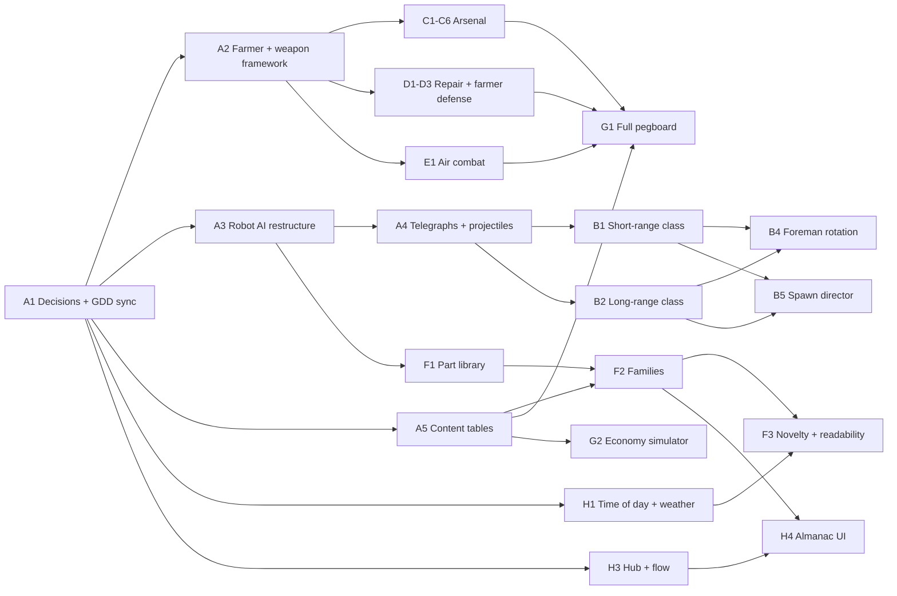

# Robot Attack! — Roadmap M2–M5

| | |
|---|---|
| **Status** | Draft v0.1 |
| **Date** | 2026-10-17 |
| **Source of truth** | [Robot_Attack_GDD.md](../Robot_Attack_GDD.md). This roadmap breaks GDD section 21 into work packages. When the two disagree, the GDD wins once the decisions in section 2 are made. |
| **Current state** | M0 and M1 are built (see section 1). M2 starts after the M1 playtest feedback is in. |

---

## Contents

1. [Where we are](#1-where-we-are)
2. [Decisions needed before M2 (M1 vs GDD)](#2-decisions-needed-before-m2-m1-vs-gdd)
3. [How work is planned](#3-how-work-is-planned)
4. [M2: Content Alpha](#4-m2-content-alpha)
5. [M3: Beta](#5-m3-beta)
6. [M4: Release](#6-m4-release)
7. [M5: Post-launch (Daily Harvest and online co-op)](#7-m5-post-launch-daily-harvest-and-online-co-op)
8. [Timeline](#8-timeline)
9. [Roadmap risks](#9-roadmap-risks)
10. [Next steps](#10-next-steps)

---

## 1. Where we are

M1 (vertical slice) is a playable graybox: primitive shapes with the clay shader, no imported art and no audio. The table compares it with the full game described in the GDD.

| Area | Built in M1 | Full game (GDD) | Lands in |
|---|---|---|---|
| Robot archetypes | 3 (Nibbler, Clanker, Thumper: the melee class) | 9 (3 types × 3 classes) | M2 |
| Weapons | 2 (wrench, Rivet Pistol) | 6 (+ Stun Gun, Shotgun, Machine Gun, Egg Grenades) + 2 mods each | M2 |
| Repair tools | 1 (wrench) | 3 (+ Auto Wrench, Welder) | M2 |
| Pegboard | 33 nodes + free jetpack | ~350 purchasable levels | M2 |
| Robot families | 3 themes, 9 palettes, 4 traits | 12 themes, 24 palettes, 10 traits | M2 |
| Farm | Every building, ladder, hay-bale stair and zipline; seeded prop scatter; corn wall; "Lost in the Corn" | + time of day, weather, crop-wedge variation, trample trails | M2 |
| Meta | Profile save (parts, upgrades, records, Almanac data), Harvest Report, restart | + Farmhouse Hub, start-phase checkpoints, Almanac UI, cosmetics | M2 |
| Look | Clay shader with lumps, thumbprints, subsurface scattering, 12 fps boil; stepped robot poses | Real models, felt/cellophane/cotton materials, VFX, cardboard UI | M2–M3 (see D8) |
| Audio | None | Adaptive bluegrass-chiptune music, clay foley, robot voices | M3 (see D8) |
| Tests | 33 GUT unit tests; 93-check headless smoke test; genome gallery | Grows with every work package | Ongoing |
| Version control | **Not a git repository yet** | Required for parallel sessions | Before M2 (see D9) |

---

## 2. Decisions needed before M2 (M1 vs GDD)

### 2.1 Behavior that differs from the GDD

Each row needs a choice from you. The recommendation is mine; the GDD gets updated to match whatever you pick (work package M2-A1).

| # | Topic | GDD says | M1 does | Options | Recommendation |
|---|---|---|---|---|---|
| **D1** | **Intermission length** | 30 s (your original spec) | 120 s, chosen so there's time to browse the pegboard | (a) Back to 30 s. (b) A middle value such as 60 s. (c) Keep 120 s. | **(a), once M2 adds the Hub pegboard (unhurried spending between runs) and a "pinned goals" quick-buy list.** Until then, keep 120 s as a setting. The GDD's *Relaxed Intermission* option covers players who want more time. |
| **D2** | **Run button** | No run modifier; base run speed is 7 m/s (5.3). A "Run (hold)" row was added to the 5.2 controls table during M1. | Hold L3 for +20% speed, gamepad only (no keyboard key) | (a) Remove it and tune base speed. (b) Keep it and bind a keyboard key (e.g., Left Ctrl; Shift is Air Dash). (c) Turn it into a Travel upgrade. | **(a)**, unless the M1 playtest shows the farm feels too big on foot. Air Dash (M2) covers short bursts. |
| **D3** | **Grain theft rate** | 50% of silo-bound Nibblers steal | Thieves are a share of each wave's spawns: 10% in wave 1, +1.5 points per wave, capped at 40%. The code ignores the Nibbler's 50% data value. | (a) Keep M1's ramp. (b) Go back to a flat 50%. | **(a)**, since it's gentler in wave 1. Document it in the GDD (the code cites a "GDD 11.7" section that doesn't exist yet). Confirm with the M1 playtest. |
| **D4** | **Thieving trait** | Any melee robot with the trait may steal grain | The trait's `thieving` flag is never read by gameplay code, so it only changes how robots look. Grunt squads can never steal. | (a) Make it work as the GDD says (Clankers and Thumpers can steal; squads break formation to do it). (b) Redefine it (e.g., +50% thief share for the wave). | **(b)**. It's simpler, fits D3's share-based model, and keeps squads readable. |
| **D5** | **Lucky Horseshoe strength** | "+6% Gold and Power Cell drop chance" (ambiguous) | +6% *relative* per level, so a Scout's 1% Gold chance becomes 1.3% at max level | (a) Keep it. (b) Relative but stronger: +15% per level (+75% at max). (c) Absolute: +6 points per level (huge for Gold). | **(b)**. Players can notice it without it breaking the economy. |
| **D6** | **Robot AI technology** | LimboAI behavior trees | A custom state machine in `robot.gd` (507 lines), with a note that LimboAI replaces it later | (a) Migrate to LimboAI at the start of M2. (b) Keep custom code but split it into per-class behavior components. | **Spike first (half a day):** check that LimboAI has a working Godot 4.7 build. If it does, choose (a) before adding the 6 new archetypes. If it doesn't, choose (b). |
| **D7** | **Camera technology** | Phantom Camera addon | A custom SpringArm3D camera (`farmer_camera.gd`, 72 lines) | (a) Keep custom. (b) Switch to Phantom Camera. | **(a)**. It's small and works. Revisit only if M3 cinematics (the Jetpack Moment, the pegboard dolly) need blending. |
| **D8** | **When real art and audio arrive** | M1 was meant to be "one polished slice" | M1 is graybox with no audio | (a) Run an art and audio track in parallel through M2, with most art done by mid-M3. (b) Graybox through M2, then all art and audio in M3. | **(a).** Art is the longest pole, and the claymation look is the game's identity. The "clayify" pipeline should be proven early. |
| **D9** | **Version control** | Not specified | The folder isn't a git repository | (a) `git init` + first commit now, optionally pushed to a private GitHub repo (enables cloud sessions and CI). (b) Stay without git. | **(a) before any M2 work.** Parallel sessions each need their own worktree, which requires git. |

### 2.2 Not built yet (already planned; no decision needed)

| Gap in M1 | Planned in |
|---|---|
| Short-range and long-range robot classes (6 archetypes); Foreman rotation | M2-B |
| Stun Gun, Shotgun, Machine Gun, Egg Grenades, mods, weapon wheel (M1 uses 1/2 keys, mouse wheel and Y to cycle) | M2-A2, M2-C |
| Auto Wrench, Welder, armor tiers past Padded Vest, silo plating past Aluminium, Scarecrow, capstones | M2-D |
| Air-combat jetpack upgrades (Air Dash, Ground Pound, ...) | M2-E |
| The remaining ~300 pegboard levels | M2-G |
| 9 more themes, 15 more palettes, 6 more traits, most of the part library | M2-F |
| Time of day, weather, crop wedges, trample trails | M2-H1, M2-H2 |
| Farmhouse Hub, title screen, start-phase checkpoints (M1 restarts straight from the Harvest Report) | M2-H3 |
| Almanac browsing UI (the data is already saved) | M2-H4 |
| Compass with lane markers, off-screen threat arrows | M2-H5 |
| Settings menu, remapping, accessibility options (M1 saves only sensitivity, invert Y and reduce motion) | M3-E |

### 2.3 GDD inconsistencies to fix

The M1 session edited a few GDD lines, which left the GDD contradicting itself. M2-A1 fixes these once D1–D5 are decided:

- **Intermission:** 30 s in sections 2.2, 11.1 and 20, but 120 s in 17.3 and Appendix A.
- **Run button:** a "Run (hold)" row was added to the 5.2 controls table, but 5.3 doesn't mention it.
- **Thieves:** the code cites "GDD 11.7", which doesn't exist. Add a thieves subsection with the per-wave share model (D3).
- **Crack model details** that M1 decided but 3.3 doesn't describe: each crack holds 10% of max Structure as its repair pool; new cracks open by height band with 50/30/20% weights (ground, catwalk 1, catwalk 2); when all 10 slots are full, extra damage goes into the nearest crack's pool.

---

## 3. How work is planned

### 3.1 Work packages

Each milestone is split into **work packages (WPs)**, each a coherent chunk one session (or one person) can finish and test. Sizes are rough estimates for a human developer:

| Size | Effort |
|---|---|
| **S** | A few hours |
| **M** | 1–3 days |
| **L** | 1–2 weeks |
| **XL** | 2+ weeks; split it before starting |

M0 and M1 showed that implementation with Claude sessions goes much faster than these estimates. Playtesting, art, balance and your decisions don't speed up the same way, and they set the real pace.

### 3.2 Definition of Done (every WP)

1. Statically typed GDScript. Content lives in `.tres` resources, generated by `tools/` scripts where M1 already does that.
2. GUT unit tests for any new formula or data rule, and the headless smoke test extended to exercise the new feature. Both pass.
3. **Co-op readiness** (GDD 18.8): no player singletons; randomness only through `RngService` streams; game-state changes happen in nodes that could run on a host; input only through `InputRouter`.
4. The GDD is updated if behavior intentionally differs from it.
5. README updated for new controls, debug keys or tools.
6. Every new third-party asset or addon has its license checked and an entry in `CREDITS.md`.

### 3.3 Running work in parallel

WPs that touch different files can run in separate sessions at the same time, each in its own git worktree (needs D9). Two sessions must never edit the same file. **Hotspot files** have one owner at a time:

| Hotspot | Lines | Why it's hot | Plan |
|---|---|---|---|
| `scripts/player/farmer.gd` | 592 | Movement, weapons, repair and interaction in one file | M2-A2 splits it into components first |
| `scripts/ai/robot.gd` | 507 | All robot behavior | M2-A3 restructures it (LimboAI or per-class components) |
| `scripts/systems/wave_director.gd` | 380 | Spawning, the wave loop and Foreman logic | Only M2-B5 and M2-H3 touch it, one after the other |
| `scripts/ui/pegboard_ui.gd` | 558 | The whole upgrade UI | Only M2-G1 touches it |
| `scripts/ui/hud.gd` | 376 | All HUD elements | Only M2-H5 touches it; other WPs emit `EventBus` signals instead |
| `tools/build_upgrade_catalog.gd` | 193 | Every pegboard node | M2-A5 moves the catalog to a data table so many WPs can add nodes without conflicts |

---

## 4. M2: Content Alpha

**Goal:** every system and every piece of content from the GDD is in the game and playable, even if unbalanced and partly graybox.
**GDD estimate:** ~12 weeks for 1–2 developers.
**Starts after:** the M1 playtest feedback and decisions D1–D9.

### 4.1 Track A: Foundations (first, mostly in sequence)

| ID | Work package | Needs | Size | Done when |
|---|---|---|---|---|
| **M2-A1** | **Decisions + GDD sync.** Apply D1–D5 in code and data; fix the 2.3 inconsistencies; create `CREDITS.md`. | D1–D9 | S | GDD and code agree; tests pass |
| **M2-A2** | **Farmer refactor + weapon framework.** Split `farmer.gd` into movement, weapon holder, repair and interaction components. Add `WeaponData` resources, a weapon wheel (hold Q / Y; number keys), mod-slot plumbing (`on_fire`, `on_hit`, `on_kill` hooks) and pooled projectiles. | A1 | L | Wrench and pistol work unchanged on the new framework; the wheel works on keyboard and gamepad; smoke test passes |
| **M2-A3** | **Robot AI restructure.** Per D6: migrate to LimboAI behavior trees, or split `robot.gd` into per-class behavior components. Add perch-aware positioning and a squad blackboard. | A1, D6 spike | L | The 3 melee archetypes behave as in M1 on the new structure; tests pass |
| **M2-A4** | **Telegraphs and enemy projectiles.** Pooled slow clay projectiles, red-yarn aim lines, chalk landing circles. | A3 | M | A test robot can fire each projectile type with its telegraph |
| **M2-A5** | **Content tables.** Move the pegboard catalog, archetype stats and genome data to one editable source (CSV/JSON in `data/source/`), with the `tools/` scripts generating `.tres` files from it. Add an "orphan stat" test: every `StatModifier` key must be read by some system. | A1 | M | Regenerating from the tables reproduces M1's data exactly; the orphan test passes |

A2 and A3 touch different files, so they can run in parallel after A1.

### 4.2 Track B: Enemies

| ID | Work package | Needs | Size | Done when |
|---|---|---|---|---|
| **M2-B1** | **Short-range class:** Spritzer (oil cone), Popper (kernel buckshot), Boiler (steam and flame cone, back fuel-tank weak point). | A3, A4 | L | All three spawn, attack and die correctly; stats match GDD 9.4 |
| **M2-B2** | **Long-range class:** Buzzer (flying, 3D steering, hover locomotion), Lobber (arc mortar with chalk circles), Longneck (siege position 45–55 m out, red-yarn telegraph, top-hatch weak point ×3). | A3, A4 | L | All three work; Longnecks find valid siege spots on every lane |
| **M2-B3** | **Weak-point system.** Hazard-stripe trim, Thumper back vent, Boiler fuel tank, Longneck top hatch; eye-expression hit reactions. | A3 | M | Weak-point multipliers verified by unit test; visible in the genome gallery |
| **M2-B4** | **Foreman rotation.** Melee → short → long by phase; Boiler debuts at wave 10 and Longneck at wave 15. | B1, B2 | S | Waves 5, 10 and 15 spawn the right Foreman |
| **M2-B5** | **Spawn director update.** Class weights 60/28/12, the GDD 9.5 unlock schedule, Longnecks always on lanes facing the silo. | B1, B2 | M | A unit test checks the archetype mix over 1,000 simulated waves |

### 4.3 Track C: Arsenal

| ID | Work package | Needs | Size | Done when |
|---|---|---|---|---|
| **M2-C1** | **Stun Gun ("Zap-Fork"):** beam, stun after 0.6 s of contact, chain, battery. | A2 | M | Stuns work on every archetype; Overload and Static Field mods work |
| **M2-C2** | **Shotgun ("Barn Blaster"):** pellets, spread, per-shell reload. | A2 | M | Slug and Barn Door mods work; knockback sends robots tumbling |
| **M2-C3** | **Machine Gun ("Rivet Repeater"):** spin-up, heat, cooldown. | A2 | M | Hot Rivets and Twin Barrel mods work |
| **M2-C4** | **Egg Grenades + Chicken House.** Throw arc, coop egg laying and collection, Sticky, Shock, Cluster and Golden eggs, Happy Hens. | A2 | L | Eggs restock at the coop at the GDD rates; all egg types work |
| **M2-C5** | **Remaining mods + Gold Mod Slot,** plus the mod loadout UI at the shed. | C1–C3 | M | Every weapon has 2 mods; the second slot unlocks at Damage 8 + Fire Rate 8 |
| **M2-C6** | **Wrench extras:** Bonk!, Wide Swing, Spin-to-Win. | A2 | S | All three work |

### 4.4 Track D: Repair and Defend

| ID | Work package | Needs | Size | Done when |
|---|---|---|---|---|
| **M2-D1** | **Auto Wrench:** deploy on the nearest crack, duration, up to 3 at once. | A2 | M | Deployed wrenches repair while the farmer fights |
| **M2-D2** | **Welder:** 10 m repair beam, Reinforce overshield, Hot Tip damage. | A2 | M | Rooftop repair works; overshield shows on the silo widget |
| **M2-D3** | **Farmer defense:** Tin and Tractor Plate armor tiers, Lunchbox pies, Second Wind revive. | A2 | M | Revive happens once per run at Home |
| **M2-D4** | **Silo defense:** Copper, Gold-Trim and Power-Shield plating (with visible plates), Zap Plates, Scarecrow Decoy, Iron Silo. | A1 | L | Plating tiers show on the silo; the scarecrow pulls melee aggro |

### 4.5 Track E: Jetpack combat

| ID | Work package | Needs | Size | Done when |
|---|---|---|---|---|
| **M2-E1** | **Air combat:** Steady Hands, Air Dash, Fuel Siphon, Ground Pound, Afterburner, Sky Farmer Overdrive. | A2 | L | Each upgrade works and feels distinct in a playtest |

### 4.6 Track F: Procedural robot families

| ID | Work package | Needs | Size | Done when |
|---|---|---|---|---|
| **M2-F1** | **Part library to target counts:** 18 bodies, 6 heads, 5 eyes, 6 antennas, 9 weapon arms (adds short- and long-range arms), 9 locomotion sets (adds hover), ~48 accessories. | A3 | L | The genome gallery shows every part on every type size |
| **M2-F2** | **Families to target counts:** 12 themes, 24 palettes, 10 traits (adds Bouncy, Magnetic, Overcharged, Shielded, Splitter, Medic, with Thieving per D4). | F1, A5 | L | Every trait's gameplay effect has a test; every theme has names and accessories |
| **M2-F3** | **Novelty and readability rules:** palette OKLab ΔE > 0.15 against the previous wave; contrast against each time-of-day preset; at most 2 of 5 shape genes repeated. | F2, H1 | M | Determinism and novelty tests pass over 1,000 seeds |

### 4.7 Track G: Pegboard and economy

| ID | Work package | Needs | Size | Done when |
|---|---|---|---|---|
| **M2-G1** | **Full pegboard (~350 levels).** All GDD section 13 nodes in the content tables; pegboard UI scaled up with filters (affordable now, by branch), pinned goals and red-yarn prerequisites. | A5 + each node's feature WP | L | Every node is purchasable and its effect is wired (orphan-stat test passes) |
| **M2-G2** | **Economy simulator.** A headless tool that simulates expected drops per wave against node costs and reports when the GDD 12.5 targets are hit (first pistol, all weapons, 50%, 80%, full tree). | A5 | M | It produces a report for the current data; M3 uses it for tuning |

### 4.8 Track H: Farm, meta and HUD

| ID | Work package | Needs | Size | Done when |
|---|---|---|---|---|
| **M2-H1** | **Time of day and weather.** 6 lighting presets that advance one step per phase; Clear, Breezy, Drizzle and Morning Fog (fog shortens long-range robot range by 20%). | A1 | L | Every preset and weather type works and is seeded per run |
| **M2-H2** | **Crop variation.** Seeded crop-wedge arrangement and trample trails that last the whole run. | A1 | M | Crops differ per seed; trails appear where robots walk |
| **M2-H3** | **Farmhouse Hub + flow.** Title screen → Hub (pegboard, Almanac, settings stub, Start Run) → run → Harvest Report → Hub. Start-phase checkpoints; Full Harvest and checkpoint records tracked separately. Save schema v2 with a migration from v1. | A1 | L | A v1 profile migrates cleanly (tested); checkpoints follow GDD 14.2 |
| **M2-H4** | **Robot Almanac UI.** SubViewport photo of each family, family codes (view and enter), milestone cosmetics (hats). | H3, F2 | M | Entering a family code rebuilds that family's look |
| **M2-H5** | **HUD pass.** Compass with lanes and threat pips, off-screen arrows (silo attackers, thieves, Longnecks), Foreman stinger, egg count, deployables. | B2, C4, D1 | M | All GDD 17.2 elements are present |

### 4.9 Track J: Art and audio groundwork (only if D8 = parallel)

| ID | Work package | Needs | Size | Done when |
|---|---|---|---|---|
| **M2-J1** | **Clayify pipeline.** Blender batch script (GDD 19.4): weld, bevel, subdivide, displace, smooth, decimate, export glTF. | — | M | One CC0 building goes in faceted and comes out soft and lumpy |
| **M2-J2** | **Farm buildings.** Replace graybox buildings with clayified Quaternius farm buildings, keeping collision, perch heights and ladders. | J1 | L | Every perch height in GDD 4.4 still holds; the navmesh rebakes cleanly |
| **M2-J3** | **First real robot family.** Modeled parts for one theme across all 3 type sizes. | J1, F1 | L | That family renders in game next to graybox families |
| **M2-J4** | **Farmer model + animations.** Base mesh plus Universal Animation Library animations retargeted to it. | J1 | L | The farmer is no longer a capsule; animations are stepped at 24 fps |
| **M2-J5** | **Audio skeleton.** Bus layout, `AudioDirector` music state machine with placeholder stems, siren, core SFX (pistol, wrench, robot pop, grain leak). | A1 | M | Every wave state has its music state; the siren plays |

### 4.10 Dependency map

### 4.11 Suggested batches of parallel sessions

| Batch | Sessions in parallel | Why this grouping |
|---|---|---|
| **0** | D9 (git init), D6 spike | Prerequisites |
| **1** | A1 alone | Every later WP builds on it |
| **2** | A2 · A3 · A5 · H1 · J1 | Disjoint files: player, AI, data tools, lighting, Blender |
| **3** | A4 → B1 and B2 (one session, AI files) · C1–C3 (weapons) · D1–D2 (repair) · H3 (hub) · F1 (robot parts) | Each owns its own folder |
| **4** | B3–B5 · C4–C6 · D3–D4 · E1 · F2 · H2 · J2–J5 | Feature fill |
| **5** | G1 · F3 · H4 · H5 · G2 | Integration: pegboard, HUD and Almanac read everything else |
| **6** | M2 playtest + bug fixes | Gate |

### 4.12 M2 exit criteria

- [ ] All 9 archetypes spawn on the GDD 9.5 schedule; Foremen rotate by class.
- [ ] All 6 weapons and all mods work; the weapon wheel works on keyboard and gamepad.
- [ ] Auto Wrench, Welder, every armor and plating tier, Scarecrow and the capstones work.
- [ ] The pegboard has ~350 levels and the orphan-stat test passes.
- [ ] 12 themes, 24 palettes and 10 traits; novelty and determinism tests pass over 1,000 seeds; the genome gallery passes a readability review.
- [ ] Hub, start-phase checkpoints, Almanac UI and save migration v1 → v2 work.
- [ ] Time of day and weather vary per run.
- [ ] The smoke test plays waves 1–20 headless on 10 seeds with no errors.
- [ ] **Performance baseline recorded:** frame time with 60 live robots on PC (graybox), so M3 knows the starting point.
- [ ] **Playtest:** at least 5 people play at least 3 runs each. Questions: Is something affordable after most waves? Can players tell the 9 archetypes apart? Is the jetpack fun in combat?

---

## 5. M3: Beta

**Goal:** the game looks, sounds and plays like the final product, runs on Steam Deck and is balanced against the GDD targets.
**GDD estimate:** ~10 weeks.

| ID | Work package | Size | Done when |
|---|---|---|---|
| **M3-A** | **Balance.** Local run telemetry (a JSON log per run: wave reached, parts earned, purchases, cause of game over). Tune with the M2-G2 simulator plus playtest logs. Verify the soft ceiling (a maxed player stalls around wave 45–60) with simulation and debug runs. | L | Economy targets (GDD 12.5) hit within ±20%; the soft ceiling lands in range |
| **M3-B** | **Art completion.** Replace all remaining graybox; finish the part library models; felt grass, paper corn, cellophane water and fire, cotton smoke; the full VFX list (GDD 15.6); tilt-shift depth of field; final time-of-day lighting presets. | XL (split per area) | No graybox remains; an art review signs off each area |
| **M3-C** | **UI skin.** Cardboard, felt and tape look; fonts (OFL); pegboard and Almanac polish; controller glyphs that switch with the active device. | L | Every screen is skinned; glyphs swap between keyboard and gamepad |
| **M3-D** | **Audio completion.** Music stems with 3 intensity layers driven by threat; Big Haul theme; clay foley; per-family robot voices from the voice gene; silo creaks that scale with damage. | L | Every GDD 16 state and cue exists; mix pass done |
| **M3-E** | **Settings and accessibility (GDD 20).** Settings menu, full remapping, aim assist, colorblind presets, HUD scale, subtitles and visual cues for the siren, thieves and Longneck charge, Reduce Motion, Relaxed Intermission, Gentle Farm (records flagged). | L | GDD 20 checklist complete |
| **M3-F** | **Steam Deck.** Deck quality preset (FSR 2, 40-robot cap, SDFGI off, 2-split shadows), on-device profiling, 800p text sizes, gyro through Steam Input. | L | 60 fps target or a stable 40 fps lock at 40 live robots, measured on a Deck |
| **M3-G** | **Onboarding.** Morning Chores tutorial; the Jetpack Moment scene; first-time tooltips on the pegboard. | M | A new playtester gets through wave 5 without help |
| **M3-H** | **Stability.** Wave-60 headless soak test (memory and error-free); a backup copy of the profile and corruption recovery; save fuzz tests. | M | The soak test passes; a corrupted profile recovers from its backup |

**M3 exit criteria**

- [ ] Steam Deck budget met (GDD 18.7); PC High at 60+ fps at 1440p with 60 robots.
- [ ] Economy within ±20% of targets; soft ceiling at wave 45–60.
- [ ] No graybox art; audio complete.
- [ ] No known crashes or save-loss bugs.
- [ ] **External playtest:** 15–20 players, including at least 3 on Steam Deck and at least 3 who mostly play with a gamepad.

---

## 6. M4: Release

**Goal:** ship on Steam for Windows, macOS and Linux, with Steam Deck support.
**GDD estimate:** ~6 weeks.

| ID | Work package | Size | Done when |
|---|---|---|---|
| **M4-A** | **Content lock + bug fixing**, then a release candidate. | L | No open bugs above minor severity |
| **M4-B** | **Steam integration** with GodotSteam (confirm its license and a Godot 4.7 build): ~25 achievements, leaderboards (best wave; best Full Harvest wave), Steam Cloud for `profile.json`, rich presence. | M | All of them work in a Steam test branch |
| **M4-C** | **Builds and CI.** Export presets for all three platforms; macOS signing and notarization; automated headless GUT + smoke tests on every build (needs D9 plus a GitHub repo). | M | One command or CI run produces three tested builds |
| **M4-D** | **Store and compliance.** Capsule art, trailer, screenshots, store description, IARC age-rating questionnaire, Steam Deck compatibility review submission. | M | Store page approved; Deck review submitted |
| **M4-E** | **Launch support.** Crash and log collection plan (log files, optionally a crash-reporting SDK), day-one patch window, feedback channel. | S | Plan written and tested with a fake crash |

**M4 exit criteria:** the release candidate passes the full automated test suite and a manual checklist (fresh profile, v1 → v2 save migration, all achievements, Deck controls); store page live in "coming soon"; launch date set.

---

## 7. M5: Post-launch (Daily Harvest and online co-op)

Ship **M5a (Daily Harvest) first**: it's smaller and reuses the leaderboard work from M4. **M5b (online co-op)** follows.

### 7.1 M5a: Daily Harvest (~4–6 weeks)

A daily shared seed: the same farm and the same robot family sequence for everyone, with a daily leaderboard (GDD 14.4).

| ID | Work package | Size | Done when |
|---|---|---|---|
| **M5a-1** | **Daily seed.** Derive the run seed from the UTC date. A determinism audit confirms that spawn, genome and lane randomness never depend on player actions (separate `RngService` streams). | M | Two machines produce identical wave compositions for the same date (tested headless) |
| **M5a-2** | **Fixed loadout ("Daily Kit").** Daily runs ignore the player's pegboard and use a preset upgrade tier. Requires `StatService` to support an override profile. | M | Daily runs use the kit; the normal profile is untouched |
| **M5a-3** | **Daily leaderboard + UI.** One Steam leaderboard per date (or a rolling board with date details); a Hub card with a countdown to the next day; results screen; streaks. Basic plausibility checks on submitted scores. | M | Scores post and show; implausible scores are rejected |

### 7.2 M5b: Online co-op, 2–4 players (~12–16 weeks)

**Approach:** host-authoritative, using Godot's high-level multiplayer API over **GodotSteam's networking peer** (Steam lobbies, invites and NAT traversal). Robots are synced as state snapshots; clients rebuild each wave's robot family from `(run_seed, wave)` instead of receiving meshes (GDD 18.8).

| ID | Work package | Size | Done when |
|---|---|---|---|
| **M5b-1** | **Co-op design decisions:** robot budget scaling by player count (starting point: × (1 + 0.6 × (players − 1))); shared silo; parts drops instanced per player so nobody fights over loot; a "downed" state with teammate revives (game over only when everyone is down); whose silo upgrades apply (host's or best of the group). | S | Written into the GDD |
| **M5b-2** | **Networking foundation:** Steam lobby and invite flow, multiple farmers in the player registry, one `InputRouter` per peer, central registration of spawnable scenes. | L | Two players can join the same farm and move around |
| **M5b-3** | **Replication:** robots, projectiles, pickups, silo and cracks, wave director state. | XL (split by system) | A 4-player wave plays with no visible desync |
| **M5b-4** | **Combat netcode:** client-side prediction for your own movement; server-validated hitscan with modest lag compensation (favor the shooter within ~150 ms). | L | Shooting feels responsive at 100 ms simulated latency |
| **M5b-5** | **Co-op meta:** per-player pegboards, shared Harvest Report, what each player keeps (everyone banks their own parts), host leaving ends the session but clients keep the parts they collected. | M | Everyone's profile updates correctly after a co-op run |
| **M5b-6** | **Network testing:** multi-instance local testing, simulated latency and packet loss, 30-minute 4-player soak tests. | M | Soak test passes at 150 ms and 2% packet loss |

**Out of scope for M5b:** host migration and local split-screen.

### 7.3 Things to do earlier so M5 stays cheap

These are already part of the Definition of Done (3.2, item 3), but they matter most for these systems:

| System | Keep in mind | When |
|---|---|---|
| `RngService` | Player actions must never consume spawn, genome or lane randomness | Every M2 WP; audited in M5a-1 |
| `StatService` | Design it so it can evaluate a different upgrade profile (for the Daily Kit and for each co-op player) | M2-A5 / G1 |
| Robots and projectiles | All spawning goes through one factory or pool, so a network spawner can wrap it later | M2-A3, A4 |
| HUD | Read state through `EventBus` signals, never by reaching into the farmer directly | M2-H5 |
| Leaderboards | Build the M4 leaderboard code so a per-date board is just another board | M4-B |

---

## 8. Timeline

The GDD's estimates are for 1–2 human developers. Using them from today gives the calendar below. M0 and M1 went much faster than their estimates, so treat these dates as an upper bound for implementation. Playtests, art and decisions will set the real pace.

| Milestone | GDD estimate | Rough window from today |
|---|---|---|
| M1 playtest + decisions D1–D9 | — | Now |
| M2 Content Alpha | ~12 weeks | Oct 2026 → Jan 2027 |
| M3 Beta | ~10 weeks | Jan → Mar 2027 |
| M4 Release | ~6 weeks | Apr → May 2027 |
| M5a Daily Harvest | ~4–6 weeks | May → Jun 2027 |
| M5b Online co-op | ~12–16 weeks | Jun → Sep 2027 |

Re-plan at each milestone gate using the actual pace of the previous milestone.

---

## 9. Roadmap risks

| Risk | Impact | Mitigation |
|---|---|---|
| LimboAI has no Godot 4.7 build | M2-A3 stalls | The D6 spike runs first; the fallback is per-class components in plain GDScript |
| Hotspot files collide between parallel sessions | Lost work, merge pain | Hotspot owner rule (3.3); A2 and A5 break up the worst files first; git worktrees (D9) |
| The ~350-node pegboard gets too large to tune by hand | Dead or overpowered nodes | Content tables (A5), the orphan-stat test, the economy simulator (G2), telemetry (M3-A) |
| Art lags behind code | M3 slips; the game looks graybox at beta | D8 = parallel art track; clayify pipeline proven in M2-J1 |
| Procedural families become unreadable once all 10 traits and 12 themes exist | Players can't read threats | Readability locks, the F3 contrast rules, genome gallery reviews at M2 exit |
| 40 robots plus the clay shader are too heavy for Steam Deck | Missed Deck target | Baseline at M2 exit; Deck preset work in M3-F; shared material with instance uniforms |
| Co-op exposes hidden single-player assumptions | M5b balloons | Co-op readiness in the Definition of Done from M2 on; determinism audit in M5a-1 |
| The 30 s intermission (D1) feels too short with a big pegboard | Frustration | Hub pegboard, pinned-goals quick-buy and the Relaxed Intermission option |

---

## 10. Next steps

1. **You:** playtest M1 and note feel and balance (economy, theft pressure, Nibbler speed vs. farmer speed, Thumper telegraphs, ziplines, Hover Mode).
2. **You:** decide D1–D9 (section 2.1). D9 (git) and the D6 spike can happen right away.
3. **Then:** run M2-A1 to apply the decisions and sync the GDD, and start batch 2 (section 4.11) in parallel sessions.
