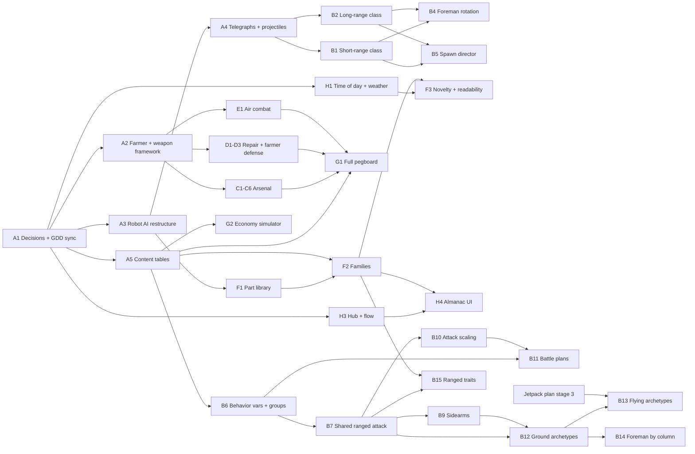

# Robot Attack! — Roadmap M2–M5

| | |
|---|---|
| **Status** | Draft v0.1 |
| **Date** | 2026-10-17 |
| **Source of truth** | [Robot_Attack_GDD.md](../Robot_Attack_GDD.md). This roadmap breaks GDD section 21 into work packages. When the two disagree, the GDD wins once the decisions in section 2 are made. |
| **Current state** | M0 and M1 are built (see section 1). Decisions D1–D9 were made on 2026-10-17; M2-A1, M2-A0, M2-A2, M2-A3 and M2-J1 are done (section 2.4, section 4.1, section 4.9). Batch 2 (section 4.11) is under way. Robot attack variety decisions R-D1–R-D6 were made and batch 2a (M2-B6, B7, B8) and M2-B9, B10 were done on 2026-10-25. On 2026-10-26 the playtest simulation's package (30 s intermissions, 3-wave phases with checkpoints, the authored six-wave opening) and the defense loop (the Rung Runner, intermission construction, springs, decoys, barricades) were built (section 4.13). After the user's playtest of that version (2026-10-26) the intermission went back to 90 s, the Tab quick-buy panel and the free milestone items were removed, defenses are placed freely instead of on marked sites, and the opening was made easier (section 4.13, "Playtest rework"). **Next step:** another normal-speed playtest of the reworked opening and free placement, then M2-B11 and M2-B12 (section 4.2, [plan](ROBOT_ATTACK_VARIETY_PLAN.md)). |

---

## Contents

1. [Where we are](#1-where-we-are)
2. [Decisions needed before M2 (M1 vs GDD)](#2-decisions-needed-before-m2-m1-vs-gdd)
3. [How work is planned](#3-how-work-is-planned)
4. [M2: Content Alpha](#4-m2-content-alpha)
5. [M3: Beta](#5-m3-beta)
6. [M4: Release](#6-m4-release)
7. [M5: Post-launch (Daily Harvest and online co-op)](#7-m5-post-launch-daily-harvest-and-online-co-op)
8. [Timeline](#8-timeline)
9. [Roadmap risks](#9-roadmap-risks)
10. [Next steps](#10-next-steps)

---

## 1. Where we are

M1 (vertical slice) is a playable graybox: primitive shapes with the clay shader, no imported art and no audio. The table compares it with the full game described in the GDD.

| Area | Built in M1 | Full game (GDD) | Lands in |
|---|---|---|---|
| Robot archetypes | 3 (Nibbler, Clanker, Thumper: the melee class) | 9 (3 types × 3 classes) | M2 |
| Weapons | 2 (wrench, Rivet Pistol) | 7 total: three melee, pistol, shotgun, long-range rifle, grenade launcher | M2 |
| Repair tools | 1 (wrench) | 3 (+ Auto Wrench, Welder) | M2 |
| Pegboard | 33 nodes + free jetpack | ~350 purchasable levels | M2 |
| Robot families | 3 themes, 9 palettes, 4 traits | 12 themes, 24 palettes, 10 traits | M2 |
| Farm | Every building, ladder, hay-bale stair and zipline; seeded prop scatter; corn wall; "Lost in the Corn" | + time of day, weather, crop-wedge variation, trample trails | M2 |
| Meta | Profile save (parts, upgrades, records, Almanac data), Harvest Report, restart | + Farmhouse Hub, start-phase checkpoints, Almanac UI, cosmetics | M2 |
| Look | Clay shader with lumps, thumbprints, subsurface scattering, 12 fps boil; stepped robot poses | Real models, felt/cellophane/cotton materials, VFX, cardboard UI | M2–M3 (see D8) |
| Audio | None | Adaptive bluegrass-chiptune music, clay foley, robot voices | M3 (see D8) |
| Tests | 64 GUT unit tests; 115-check headless smoke test that passes on every seed tried (10 fixed after the 2026-10-18 merges; 104 fixed and 6 random at M2-A0); genome and atmosphere galleries | Grows with every work package | Ongoing |
| Version control | Git repository on `main` with an initial commit (D9, done) | Required for parallel sessions | Done |

---

## 2. Decisions needed before M2 (M1 vs GDD)

### 2.1 Behavior that differs from the GDD

**Decided 2026-10-17: you accepted every recommendation below.** Section 2.4 lists what changed. The table is kept as the record of why.

| # | Topic | GDD says | M1 does | Options | Recommendation |
|---|---|---|---|---|---|
| **D1** | **Intermission length** | 30 s (your original spec) | 120 s, chosen so there's time to browse the pegboard | (a) Back to 30 s. (b) A middle value such as 60 s. (c) Keep 120 s. | **(a), once M2 adds the Hub pegboard (unhurried spending between runs) and a "pinned goals" quick-buy list.** Until then, keep 120 s as a setting. The GDD's *Relaxed Intermission* option covers players who want more time. |
| **D2** | **Run button** | No run modifier; base run speed is 7 m/s (5.3). A "Run (hold)" row was added to the 5.2 controls table during M1. | Hold L3 for +20% speed, gamepad only (no keyboard key) | (a) Remove it and tune base speed. (b) Keep it and bind a keyboard key (e.g., Left Ctrl; Shift is Air Dash). (c) Turn it into a Travel upgrade. | **(a)**, unless the M1 playtest shows the farm feels too big on foot. Air Dash (M2) covers short bursts. |
| **D3** | **Grain theft rate** | 50% of silo-bound Nibblers steal | Thieves are a share of each wave's spawns: 10% in wave 1, +1.5 points per wave, capped at 40%. The code ignores the Nibbler's 50% data value. | (a) Keep M1's ramp. (b) Go back to a flat 50%. | **(a)**, since it's gentler in wave 1. Document it in the GDD (the code cites a "GDD 11.7" section that doesn't exist yet). Confirm with the M1 playtest. |
| **D4** | **Thieving trait** | Any melee robot with the trait may steal grain | The trait's `thieving` flag is never read by gameplay code, so it only changes how robots look. Grunt squads can never steal. | (a) Make it work as the GDD says (Clankers and Thumpers can steal; squads break formation to do it). (b) Redefine it (e.g., +50% thief share for the wave). | **(b)**. It's simpler, fits D3's share-based model, and keeps squads readable. |
| **D5** | **Lucky Horseshoe strength** | "+6% Gold and Power Cell drop chance" (ambiguous) | +6% *relative* per level, so a Scout's 1% Gold chance becomes 1.3% at max level | (a) Keep it. (b) Relative but stronger: +15% per level (+75% at max). (c) Absolute: +6 points per level (huge for Gold). | **(b)**. Players can notice it without it breaking the economy. |
| **D6** | **Robot AI technology** | LimboAI behavior trees | A custom state machine in `robot.gd` (507 lines), with a note that LimboAI replaces it later | (a) Migrate to LimboAI at the start of M2. (b) Keep custom code but split it into per-class behavior components. | **Spike first (half a day):** check that LimboAI has a working Godot 4.7 build. If it does, choose (a) before adding the 6 new archetypes. If it doesn't, choose (b). |
| **D7** | **Camera technology** | Phantom Camera addon | A custom SpringArm3D camera (`farmer_camera.gd`, 72 lines) | (a) Keep custom. (b) Switch to Phantom Camera. | **(a)**. It's small and works. Revisit only if M3 cinematics (the Jetpack Moment, the pegboard dolly) need blending. |
| **D8** | **When real art and audio arrive** | M1 was meant to be "one polished slice" | M1 is graybox with no audio | (a) Run an art and audio track in parallel through M2, with most art done by mid-M3. (b) Graybox through M2, then all art and audio in M3. | **(a).** Art is the longest pole, and the claymation look is the game's identity. The "clayify" pipeline should be proven early. |
| **D9** | **Version control** | Not specified | The folder isn't a git repository | (a) `git init` + first commit now, optionally pushed to a private GitHub repo (enables cloud sessions and CI). (b) Stay without git. | **(a) before any M2 work.** Parallel sessions each need their own worktree, which requires git. |

### 2.2 Not built yet (already planned; no decision needed)

| Gap in M1 | Planned in |
|---|---|
| Short-range and long-range robot classes (6 archetypes); Foreman rotation | M2-B |
| Shotgun, long-range rifle, grenade launcher, heavy maul, 360-degree scythe, and their combat polish | M2-C |
| Auto Wrench, Welder, armor tiers past Padded Vest, silo plating past Aluminium, Scarecrow, capstones | M2-D |
| Air-combat jetpack upgrades: Air Dash and Ground Pound prototypes, followed by combat polish | M2-E |
| The remaining ~300 pegboard levels | M2-G |
| 9 more themes, 15 more palettes, 6 more traits, most of the part library | M2-F |
| Time of day, weather, crop wedges, trample trails | M2-H1, M2-H2 |
| Farmhouse Hub, title screen, start-phase checkpoints (M1 restarts straight from the Harvest Report) | M2-H3 |
| Almanac browsing UI (the data is already saved) | M2-H4 |
| Compass with lane markers, off-screen threat arrows | M2-H5 |
| Settings menu, remapping, accessibility options (M1 saves only sensitivity, invert Y and reduce motion) | M3-E |

### 2.3 GDD inconsistencies (fixed in M2-A1)

The M1 session edited a few GDD lines, which left the GDD contradicting itself. M2-A1 fixed all of these:

- **Intermission:** 30 s in sections 2.2, 11.1 and 20, but 120 s in 17.3 and Appendix A.
- **Run button:** a "Run (hold)" row was added to the 5.2 controls table, but 5.3 doesn't mention it.
- **Thieves:** the code cites "GDD 11.7", which doesn't exist. Add a thieves subsection with the per-wave share model (D3).
- **Crack model details** that M1 decided but 3.3 doesn't describe: each crack holds 10% of max Structure as its repair pool; new cracks open by height band with 50/30/20% weights (ground, catwalk 1, catwalk 2); when all 10 slots are full, extra damage goes into the nearest crack's pool.

### 2.4 Outcomes

| # | Decision | What changed |
|---|---|---|
| D1 | 30 s target; 120 s until the Hub pegboard and pinned goals exist | GDD says 30 s everywhere, with a note about builds. Code keeps 120 s (comment points here) and adds a console command, `intermission <seconds>`, for trying other lengths. **M2-H3/M2-G1 exit criteria now include switching the default to 30 s.** **Done 2026-10-26:** the default is 30 s (siren included), with the Tab quick-buy panel (three affordable suggestions, the pinned goal, Ready from anywhere), unhurried shopping at the Harvest Report, and a Relaxed Intermission setting (90 s). The playtest simulation's scenario (a) measured the change: combat from 38% to 56% of a session. | **Reversed 2026-10-26 after a playtest:** the quick-buy menu took the fun out of crossing the farm, so the default is **90 s** again, the quick-buy panel, pinned goals and Relaxed Intermission setting are gone, and shopping happens at the shed (the dinner bell still starts a wave early).
| D2 | Remove the run button | Removed the `run` input action, `run_multiplier` and the README/GDD rows. |
| D3 | Keep M1's thief ramp | New GDD section 11.7 documents it; Nibbler text in 3.3 and 9.3 updated; the archetype's `steal_chance` comment explains that scouts use the curve. |
| D4 | Thieving = ×1.5 thief share (max 60%) | `DifficultyCurve.thief_share(wave, thieving)` plus `thieving_share_multiplier` / `thieving_share_cap`; `robot.gd` reads the trait; new unit test. Squads still never steal. |
| D5 | Lucky Horseshoe +15% relative per level | Catalog tool, the `.tres` node and GDD 13.8 updated. |
| D6 | LimboAI | **Spike passed** on Godot 4.7.2 with the LimboAI v1.8.1 GDExtension: all classes register, a `BTPlayer` ticks a GDScript task, and a `LimboHSM` switches states. Quirk: the first headless import of a fresh project crashes once (signal 11); later runs are fine. CI must run the import twice. |
| D7 | Keep the custom camera | GDD 18.4 and 19.2 updated. |
| D8 | Art and audio in parallel from M2 | Track J is active; GDD 21 points here. |
| D9 | Git | Repository created on `main` with an initial commit. |

---

## 3. How work is planned

### 3.1 Work packages

Each milestone is split into **work packages (WPs)**, each a coherent chunk one session (or one person) can finish and test. Sizes are rough estimates for a human developer:

| Size | Effort |
|---|---|
| **S** | A few hours |
| **M** | 1–3 days |
| **L** | 1–2 weeks |
| **XL** | 2+ weeks; split it before starting |

M0 and M1 showed that implementation with Claude sessions goes much faster than these estimates. Playtesting, art, balance and your decisions don't speed up the same way, and they set the real pace.

### 3.2 Definition of Done (every WP)

1. Statically typed GDScript. Content lives in `.tres` resources, generated by `tools/` scripts where M1 already does that.
2. GUT unit tests for any new formula or data rule, and the headless smoke test extended to exercise the new feature. Both pass.
3. **Co-op readiness** (GDD 18.8): no player singletons; randomness only through `RngService` streams; game-state changes happen in nodes that could run on a host; input only through `InputRouter`.
4. The GDD is updated if behavior intentionally differs from it.
5. README updated for new controls, debug keys or tools.
6. Every new third-party asset or addon has its license checked and an entry in `CREDITS.md`.

### 3.3 Running work in parallel

WPs that touch different files can run in separate sessions at the same time, each in its own git worktree (needs D9). Two sessions must never edit the same file. **Hotspot files** have one owner at a time:

| Hotspot | Lines | Why it's hot | Plan |
|---|---|---|---|
| `scripts/player/farmer.gd` | 247 | State chart, health, armor, aiming, presentation | Split by M2-A2: movement (`farmer_movement.gd`, M2-E1), repair (`farmer_repair.gd`, M2-D1/D2), interaction and weapons (`scripts/weapons/`, M2-C) now have their own files |
| `scripts/ai/robot.gd` | 921 | All robot behavior | M2-A3 restructures it (LimboAI or per-class components). M2-B6, B7, B9 and B12 also touch it: never in parallel with A3 or each other |
| `scripts/systems/wave_director.gd` | 497 | Spawning, the wave loop and Foreman logic | M2-B6, M2-B11 (replaces B5), M2-H3 and the opening plan's authored waves ([first five waves plan](FIRST_FIVE_WAVES_FUN_PLAN.md)) touch it, one after the other |
| `scripts/ui/pegboard_ui.gd` | 558 | The whole upgrade UI | Only M2-G1 touches it |
| `scripts/ui/hud.gd` | 376 | All HUD elements | Only M2-H5 touches it; other WPs emit `EventBus` signals instead |
| `tools/build_upgrade_catalog.gd` | 193 | Every pegboard node | M2-A5 moves the catalog to a data table so many WPs can add nodes without conflicts |

---

## 4. M2: Content Alpha

**Goal:** every system and every piece of content from the GDD is in the game and playable, even if unbalanced and partly graybox.
**GDD estimate:** ~12 weeks for 1–2 developers.
**Starts after:** the M1 playtest feedback and decisions D1–D9.

### 4.1 Track A: Foundations (first, mostly in sequence)

| ID | Work package | Needs | Size | Done when |
|---|---|---|---|---|
| ~~M2-A1~~ | **Done 2026-10-17.** Decisions + GDD sync: applied D1–D5 in code and data; fixed the 2.3 inconsistencies; created `CREDITS.md`. | D1–D9 | S | Unit tests pass (34/34); smoke results identical before and after the change |
| ~~M2-A0~~ | **Done 2026-10-17.** Fixed the seed-dependent smoke test. Root cause: the test's god-mode farmer doesn't defend the silo, and on seeds without a wave-1 thief it waited 40 s for one while Nibblers destroyed the silo (about 40 s from full), which ended the run. The test now sends a silo attacker to the chute instead, reseals the silo between sections, clears the pistol's line of fire, uses one profile per process and fails once with the reason when a run ends early. **Game bug found and fixed:** robots stopped dead at building corners (a 2 s+ stall on 21 of 62 seeds; `wall_min_slide_angle`, regression test in `test_robot_movement.gd`). **Porch stall fixed 2026-10-18:** robots were also pinned for good against the Home porch's 0.2 m floor and the sides of its ramp (3 of 102 seeds). The navmesh joined steps up to 0.25 m, but a capsule only steps up about a third of its radius (Nibbler 0.10 m, Clanker 0.18 m, Thumper 0.24 m). The bake now uses `cell_height` and `agent_max_climb` 0.05 m, so it never joins a step of 0.1 m or more, and robots reach the porch up its ramp (`tools/build_graybox_farm.gd`, rebaked `farm_navmesh.res`, `navigation/3d/default_cell_height`; regression test in `test_robot_movement.gd`). | — | M | Smoke test passes on seeds 1–100, 1234, 2024, 31337, 664607717 and 6 random seeds; 36/36 unit tests pass; no robot pinned for 2 s on seeds 1–100 |
| ~~M2-A2~~ | **Done 2026-10-18.** Farmer refactor + weapon framework. `farmer.gd` (589 lines) is now a coordinator that ticks `FarmerMovement`, `FarmerRepair`, `FarmerInteraction` and `WeaponHolder` in a fixed order. `WeaponData` resources (`data/weapons/wrench.tres`, a `MeleeWeaponData`, and `pistol.tres`) hold base stats, slot, unlock flag and the stat keys each pegboard track modifies. Weapon wheel: tap Q / Y for the last weapon, hold to open it (mouse or right stick points, release equips; the camera holds still and nothing fires, the farmer keeps moving, no slow-motion); number keys 1–6; the mouse wheel cycles. `WeaponMod` hooks (`on_fire` can change the shot, `on_hit` the packet before it lands, `on_kill` after) with 1 slot per weapon plus a Gold Mod Slot flag; `Hurtbox.hit()` now reports kills. `ProjectilePool` + `Projectile` (ray-swept, piercing, gravity) for any weapon with `projectile_speed` > 0, and for robot projectiles in M2-A4. A newly bought weapon is equipped; other purchases no longer swap the wrench for the pistol. Mods aren't saved yet (M2-C5 adds the loadout UI). | A1 | L | 42/42 unit tests pass (6 new in `test_weapons.gd`); smoke test (104 checks, 11 new: wheel tap/hold/stick/number keys, mod slots and hooks) passes on seeds 1–10, 42, 1234, 2024, 31337, 664607717 and 2 random seeds |
| ~~M2-A3~~ | **Done 2026-10-30. Robot AI restructure.** LimboAI v1.8.1 is vendored and credited. A manually ticked melee behavior tree drives Nibblers, Clankers, Thumpers and the Rung Runner through the current movement/attack hooks. Shared squad blackboards retain leadership, formation and first-hit rhythm; perch approaches stop outside walls instead of selecting isolated roofs. Current targeting, heists, sidearm throws, traps and authored bosses are retained. Spitter, Roof Lobber and Drone controllers remain as implemented by B7/B9; their separate trees and reduced thinking rates remain future work. [Architecture](ROBOT_AI.md), [validation](audit-evidence/2026-10-30-robot-ai/README.md). | A1 | L | 224/224 unit tests (8 AI tests); main smoke 141 checks on seeds 7, 42 and 1234; opening 92 checks and tutorial 67 checks on seed 7 |
| ~~M2-A4~~ | **Done 2026-10-25, delivered by M2-B7** (section 4.2). Telegraphs and enemy projectiles: pooled projectiles, red-yarn aim lines, chalk landing circles. | A3 | M | A test robot can fire each projectile type with its telegraph |
| ~~M2-A5~~ | **Done 2026-10-18.** Content tables: the pegboard, archetype stats and genome data are CSV tables in `data/source/` (format in `data/source/README.md`; why CSV in the README). Each table is a folder with one row per item, and M1 ships one file per branch or class, so parallel WPs add rows or their own files without touching the same lines. `tools/build_upgrade_catalog.gd` and `tools/build_robot_data.gd` generate the `.tres` files through a shared reader (`tools/content_tables.gd`) and keep resource ids, so regenerating reproduces M1's `data/` byte for byte (even from empty folders) and a table edit only changes its own lines. New `test_content_tables.gd`: the `.tres` files match the tables, bad cells are reported with file and line, the GDD 12.4 recipes hold, and the orphan-stat rule (every `StatModifier` key appears in a system's script, scene or data; `PENDING_STATS` holds keys whose feature WP is still open, empty now). **One orphan found and fixed:** `jetpack.owned` was never read (`GameState.jetpack_unlocked` checked the node's level), so the getter now reads the flag. No orphans remain. `StatService` is unchanged: the catalog is plain data and a profile is just a levels dictionary, so the Daily Kit (M5a-2) and per-player pegboards (M5b-5) can fold another set of levels without touching the tables. | A1 | M | Regenerating from the tables reproduces M1's data exactly (`git diff data/` empty); 42/42 unit tests pass, including the orphan test; smoke test passes on seeds 1–10 and 1234 |

A2 and A3 touch different files, so they can run in parallel after A1.

### 4.2 Track B: Enemies

| ID | Work package | Needs | Size | Done when |
|---|---|---|---|---|
| **M2-B1** | **Short-range class:** Spritzer (oil cone), Popper (kernel buckshot), Boiler (steam and flame cone, back fuel-tank weak point). | A3, A4 | L | All three spawn, attack and die correctly; stats match GDD 9.4 |
| **M2-B2** | **Long-range class:** Buzzer (flying, 3D steering, hover locomotion), Lobber (arc mortar with chalk circles), Longneck (siege position 45–55 m out, red-yarn telegraph, top-hatch weak point ×3). | A3, A4 | L | All three work; Longnecks find valid siege spots on every lane |
| **M2-B3** | **Weak-point system.** Hazard-stripe trim, Thumper back vent, Boiler fuel tank, Longneck top hatch; eye-expression hit reactions. | A3 | M | Weak-point multipliers verified by unit test; visible in the genome gallery |
| **M2-B4** | **Foreman rotation.** Melee → short → long by phase; Boiler debuts at wave 10 and Longneck at wave 15. | B1, B2 | S | Waves 5, 10 and 15 spawn the right Foreman |
| **M2-B5** | **Spawn director update.** Class weights 60/28/12, the GDD 9.5 unlock schedule, Longnecks always on lanes facing the silo. | B1, B2 | M | A unit test checks the archetype mix over 1,000 simulated waves |

B1, B2, B4 and B5 follow the GDD's 3 × 3 type-and-class grid. The robot attack variety plan below proposes replacing them (decision R-D1). Until those decisions are made, don't start B1, B2, B4 or B5. B3 stands either way.

#### Robot attack variety

**Source:** [docs/ROBOT_ATTACK_VARIETY_PLAN.md](ROBOT_ATTACK_VARIETY_PLAN.md), proposed 2026-10-25. **Decisions R-D1 to R-D6 were made on 2026-10-25, as recommended.** It holds the design: the size × attack grid, group rules, behavior variables, scaling, battle plans and decisions R-D1 to R-D6.

**The new grid:**

- **Sizes and attacks:** small, medium and large robots, each fighting with melee, ranged or flight attacks.
- **Groups:**
  - small ground robots usually come in threes;
  - medium ground robots rarely do;
  - large robots, flyers and Foremen are always solo.
- **Shared behavior variables:** every robot uses the same set (silo focus, thief chance, trio chance, distraction, return-to-silo rules), with defaults per archetype.

**Constraints from the other plans:**

- **Opening:** waves 1–5 stay as the [first five waves plan](FIRST_FIVE_WAVES_FUN_PLAN.md) authors them. New attack variety starts at wave 6.
- **Flight:** every enemy can be beaten without the jetpack. The flying archetypes wait for stage 3 of the [jetpack plan](JETPACK_GAMEPLAY_AND_REWARD_PLAN.md).

| ID | Work package | Needs | Size | Done when |
|---|---|---|---|---|
| ~~M2-B6~~ | **Done 2026-10-25.** `RobotArchetype` has the behavior variables (`silo_focus`, `trio_chance` and `trio_chance_late`, `distractibility`, `distract_triggers`, `distract_range`, `commit_time`, `chase_time`, `leash_range`, `give_up_time`, `on_unreachable`); `farmer_target_chance`, `squad_size`, `aggro_range` and `unreachable_give_up_time` are gone. The size × attack grid replaced the class enum: `RobotClass` is now `MELEE`, `RANGED`, `FLIGHT` (R-D4: the Drone flies, the Roof Lobber is ranged), and per-robot costs are Small 2, Medium 4, Large 14. New `RobotTargeting` (plain logic, shared by a trio through `RobotSquad`) holds the spawn roll, the once-a-second distraction rolls and the return rules; `Robot` and `VerticalRobot` feed it what they sense. `WaveDirector.roll_group_size` rolls trios from the wave's spawn stream (`DifficultyCurve.trio_chance`: small ground 40% → 60% → 70% by wave 15), and `SpawnEvent` takes an explicit group size for authored waves. Heist crews: the leader carries the sack, the escorts fight a farmer near either of them, the crew counts as one thief. A switch to the farmer shows a "!" pop and an angry eye. `on_unreachable` `throw` and `relocate` act like `give_up` until B9 and B12. GDD 9.1, 9.2, 9.6, 11.4, 11.6 and 11.7 updated. Smoke checks that assumed M1 targeting (a hit always switches; Clankers always come in threes; a fixed alarm voice) now check the new rules. | A5; decisions R-D1, R-D5 | M | `test_robot_targeting.gd` (16 tests) covers distraction, every return rule, M1 values behaving as before, the heist crew, the thief share per group and trio rates over 1,000 seeds; large robots, flyers and Foremen never form trios |
| ~~M2-B7~~ | **Done 2026-10-25.** `AttackProfile` (kind straight / lob / rail / bomb, charge, interval, damage, speed, gravity, range, aim heights, splash, volley) generated from `data/source/robots/attacks/` into `data/robots/attacks/` (`drone_shot`, `lobber_lob`, plus `longneck_rail` and `duster_bomb` ready for B12 and B13); archetypes name theirs in `ranged_attack_id`. `RangedAttack` (charge → fire → recover) replaces `VerticalRobot`'s own attack, with the M1 trajectory and timing. `AttackTelegraph`: chalk landing circle (follows the target while a lob charges, then stays put), red-yarn aim line (locks 0.4 s before a rail fires), bomb shadow; every shot also charges the muzzle glow, never under 0.45 s. `AttackTokens`: 2 per farmer in waves 1–5, 3 after (`DifficultyCurve.farmer_attack_tokens`; B10 adds 4 and 5); without one a robot shoots the silo. At most 24 robot shots in flight. `EventBus.robot_shot_incoming(robot, farmer, impact_time, off_screen)` for M2-H5. Who a ranged robot shoots now comes from B6's targeting (the farmer while it is after them and within range, otherwise the silo) instead of "always the nearest farmer within range". | B6 | L | `test_ranged_attack.gd` (12 tests): the Drone and Roof Lobber keep their M1 numbers, trajectory and timing; a test robot fires every profile with its telegraph; no more than N robots shoot the farmer at once; the wave-3 Lobber's circle sits under the farmer. A real-farm probe of waves 6–7 saw lobbers reach roofs and fire with their circles, and no script errors |
| ~~M2-B8~~ | **Done 2026-10-25.** `Silo` measures each band's height from its sockets; `hit_band()` picks the nearest. A new crack goes to the hit's band with `hit_band_weight` 0.7, the rest by `band_weights`. Up to `ground_only_until_wave` (2) only ground sockets open; a full ground band then folds the damage into an open crack's pool instead of losing it. GDD 3.3 updated. | Decision R-D3 | S | `test_silo_cracks.gd` (4 tests): ground hits crack low ~70%, catwalk and top hits crack high ~70%, waves 1–2 never open a catwalk crack, and no Structure is lost when the ground band is full |
| ~~M2-B9~~ | **Done 2026-10-25.** **Spitter:** `SpitterRobot` (`scenes/robots/spitter.tscn`, row in `data/source/robots/archetypes/spitter.csv`) fires `spitter_pea` (straight, 0.8 s charge, 3 / 5 every 2.2 s at 14 m/s, aimed at catwalk height so it opens high cracks). It is a role, not a pick of its own: `WaveDirector.roll_role` turns a small ground melee pick into a Spitter group with `DifficultyCurve.spitter_share` from wave 7 (`spitter_archetype` on the director). It stands 12–16 m off its target, holds still while it charges, hops 35° around the target every 3 shots, backs off 4 m once from a farmer within 5 m, can shoot a farmer up high, and a trio fires a staggered 3-beat volley. **Throws:** Clanker and Thumper have `on_unreachable = throw` with `clanker_bolt` (lob, 5 / 8) and `thumper_clod` (lob, 15 / 20, 2 m splash). From wave 7 (`DifficultyCurve.throws_at_unreachable`) a farmer out of reach for 0.5 s and within range draws up to two throws through a second `RangedAttack` (glow plus chalk circle); `RobotTargeting.hold_give_up()` holds the give-up clock while each is under way, and after the second the robot goes back to the silo unless the farmer came back within reach. A throw needs a farmer token and never falls back to the silo (`RangedAttack.silo_fallback`). Out-of-reach farmers still never distract. **Arm guard:** the Clanker's `front_guard` 0.5 halves hits from within 60° of its facing, from wave 6 (`DifficultyCurve.arm_guard_up`; the opening keeps the M1 Clanker). New archetype columns `front_guard` and `tells`; `RobotFactory` builds each tell (guard plate, pea-shooter, bolt pouch, clod scoop) under its own node, and a robot hides a tell that isn't live yet in its wave. The genome gallery shows the Spitter and starts at wave 7. GDD 9.3, 9.4, 9.5 and 9.6 updated. | B7; decision R-D2 | M | `test_sidearms.gd` (14 tests): the Spitter's numbers, role share and built waves, stand-off and hop, one back-off, the trio beat and shooting up high; bolt and clod throws (telegraph, two then back, the wave-7 gate, no token no throw); a hovering farmer is neither immune nor a lure; the arm guard from the front, flank and back, its wave gate, Clanker only |
| ~~M2-B10~~ | **Done 2026-10-25.** `DifficultyCurve.attack_phase` (opening 1–5, early 6–15, middle 16–30, late 31+) drives the knobs: `farmer_attack_tokens` 2 / 3 / 4 / 5 (`farmer_tokens_by_phase` replaces `farmer_tokens_opening` and `farmer_tokens`); `charge_multiplier` 1.0 / 0.9 / 0.8 / 0.7, with `AttackProfile`'s 0.45 s floor; `aim_lead` 0 until wave 10, 0.3, then 0.6 from wave 16, for straight shots only (`RangedAttack.aim_point` leads by the farmer's velocity × flight time × lead); `volley_size` 1, then 2 from wave 16 and 3 from wave 24 (the plan's "2–3"), for Drones and Spitter trios through `RangedAttack.volley_override`; `spitter_share` 10% at wave 7, +2 points a wave, up to 40%; `column_weights` 60/28/12, 52/30/18, 45/33/22, which `WaveDirector.option_weights` applies by rescaling the type weights so each column among the options gets its share (measured before the Spitter role roll). B9's wave gates (`throws_at_unreachable`, `arm_guard_up`) live here too. `Robot.setup` reads them and `Robot.make_ranged_attack` hands them to every `RangedAttack`. Waves 1–5 get the M1 value of every knob and build the same spawns. GDD 9.6, 11.4 and the new 11.8 updated. | B7 | S | `test_difficulty_curve.gd` +11 tests: every knob, waves 1–5 at their M1 values, the director's column shares, and waves 1–6 building the same spawns with or without the Spitter role. `test_ranged_attack.gd` +4: the wave sets charge, lead, tokens and volley; a shorter charge; straight shots lead and lobs don't; volleys |
| **M2-B11** | **Battle plans** (replaces M2-B5). Plan data in `data/source/robots/battle_plans/` (Rush, Rooftop, Heist, Sky Raid, Barrage, Swarm, Pincer, Siege) replaces the director's `roof_lobber`, `rung_runner` and `drone` id checks and caps. Plans start at wave 8 (phase 3's twist, the phase plan), never repeat within 3 waves, show on the family name card, and stack two at a time from wave 31. Retune the spawn type weights for trios. | B6, B10; the authored opening (done, section 4.13) | M | A unit test checks the mix and plan rules over 1,000 simulated waves; waves 1–6 still follow the authored opening |
| **M2-B12** | **Ground archetype changes.** Longneck (large ranged: siege spot 45–55 m out, yarn telegraph, body-blockable rail, top hatch ×3). The Roof Lobber moves to medium size and gets rare trios. Splash from wave 12. | B7, B9, B3 | L | Longnecks find a valid siege spot on every lane. The Roof Lobber's stats and cost match the plan |
| **M2-B13** | **Flying archetypes.** Crop Duster (solo bombing passes with shadow circles, belly plate). Harvester Blimp (grain siphon, hose that can be cut, Nibbler drops, belly turret, flees at 30% with its grain). | B7, B12; decision R-D6; [jetpack plan](JETPACK_GAMEPLAY_AND_REWARD_PLAN.md) stage 3 | L | Both can be beaten without flight (tested with the jetpack disabled). Grain from a downed Blimp can be recovered |
| **M2-B14** | **Foreman rotation by column** (replaces M2-B4). With 3-wave phases: Thumper at waves 3, 6 and 9 → ranged (Longneck) from 12 → flight (Blimp) from 15 (the Longneck again if B13 isn't ready), then by phase. The opening's two Foremen are already authored (section 4.13): wave 3's has fixed behavior and no trait, wave 6's has the clod-throw phase at 50% HP; generalize that ranged phase to every Foreman from the second on. | B12; B13 for flight | S | Waves 3, 6, 9, 12 and 15 spawn the right Foreman |
| **M2-B15** | **Ranged traits:** Sharpshooter, Scattershot, Sticky and Spotter join the M2-F2 trait pool. | B7, F2 | M | Every trait's effect has a test and a visual tell |

### 4.3 Track C: Arsenal

| ID | Work package | Needs | Size | Done when |
|---|---|---|---|---|
| **M2-C1** | **Barn Blaster shotgun:** seven-pellet short cone. Prototype implemented; finish audio, recoil and encounter tuning. | A2 | M | Nearby groups reward the spread; distant targets reward another weapon |
| **M2-C2** | **Longneck Rifle:** slow 100 m precision shot. Prototype implemented; finish sight picture and weak-point feedback. | A2 | M | Long-range threats are engaging to intercept without trivializing close defense |
| **M2-C3** | **Boiler Grenades:** lobbed shell with a 5 m blast. Prototype implemented; finish blast telegraph and encounter tuning. | A2 | M | The blast hits each robot once and gives clustered tough enemies a clear counter |
| **M2-C4** | **Haymaker Maul and Harvest Scythe:** slow front swing versus 360-degree sweep. Prototypes implemented; finish animations and hit feedback. | A2 | M | Each melee weapon solves a different spacing problem |
| **M2-C5** | **Shed build depth:** add only firing modes or mods whose tactical role survives playtests; provide a loadout UI if needed. | C1–C4 | M | Each choice has an identified target situation and visible effect; no ricochet |
| **M2-C6** | **Seven-weapon balance and controls:** measure pick rates, hits to kill, access timing and gamepad wheel use. | C1–C4 | M | All seven are useful across the first ten waves without one choice dominating |

### 4.4 Track D: Repair and Defend

| ID | Work package | Needs | Size | Done when |
|---|---|---|---|---|
| **M2-D1** | **Auto Wrench:** deploy on the nearest crack, duration, up to 3 at once. | A2 | M | Deployed wrenches repair while the farmer fights |
| **M2-D2** | **Welder:** 10 m repair beam, Reinforce overshield, Hot Tip damage. | A2 | M | Rooftop repair works; overshield shows on the silo widget |
| **M2-D3** | **Farmer defense:** Tin and Tractor Plate armor tiers, Lunchbox pies, Second Wind revive. | A2 | M | Revive happens once per run at Home |
| **M2-D4** | **Silo defense:** Copper, Gold-Trim and Power-Shield plating (with visible plates), Zap Plates, Scarecrow Decoy, Iron Silo. | A1 | L | Plating tiers show on the silo; the scarecrow pulls melee aggro |

### 4.5 Track E: Jetpack combat

| ID | Work package | Needs | Size | Done when |
|---|---|---|---|---|
| **M2-E1** | **Air combat:** Air Dash and Ground Pound prototypes implemented; tune fuel cost, landing safety, VFX, and encounter value before adding further abilities. | A2 | L | Both moves work and feel distinct in a playtest |

### 4.6 Track F: Procedural robot families

| ID | Work package | Needs | Size | Done when |
|---|---|---|---|---|
| **M2-F1** | **Part library to target counts:** 18 bodies, 6 heads, 5 eyes, 6 antennas, 9 weapon arms (adds short- and long-range arms), 9 locomotion sets (adds hover), ~48 accessories. | A3 | L | The genome gallery shows every part on every type size |
| **M2-F2** | **Families to target counts:** 12 themes, 24 palettes, 10 traits (adds Bouncy, Magnetic, Overcharged, Shielded, Splitter, Medic, with Thieving per D4). **Overcharged done 2026-10-24:** a fused death blast (radius, robot and farmer damage tuned in `data/source/robots/traits/m2_overcharged.csv`) that chains through Overcharged packs; spark-coil tell; tests in `test_overcharged.gd`. | F1, A5 | L | Every trait's gameplay effect has a test; every theme has names and accessories |
| **M2-F3** | **Novelty and readability rules:** palette OKLab ΔE > 0.15 against the previous wave; contrast against each time-of-day preset; at most 2 of 5 shape genes repeated. | F2, H1 | M | Determinism and novelty tests pass over 1,000 seeds |

### 4.7 Track G: Pegboard and economy

| ID | Work package | Needs | Size | Done when |
|---|---|---|---|---|
| **M2-G1** | **Full pegboard (~350 levels).** All GDD section 13 nodes in the content tables; pegboard UI scaled up with filters (affordable now, by branch), pinned goals and red-yarn prerequisites. | A5 + each node's feature WP | L | Every node is purchasable and its effect is wired (orphan-stat test passes) |
| **M2-G2** | **Economy simulator.** A headless tool that simulates expected drops per wave against node costs and reports when the GDD 12.5 targets are hit (first pistol, all weapons, 50%, 80%, full tree). | A5 | M | It produces a report for the current data; M3 uses it for tuning |

### 4.8 Track H: Farm, meta and HUD

| ID | Work package | Needs | Size | Done when |
|---|---|---|---|---|
| ~~M2-H1~~ | **Done 2026-10-18.** Time of day and weather. Six `LightingPreset`s (Dawn → Moonlit Night) and four `WeatherType`s live in `data/environment/` behind one `EnvironmentTable`. `TimeOfDay` and `Weather` nodes in `farm.tscn` roll the starting preset, the weather and per-run variation (key-light bearing, cloud layout, wind, puddles) from a new `environment` RngService stream. They step one preset per phase from `EventBus.wave_phase_changed`, blending over 6 s in 12 fps steps, and emit `time_of_day_changed` / `weather_changed`. Drizzle adds stepped clay droplets, puddle decals, shinier clay and darker felt; Breezy sways the corn wall; Morning Fog shortens sight lines and blooms eyes sooner. **Hooks for M2-B2:** `Weather.engagement_range_multiplier(robot_class)` (0.8 for long-range in fog) and `Weather.wind`. **For M2-F3:** `AtmosphereLook.compose(preset, weather)` gives each combination as plain values, and `tests/tools/atmosphere_gallery.tscn` renders every preset × weather with robots at 10, 25 and 45 m (color and grayscale sheets). | A1 | L | Every preset and weather type works and is seeded per run: 49/49 unit tests (13 new); smoke test (104 checks) passes on seeds 1–10 and 1234; every preset × weather reviewed in a windowed run, robots readable against the crops in color and grayscale |
| **M2-H2** | **Crop variation.** Seeded crop-wedge arrangement and trample trails that last the whole run. | A1 | M | Crops differ per seed; trails appear where robots walk |
| **M2-H3** | **Farmhouse Hub + flow.** Title screen → Hub (pegboard, Almanac, settings stub, Start Run) → run → Harvest Report → Hub. **Phase checkpoints, Full Harvest records, save schema v2 and the v1 migration are done** (section 4.13); the Hub still needs its Continue: Phase N and Start at Phase 1 buttons and the list of earlier phase starts. | A1 | L | The Hub offers every checkpoint the profile has reached |
| **M2-H4** | **Robot Almanac UI.** SubViewport photo of each family, family codes (view and enter), milestone cosmetics (hats). | H3, F2 | M | Entering a family code rebuilds that family's look |
| **M2-H5** | **HUD pass.** Compass with lanes and threat pips, off-screen arrows (silo attackers, thieves, Longnecks), Foreman stinger, weapon ammo, deployables. | B2, C4, D1 | M | All GDD 17.2 elements are present |

### 4.9 Track J: Art and audio groundwork (D8: runs in parallel with the rest of M2)

| ID | Work package | Needs | Size | Done when |
|---|---|---|---|---|
| ~~M2-J1~~ | **Done 2026-10-18 in the visual pass.** Clayify pipeline: `tools/clayify/clayify.py` bakes material colors to vertex colors, recolors to the farm palette, welds, bevels, shades smooth and stretches buildings onto their gameplay dimensions (see README). The barn, water tower, well and windpump already use it, which is part of M2-J2. | — | M | One CC0 building goes in faceted and comes out soft and lumpy |
| **M2-J2** | **Farm buildings.** Replace graybox buildings with clayified Quaternius farm buildings, keeping collision, perch heights and ladders. | J1 | L | Every perch height in GDD 4.4 still holds; the navmesh rebakes cleanly |
| **M2-J3** | **First real robot family.** Modeled parts for one theme across all 3 type sizes. | J1, F1 | L | That family renders in game next to graybox families |
| **M2-J4** | **Farmer model + animations.** Base mesh plus Universal Animation Library animations retargeted to it. | J1 | L | The farmer is no longer a capsule; animations are stepped at 24 fps |
| **M2-J5** | **Audio skeleton.** Bus layout, `AudioDirector` music state machine with placeholder stems, siren, core SFX (pistol, wrench, robot pop, grain leak). | A1 | M | Every wave state has its music state; the siren plays |

### 4.10 Dependency map

B8 (hit-height cracks) only needs decision R-D3 and touches `silo.gd` alone, so it can run alongside anything.

### 4.11 Suggested batches of parallel sessions

| Batch | Sessions in parallel | Why this grouping |
|---|---|---|
| ~~0~~ | D9 (git init), D6 spike: **done** | Prerequisites |
| ~~1~~ | A1 · A0: **done** | A0 before parallel work, so every session can trust the smoke test |
| **2** | A2 · A3 · A5 · H1 · J1 | Disjoint files: player, AI, data tools, lighting, Blender |
| ~~2a~~ | B6 → B7 (one session, AI files) · B8 (silo), then B9 + B10 (one session): **done 2026-10-25** | Robot attack variety framework. B6 and B7 share `robot.gd` with A3, so finish or pause A3 first. Coordinate B6's `wave_director.gd` work with the opening plan's authored waves |
| **3** | A4 → B1 and B2 (one session, AI files) · C1–C3 (weapons) · D1–D2 (repair) · H3 (hub) · F1 (robot parts) | Each owns its own folder |
| **4** | B3–B5 · C4–C6 · D3–D4 · E1 · F2 · H2 · J2–J5 | Feature fill |
| **5** | G1 · F3 · H4 · H5 · G2 | Integration: pegboard, HUD and Almanac read everything else |
| **6** | M2 playtest + bug fixes | Gate |

### 4.13 The playtest simulation package and the defense loop (done 2026-10-26)

**Sources:** the recalibrated [playtest simulation report](PLAYTEST_SIMULATION_REPORT.md) on branch `claude/beautiful-yalow-10a844` (its section 6: ship short breaks, phase checkpoints and the authored opening together, with the first Foreman's HP lowered first), and the [defense proposal](DEFENSE_BUILDING_AND_COMBAT_PROGRESSION_PROPOSAL.md) (slices 2-6). Their plans' recommendations were adopted as decisions. Evidence: [docs/audit-evidence/2026-10-26-opening-and-defense](audit-evidence/2026-10-26-opening-and-defense/README.md).

| ID | Work package | Done |
|---|---|---|
| ~~PS-1~~ | **3-wave phases and checkpoints** ([phase plan](PHASE_CHECKPOINT_PROGRESSION_PLAN.md) steps 1, 2, 3, 5, 6; decisions P-D1 to P-D6 as recommended). One phase length on the curve; the Big Haul on waves 3, 6, 9, ...; the re-keyed schedule (Lobbers 4, Drones 7, Thumpers 8, Spitters, throws and the arm guard 13, lanes 5/14/31, traits 7/16/31, volley 3 at 25); Retry Phase / Start over on the Harvest Report and in the pause menu; `resume_wave`, attempts per phase, a no-retry Full Harvest and save schema v2 with its migration; Early Bird above the best wave only; each Foreman wave's 2 PC + 1 Au bounty once per profile; the jetpack as a wave-9 milestone; time of day counted from wave 1. | `test_difficulty_curve.gd` (every threshold on a phase start), `test_checkpoints.gd`, `test_save_and_waves.gd`, `test_economy.gd`, the smoke and opening tests |
| ~~PS-2~~ | **The authored opening** ([opening plan](FIRST_FIVE_WAVES_FUN_PLAN.md) re-keyed by phase plan step 4, with the simulator's rosters): `OpeningWave` data generated from `data/source/opening/`; groups by time or after an earlier group; live caps; arrivals 45 m out; one-time debut captions; a 700 HP first Foreman with a 1.2 s slam tell and a 2.5 s x3 vent window whose defeat calls off its adds; the second Foreman's clod phase; the pistol kit, the free Barn Blaster or Maul, and the Spring Trap as first-completion rewards; waves that clear as soon as they're empty; 30 s intermissions with the Tab quick-buy panel and Ready (D1). Waves 7-9 ramp the budget (x0.7 / 0.8 / 0.85) so generated waves step up from the opening instead of jumping. | `test_checkpoints.gd`, `test_content_tables.gd`, `opening_test.tscn` |
| ~~DF-1~~ | **The Rung Runner** (defense slice 2): climbs the silo ladder (two at a time, the rest beside the foot), walks the first catwalk to a crack socket and bashes the silo there; climbing clank, marker and HUD warning; part of the 25% climber share from wave 7. Wave 5 pairs it with a Lobber on the barn roof so the existing dome-to-barn cable connects the two fights. | `test_ladder_climber.gd`, `opening_test.tscn` |
| ~~DF-2~~ | **Intermission construction and the starter defenses** (slices 3-5): authored sites, reserved cost and capacity (8), one job at a time with two waiting, standing by doubles the speed, the siren cutoff, frozen ghosts, cancel and run-end refunds that settle once, moving, repairing and dismantling; the Spring Trap (real launches, capped fall damage, kill credit, mass limits), Scarecrow Decoy and Scrap Barricade. | `test_defenses.gd`, `test_ladder_climber.gd`, `opening_test.tscn` |
| ~~DF-3~~ | **Progression around it** (slice 6): the BUILD pegboard branch (recipes, Quick Assembly, Coil Springs, Loud Scarecrow, Sturdy Scrap, More Room; the rarer parts go here); Springy Soles and Zipline Grip retired and refunded once; every gun fires from a zipline. | `test_upgrades.gd`, `test_content_tables.gd` |
| ~~PS-3~~ | **Other simulation findings:** the Haymaker Maul, Harvest Scythe and Boiler Grenades are on the pegboard (finding 5); a tighter shotgun pattern (finding 8); a low-health warning and a well heal 12 m from the silo (finding 7); the worst leak with its time to seal, and a relief chime (finding 2). | `test_checkpoints.gd`, the opening and smoke tests |

**Playtest rework (2026-10-26, same day).** The user's playtest of the package above: "the fast select menu takes out the fun of traveling", the robots' pace is better but the first rounds were too hard. Changed: intermissions are 90 s (no Relaxed setting); the Tab quick-buy panel, `UpgradeAdvisor` and pinned goals are removed, so shopping means walking to the shed; no milestone hands over an item (the pistol kit, the free Barn Blaster or Maul and the free Spring Trap copy are gone; the Spring Trap recipe costs 15 Al on the BUILD board; only the wave-9 jetpack blueprint remains, and it is still built at the shed); the authored build sites are gone and Tab now opens a build menu whose ghost can be placed anywhere it doesn't overlap the world, a robot or another copy (snapping onto the climbers' ring on the first catwalk); and the opening is lighter: 6 Nibblers in wave 1 (cap 3), Clanker pairs instead of trios through wave 6, a 450 HP first Foreman with 4 Nibbler adds, and a 900 HP second Foreman instead of the curve's ~1,700. Tests: `test_defenses.gd` (placement rules), `test_checkpoints.gd` (rosters, no free items), the opening test (Tab, the ghost, Interact to build). The economy probe and simulator figures above predate it.

**Opening retune (2026-10-26, second playtest).** Waves 1 and 2 were "way too easy", with Nibbler pairs too far apart. Wave 1 is now 15 Nibblers in singles and pairs, one group every 4-6 s (cap 4); wave 2 has two Roof Lobbers on the tool shed (at 0 s and 28 s) and 12 Nibblers streaming in the same way (cap 4). The first Foreman couldn't be beaten without the pistol: the wrench's swing always landed on the body capsule, never the open vent (melee skips weak points, and pressed against its back the swing passes under the vent box). Now any hit from within 3.5 m behind an authored Foreman during its punish window counts as a vent hit (`HeavyRobot.back_whack`), and its HP is 350, two wrench punish windows. Tests: `test_foreman_melee.gd`, `test_checkpoints.gd`, the opening test.

**Second playtest rework (2026-10-26).** "I don't want the pistol to be available until after the roof crawlers"; the second Foreman "was way too easy to kill with a pistol" (its clods only started once it was hurt, so the farmer walked away and shot); "I did 7 waves and had no need for" defenses. Changed: the first Roof Lobber moves to wave 2 (on the tool shed, before any gun), and clearing wave 2 opens the pistol (`StatService.MILESTONE_GATES`; every gun needs the pistol, so it gates them all); the Clanker pair and thief move to wave 4 with a barn Lobber. Authored Foremen wear plates (hits from beyond 6 m do 30% unless they land in the open vent), and wave 6's throws clods at a distant farmer from the start, faster below half health. Waves 5 and 6 split the pressure: the main lane is on the silo ladder's side (lanes 5-6) and the raid slot now takes the lane farthest from the main ones, so a Rung Runner climbs while a raid or the Foreman hits the far side. The wave 5 intermission asks for a Spring Trap at the ladder top. Tests: `test_checkpoints.gd` (rosters, the pistol gate, the plates), the opening test (92 checks).

**Still open from these plans:** turrets (defense slice 7); the opening plan's camera, landmark compass and offscreen threat arrows (beyond the landmark lane names now used); the Hub's checkpoint list (M2-H3); and a normal-speed playtest: does a 30 s intermission leave time to build, does the catwalk spring make climbing worth it, and does the cable get used in wave 5.

### 4.12 M2 exit criteria

- [ ] All 9 archetypes spawn on schedule and Foremen rotate. That means the attack variety plan's grid and Foreman order (melee → ranged → flight) if R-D1 is accepted, otherwise the GDD 9.5 schedule.
- [ ] All 7 weapons feel distinct and the weapon wheel works on keyboard and gamepad.
- [ ] Auto Wrench, Welder, every armor and plating tier, Scarecrow and the capstones work.
- [ ] The pegboard has ~350 levels and the orphan-stat test passes.
- [ ] 12 themes, 24 palettes and 10 traits; novelty and determinism tests pass over 1,000 seeds; the genome gallery passes a readability review.
- [ ] Hub, start-phase checkpoints, Almanac UI and save migration v1 → v2 work.
- [ ] Time of day and weather vary per run.
- [ ] The smoke test plays waves 1–20 headless on 10 seeds with no errors.
- [ ] **Performance baseline recorded:** frame time with 60 live robots on PC (graybox), so M3 knows the starting point.
- [ ] **Playtest:** at least 5 people play at least 3 runs each. Questions: Is something affordable after most waves? Can players tell the 9 archetypes apart? Is the jetpack fun in combat?

---

## 5. M3: Beta

**Goal:** the game looks, sounds and plays like the final product, runs on Steam Deck and is balanced against the GDD targets.
**GDD estimate:** ~10 weeks.

| ID | Work package | Size | Done when |
|---|---|---|---|
| **M3-A** | **Balance.** Local run telemetry (a JSON log per run: wave reached, parts earned, purchases, cause of game over). Tune with the M2-G2 simulator plus playtest logs. Verify the soft ceiling (a maxed player stalls around wave 45–60) with simulation and debug runs. | L | Economy targets (GDD 12.5) hit within ±20%; the soft ceiling lands in range |
| **M3-B** | **Art completion.** Replace all remaining graybox; finish the part library models; felt grass, paper corn, cellophane water and fire, cotton smoke; the full VFX list (GDD 15.6); tilt-shift depth of field; final time-of-day lighting presets. | XL (split per area) | No graybox remains; an art review signs off each area |
| **M3-C** | **UI skin.** Cardboard, felt and tape look; fonts (OFL); pegboard and Almanac polish; controller glyphs that switch with the active device. | L | Every screen is skinned; glyphs swap between keyboard and gamepad |
| **M3-D** | **Audio completion.** Music stems with 3 intensity layers driven by threat; Big Haul theme; clay foley; per-family robot voices from the voice gene; silo creaks that scale with damage. | L | Every GDD 16 state and cue exists; mix pass done |
| **M3-E** | **Settings and accessibility (GDD 20).** Settings menu, full remapping, aim assist, colorblind presets, HUD scale, subtitles and visual cues for the siren, thieves and Longneck charge, Reduce Motion, Relaxed Intermission, Gentle Farm (records flagged). | L | GDD 20 checklist complete |
| **M3-F** | **Steam Deck.** Deck quality preset (FSR 2, 40-robot cap, SDFGI off, 2-split shadows), on-device profiling, 800p text sizes, gyro through Steam Input. | L | 60 fps target or a stable 40 fps lock at 40 live robots, measured on a Deck |
| **M3-G** | **Onboarding.** Morning Chores tutorial; the Jetpack Moment scene; first-time tooltips on the pegboard. | M | A new playtester gets through wave 5 without help |
| **M3-H** | **Stability.** Wave-60 headless soak test (memory and error-free); a backup copy of the profile and corruption recovery; save fuzz tests. | M | The soak test passes; a corrupted profile recovers from its backup |

**M3 exit criteria**

- [ ] Steam Deck budget met (GDD 18.7); PC High at 60+ fps at 1440p with 60 robots.
- [ ] Economy within ±20% of targets; soft ceiling at wave 45–60.
- [ ] No graybox art; audio complete.
- [ ] No known crashes or save-loss bugs.
- [ ] **External playtest:** 15–20 players, including at least 3 on Steam Deck and at least 3 who mostly play with a gamepad.

---

## 6. M4: Release

**Goal:** ship on Steam for Windows, macOS and Linux, with Steam Deck support.
**GDD estimate:** ~6 weeks.

| ID | Work package | Size | Done when |
|---|---|---|---|
| **M4-A** | **Content lock + bug fixing**, then a release candidate. | L | No open bugs above minor severity |
| **M4-B** | **Steam integration** with GodotSteam (confirm its license and a Godot 4.7 build): ~25 achievements, leaderboards (best wave; best Full Harvest wave), Steam Cloud for `profile.json`, rich presence. | M | All of them work in a Steam test branch |
| **M4-C** | **Builds and CI.** Export presets for all three platforms; macOS signing and notarization; automated headless GUT + smoke tests on every build (needs D9 plus a GitHub repo). | M | One command or CI run produces three tested builds |
| **M4-D** | **Store and compliance.** Capsule art, trailer, screenshots, store description, IARC age-rating questionnaire, Steam Deck compatibility review submission. | M | Store page approved; Deck review submitted |
| **M4-E** | **Launch support.** Crash and log collection plan (log files, optionally a crash-reporting SDK), day-one patch window, feedback channel. | S | Plan written and tested with a fake crash |

**M4 exit criteria:** the release candidate passes the full automated test suite and a manual checklist (fresh profile, v1 → v2 save migration, all achievements, Deck controls); store page live in "coming soon"; launch date set.

---

## 7. M5: Post-launch (Daily Harvest and online co-op)

Ship **M5a (Daily Harvest) first**: it's smaller and reuses the leaderboard work from M4. **M5b (online co-op)** follows.

### 7.1 M5a: Daily Harvest (~4–6 weeks)

A daily shared seed: the same farm and the same robot family sequence for everyone, with a daily leaderboard (GDD 14.4).

| ID | Work package | Size | Done when |
|---|---|---|---|
| **M5a-1** | **Daily seed.** Derive the run seed from the UTC date. A determinism audit confirms that spawn, genome and lane randomness never depend on player actions (separate `RngService` streams). | M | Two machines produce identical wave compositions for the same date (tested headless) |
| **M5a-2** | **Fixed loadout ("Daily Kit").** Daily runs ignore the player's pegboard and use a preset upgrade tier. Requires `StatService` to support an override profile. | M | Daily runs use the kit; the normal profile is untouched |
| **M5a-3** | **Daily leaderboard + UI.** One Steam leaderboard per date (or a rolling board with date details); a Hub card with a countdown to the next day; results screen; streaks. Basic plausibility checks on submitted scores. | M | Scores post and show; implausible scores are rejected |

### 7.2 M5b: Online co-op, 2–4 players (~12–16 weeks)

**Approach:** host-authoritative, using Godot's high-level multiplayer API over **GodotSteam's networking peer** (Steam lobbies, invites and NAT traversal). Robots are synced as state snapshots; clients rebuild each wave's robot family from `(run_seed, wave)` instead of receiving meshes (GDD 18.8).

| ID | Work package | Size | Done when |
|---|---|---|---|
| **M5b-1** | **Co-op design decisions:** robot budget scaling by player count (starting point: × (1 + 0.6 × (players − 1))); shared silo; parts drops instanced per player so nobody fights over loot; a "downed" state with teammate revives (game over only when everyone is down); whose silo upgrades apply (host's or best of the group). | S | Written into the GDD |
| **M5b-2** | **Networking foundation:** Steam lobby and invite flow, multiple farmers in the player registry, one `InputRouter` per peer, central registration of spawnable scenes. | L | Two players can join the same farm and move around |
| **M5b-3** | **Replication:** robots, projectiles, pickups, silo and cracks, wave director state. | XL (split by system) | A 4-player wave plays with no visible desync |
| **M5b-4** | **Combat netcode:** client-side prediction for your own movement; server-validated hitscan with modest lag compensation (favor the shooter within ~150 ms). | L | Shooting feels responsive at 100 ms simulated latency |
| **M5b-5** | **Co-op meta:** per-player pegboards, shared Harvest Report, what each player keeps (everyone banks their own parts), host leaving ends the session but clients keep the parts they collected. | M | Everyone's profile updates correctly after a co-op run |
| **M5b-6** | **Network testing:** multi-instance local testing, simulated latency and packet loss, 30-minute 4-player soak tests. | M | Soak test passes at 150 ms and 2% packet loss |

**Out of scope for M5b:** host migration and local split-screen.

### 7.3 Things to do earlier so M5 stays cheap

These are already part of the Definition of Done (3.2, item 3), but they matter most for these systems:

| System | Keep in mind | When |
|---|---|---|
| `RngService` | Player actions must never consume spawn, genome or lane randomness | Every M2 WP; audited in M5a-1 |
| `StatService` | Design it so it can evaluate a different upgrade profile (for the Daily Kit and for each co-op player) | M2-A5 / G1 |
| Robots and projectiles | All spawning goes through one factory or pool, so a network spawner can wrap it later | M2-A3, A4 |
| HUD | Read state through `EventBus` signals, never by reaching into the farmer directly | M2-H5 |
| Leaderboards | Build the M4 leaderboard code so a per-date board is just another board | M4-B |

---

## 8. Timeline

The GDD's estimates are for 1–2 human developers. Using them from today gives the calendar below. M0 and M1 went much faster than their estimates, so treat these dates as an upper bound for implementation. Playtests, art and decisions will set the real pace.

| Milestone | GDD estimate | Rough window from today |
|---|---|---|
| M1 playtest + decisions D1–D9 | — | Now |
| M2 Content Alpha | ~12 weeks | Oct 2026 → Jan 2027 |
| M3 Beta | ~10 weeks | Jan → Mar 2027 |
| M4 Release | ~6 weeks | Apr → May 2027 |
| M5a Daily Harvest | ~4–6 weeks | May → Jun 2027 |
| M5b Online co-op | ~12–16 weeks | Jun → Sep 2027 |

Re-plan at each milestone gate using the actual pace of the previous milestone.

---

## 9. Roadmap risks

| Risk | Impact | Mitigation |
|---|---|---|
| LimboAI breaks on a future Godot update | M2-A3+ stalls | Pin Godot 4.7.x and LimboAI 1.8.x together; upgrade both only between milestones. (The D6 spike confirmed v1.8.1 works on 4.7.2.) |
| LimboAI's first-import crash breaks CI | Red builds | Run `--import` twice in CI before tests (M4-C) |
| Robots stall where the navmesh and their bodies disagree (new art in M2-J2; the Home porch ledge was one, fixed after M2-A0) | Waves that only clear once the player finds the straggler | The bake only joins steps under 0.1 m, what a Nibbler's capsule can step onto; a robot with a smaller capsule needs a lower `agent_max_climb`. After farm geometry changes, rebake (`build_graybox_farm.gd -- --navmesh-only`) and rerun a seed sweep with a stall probe. Stuck recovery in M2-A3 would be a safety net |
| Hotspot files collide between parallel sessions | Lost work, merge pain | Hotspot owner rule (3.3); A2 and A5 break up the worst files first; git worktrees (D9) |
| The ~350-node pegboard gets too large to tune by hand | Dead or overpowered nodes | Content tables (A5), the orphan-stat test, the economy simulator (G2), telemetry (M3-A) |
| Art lags behind code | M3 slips; the game looks graybox at beta | D8 = parallel art track; clayify pipeline proven in M2-J1 |
| Procedural families become unreadable once all 10 traits and 12 themes exist | Players can't read threats | Readability locks, the F3 contrast rules, genome gallery reviews at M2 exit |
| 40 robots plus the clay shader are too heavy for Steam Deck | Missed Deck target | Baseline at M2 exit; Deck preset work in M3-F; shared material with instance uniforms |
| Co-op exposes hidden single-player assumptions | M5b balloons | Co-op readiness in the Definition of Done from M2 on; determinism audit in M5a-1 |
| The 30 s intermission (D1) feels too short with a big pegboard | Frustration | Hub pegboard, pinned-goals quick-buy and the Relaxed Intermission option |
| Ranged and flying robots stack into damage the farmer can't avoid | Deaths that feel unfair; flight feels punished | Attack tokens, telegraphs on every shot, a projectile cap and no aim lead on lobs (M2-B7, B10); every enemy beatable without flight (M2-B13) |

---

## 10. Next steps

1. **You:** playtest M1 and note feel and balance (economy, theft pressure, Nibbler speed vs. farmer speed, Thumper telegraphs, ziplines, Hover Mode). The run button is gone (D2); `intermission 30` in the console lets you try the 30 s target.
2. **Next: robot attack variety** ([plan](ROBOT_ATTACK_VARIETY_PLAN.md), section 4.2). R-D1 to R-D6 are decided and batch 2a (B6, B7, B8) is done.
   - B9 (sidearms) and B10 (attack scaling) are done too. Next: B11 (battle plans) and B12 (ground archetypes).
   - B13 (flying robots) waits for the jetpack plan's combat proof.
3. **Then:** the rest of batch 2 (section 4.11) in parallel sessions, each in its own git worktree.
