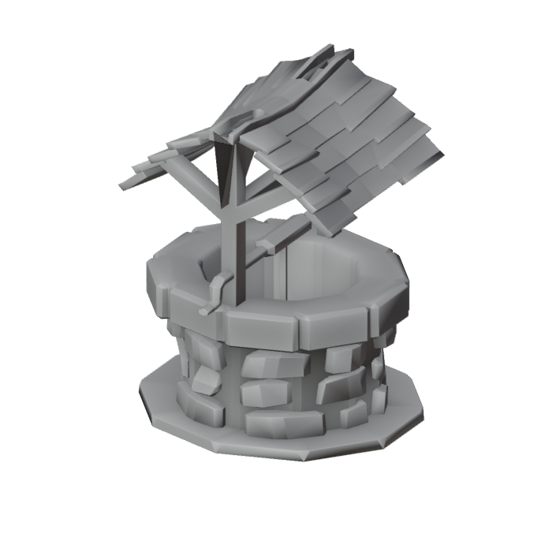
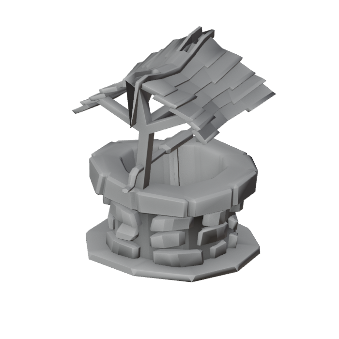

# M2-J1 well preview

The well is the first CC0 building to use the optional clay displacement pass.
The field is sampled from vertex coordinates, so split normals on the roof,
crank and stones move together without opening seams. The shape change is
subtle enough to preserve the authored silhouette and its gameplay footprint.

Blender 5.2.2 LTS produced 6,439 triangles before and after, within the
7,000-triangle manifest budget. The final footprint is 2.30 × 2.40 m and
height 2.85 m. Two clean builds produced byte-identical GLBs.

A full 24-asset manifest build completed. The checked-in outputs for the other
assets were left untouched. The barrel and workbench outputs varied across two
builds of the *original* script as well, so byte-level reproducibility for
those two props remains separate pipeline work.
